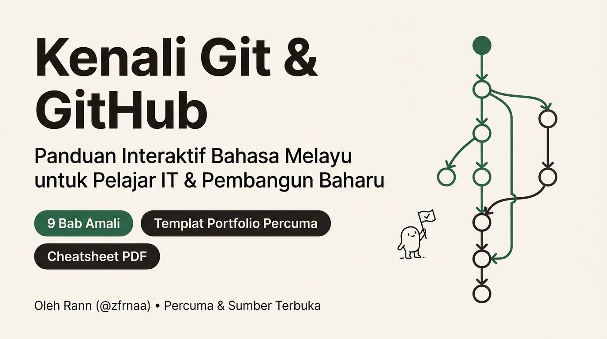

# Kenali Git & GitHub untuk Pemula (Edisi Pelajar & Pembangun Baharu)

Pernahkah anda menyimpan fail tugasan koding di dalam komputer dengan nama seperti ini?

- `tugasan_akhir.zip`
- `tugasan_akhir_v2.zip`
- `tugasan_akhir_v2_betul_betul_final.zip`
- `tugasan_akhir_v3_jangan_padam_tolonglah.zip`

Atau lebih mencemaskan lagi: anda sedang menyunting kod projek kumpulan pada jam 2:00 pagi, tiba-tiba program anda gagal berfungsi, dan apabila anda menekan `Ctrl + Z`, kod asal yang elok tadi sudah tidak dapat dikembalikan?

Jika anda pernah mengalaminya, tarik nafas lega. Anda berada di tempat yang betul.

Selamat datang ke **Kursus Interaktif Git & GitHub dalam Bahasa Melayu** yang direka khas untuk pelajar universiti, pelajar kolej, dan pembangun baharu (*junior developers*) di Malaysia serta Nusantara. Di sini, kita menukar rasa gerun terhadap skrin hitam terminal menjadi kemahiran praktikal yang membina keyakinan anda.

---

## ⭐ Langkah 0: Klik "Star" Sekarang (Simpan Sebagai *Bookmark* Anda!)

Sebelum anda mula membaca Bab 1, lihat ke bahagian **penjuru kanan atas** halaman GitHub ini dan klik butang **⭐ Star**. *(Belum mempunyai akaun GitHub? Daftar secara percuma di **[github.com/signup](https://github.com/signup)** dalam masa 1 minit dahulu, kemudian log masuk dan tekan ⭐ Star!)*

> **💡 Kenapa anda perlu klik ⭐ Star sekarang?**
> Di GitHub, butang **⭐ Star** berfungsi sama seperti ciri **Bookmark (Simpanan Kegemaran)**. Apabila anda menekan butang tersebut:
> 1. **Mudah Dicari Semula:** Anda tidak perlu lagi mencari pautan repositori ini di sejarah pelayar web (*browser history*) atau di celah-celah hantaran Threads. Anda boleh membukanya semula pada bila-bila masa terus daripada menu **Your Stars** di profil GitHub anda.
> 2. **Rujukan Pantas Semasa Kuliah & Amali:** Apabila anda terlupa arahan Git semasa membuat tugasan atau projek tahun akhir (FYP), panduan ini sentiasa tersedia satu klik sahaja di akaun anda.
> 3. **Menyokong Komuniti Sumber Terbuka Melayu:** Setiap ⭐ Star yang anda berikan membantu algoritma GitHub mengesyorkan panduan percuma ini kepada lebih ramai rakan pelajar IT di seluruh Malaysia!

Sudah klik **⭐ Star**? Bagus! Mari kita lihat apa yang bakal anda bina sepanjang kursus ini.

---

## 🎯 Apa Yang Akan Anda Capai Dalam Kursus Ini?

Kursus ini direka supaya anda belajar sambil membina hasil sebenar yang boleh dipamerkan di dalam resume anda:

1. **Memahami Git Tanpa Rasa Takut:** Menguasai konsep *Version Control* melalui analogi dunia sebenar seperti **"Butang *Save Checkpoint* Permainan Video"** dan **"Mesin Masa Kod Anda"**.
2. **Menuntut *GitHub Student Developer Pack*:** Membuka akses kepada perisian dan alatan pembangun profesional (GitHub Pro, JetBrains IDE, domain percuma, dan GitHub Copilot) yang bernilai ribuan ringgit secara percuma menggunakan e-mel pelajar anda.
3. **Log Masuk Terminal Tanpa Sakit Kepala:** Menggunakan kaedah moden `gh auth login` supaya anda boleh terus memuat naik kod tanpa tersangkut pada ralat kata laluan terminal.
4. **Membina & Menerbitkan Laman Web Portfolio Sendiri:** Mengubah suai kod sedia guna di dalam folder [`template-portfolio/`](./template-portfolio/) dan menerbitkannya ke internet secara percuma menggunakan **GitHub Pages** (`username.github.io`).
5. **Menghantar *Pull Request* (PR) Pertama Anda:** Mencuba aliran kerja industri sebenar dengan menyenaraikan nama serta pautan portfolio anda (pilihan) di dalam Dinding Kenangan ([`SENARAI-PELAJAR.md`](./SENARAI-PELAJAR.md)).

---

## 📚 Jadual Kandungan & Silibus Lengkap (9 Bab)

Setiap bab dilengkapi dengan penunjuk kemajuan projek, rajah visual, latihan amali langkah demi langkah, serta kotak **"Kesilapan Lazim Pemula (Jangan Panik!)"**.

| Bab | Tajuk & Pautan Bab | Fokus Kemahiran & Amali | Kemajuan Projek Portfolio |
| :---: | :--- | :--- | :---: |
| **01** | [**Bab 1: Pengenalan Git & GitHub**](./bab-01-pengenalan-git-dan-github.md) | Konsep Kawalan Versi (*Save Checkpoint*), perbezaan Git vs GitHub, dan ekosistem GitLab/Bitbucket. | `[10%]` Memahami Konsep Asas |
| **02** | [**Bab 2: Persediaan & Pengesahan Mudah**](./bab-02-persediaan-dan-pengesahan.md) | Pemasangan Git, tetapan identiti `git config`, tuntutan *GitHub Student Developer Pack*, dan log masuk pantas dengan `gh auth login`. | `[20%]` Terminal & Akaun Sedia |
| **03** | [**Bab 3: Asas Git Tempatan (*Local*)**](./bab-03-asas-git-tempatan.md) | Tiga kawasan Git (*Working Directory*, *Staging Area*, *Repository*), arahan `init`, `status`, `add`, `commit`, `log`, dan fail `.gitignore`. | `[35%]` Tapak Portfolio Tempatan |
| **04** | [**Bab 4: Berhubung dengan GitHub (*Remote*)**](./bab-04-berhubung-dengan-github.md) | Konsep *Remote* (`origin`), mencipta repositori di GitHub, menghubungkan folder tempatan dengan `git remote`, `git push`, dan `git clone`. | `[50%]` Kod Selamat di Awan |
| **05** | [**Bab 5: Kemas Kini Jarak Jauh (`fetch` vs `pull`)**](./bab-05-kemas-kini-jarak-jauh.md) | Perbezaan kritikal antara `git fetch` dan `git pull` (analogi peti surat), serta amali menyegerakkan perubahan dari web GitHub ke komputer. | `[65%]` Bahagian Kemahiran Siap |
| **06** | [**Bab 6: *Branching*, *Merge* & *Pull Request***](./bab-06-branching-dan-pull-request.md) | GitHub Issues, `git branch`, `git switch`, `git merge`, menyelesaikan *Merge Conflict* dengan tenang, dan menghantar PR ke `SENARAI-PELAJAR.md`. | `[80%]` Projek & PR Pertama |
| **07** | [**Bab 7: Perisian GUI & Alternatif Industri**](./bab-07-perisian-gui-dan-alternatif.md) | Mengurus Git secara visual menggunakan VS Code Source Control & GitHub Desktop, serta perbandingan GitHub vs GitLab vs Bitbucket vs Gitea. | `[90%]` Aliran Kerja Pantas |
| **08** | [**Bab 8: Projek Akhir — GitHub Pages & Profil**](./bab-08-projek-akhir-github-pages.md) | Melancarkan laman web portfolio rasmi anda ke internet (`username.github.io`), membina README Profil GitHub, dan cabaran kolaborasi rakan. | `[100%]` Laman Portfolio Terbit! 🎉 |
| **09** | [**Bab 9: Langkah Seterusnya ke Tahap *Junior Dev***](./bab-09-langkah-seterusnya-junior-dev.md) | Pengenalan kepada alatan industri: `git stash`, `git rebase`, `git commit --amend`, `git cherry-pick`, dan automasi GitHub Actions (CI/CD). | `[Bonus]` Persediaan Kerjaya |

---

## 🛠️ Sumber Pantas & Kod Permulaan

Selain 9 bab utama di atas, repositori ini turut menyediakan tiga aset penting untuk mempercepatkan pembelajaran anda:

- 📱 **[`PDF cheatsheet-git-melayu`](./cheatsheet-git-melayu.pdf) & [`cheatsheet-git-melayu.md`](./cheatsheet-git-melayu.md) — Helaian Rujukan Pantas (Versi PDF Telefon & Web):** Muat turun versi **PDF** terus ke telefon pintar anda (mudah dibuka di WhatsApp/Files tanpa perlu melayari GitHub Mobile) atau baca versi Markdown di pelayar web. Lengkap dengan penjelasan *"Jadi kenapa?"* dalam Bahasa Melayu.
- 🏆 **[`SENARAI-PELAJAR.md`](./SENARAI-PELAJAR.md) — Balai Kemasyhuran (*Hall of Fame*):** Senarai pelajar dan pembangun baharu yang telah berjaya menghantar *Pull Request* pertama mereka. Nama anda bakal berada di sini pada Bab 6!
- 💻 **[`template-portfolio/`](./template-portfolio/) — Kod Permulaan Portfolio Peribadi:** Templat laman web HTML5 dan CSS3 moden yang responsif. Anda tidak perlu menulis kod reka bentuk daripada kosong; fokus terus kepada kemahiran mengawal versi kod dengan Git.
- 📄 **[`panduan-readme-dan-fail-github.md`](./panduan-readme-dan-fail-github.md) — Panduan Lengkap `README.md`, Markdown & Fail Standard GitHub:** Rujukan penuh sintaks Markdown (`.md`), templat `README.md` untuk projek FYP anda, serta fungsi `LICENSE` dan `CONTRIBUTING.md`.

---

## 🎒 Rahsia Pelajar: Tuntut *GitHub Student Developer Pack* Anda!

Tahukah anda bahawa status anda sebagai pelajar universiti, politeknik, matrikulasi, atau kolej melayakkan anda menerima pakej perisian bernilai ribuan ringgit secara percuma?

Melalui **GitHub Student Developer Pack** (yang akan kita tuntut langkah demi langkah dalam **[Bab 2](./bab-02-persediaan-dan-pengesahan.md)**), anda bakal mendapat:
- **GitHub Pro Percuma** sepanjang tempoh pengajian anda.
- **GitHub Copilot Percuma** (pembantu kod AI terus di dalam VS Code).
- **Nama Domain Percuma** (`.me`, `.tech`, atau `.live`) daripada Namecheap / Name.com untuk disambungkan ke portfolio anda.
- **Lesen Penuh JetBrains IDE** (IntelliJ IDEA, PyCharm, WebStorm, CLion) secara percuma.
- Kredit awan (*cloud credits*) daripada DigitalOcean dan Microsoft Azure untuk menghoskan projek tahun akhir anda.

Jangan biarkan e-mel pelajar (`.edu.my` atau kad matrik) anda tamat tempoh tanpa menuntut manfaat ini!

---

## 🤝 Komuniti & Saluran Bantuan (Jangan Belajar Seorang Diri!)

Belajar pengaturcaraan menjadi jauh lebih mudah apabila anda mempunyai rakan seperjuangan. Kami menggunakan ruang **GitHub Discussions** di dalam repositori ini sebagai pusat komuniti kita:

1. **👋 `Perkenalkan Diri`:** Singgah ke saluran ini untuk menyapa rakan-rakan baharu! Kongsikan nama panggilan anda, kursus/universiti (atau latar belakang kerjaya), dan matlamat anda belajar Git.
2. **🆘 `Bantuan Ralat Git`:** Tersangkut pada mana-mana arahan terminal atau mendapat mesej ralat yang mengelirukan? Tampalkan (*paste*) mesej ralat anda di sini supaya komuniti dan mentor dapat membantu anda menyelesaikannya.
3. **🚀 `Pameran Portfolio`:** Apabila laman web `username.github.io` anda siap diterbitkan pada Bab 8, kongsikan pautannya di sini supaya rakan-rakan lain dapat melihat hasil kerja anda dan memberikan maklum balas!

---

## 🚦 Cara Terbaik Menggunakan Panduan Ini

1. **Klik ⭐ Star** di penjuru kanan atas halaman ini supaya panduan ini tersimpan kemas di dalam akaun GitHub anda.
2. **Ikut Turutan Bab:** Mulakan daripada [Bab 1](./bab-01-pengenalan-git-dan-github.md) sehingga [Bab 9](./bab-09-langkah-seterusnya-junior-dev.md). Setiap bab mengambil masa sekitar 15 hingga 25 minit sahaja.
3. **Buka Terminal & Buat Bersama:** Jangan sekadar membaca di skrin telefon. Buka komputer anda, jalankan setiap arahan di dalam kotak **Latihan Amali**, dan lihat sendiri bagaimana fail portfolio anda berkembang dari satu bab ke satu bab.
4. **Hantar PR Pertama Anda di Bab 6:** Jangan lepaskan peluang untuk mempraktikkan *Pull Request* sebenar ke dalam fail [`SENARAI-PELAJAR.md`](./SENARAI-PELAJAR.md).

---

### Sedia untuk memulakan perjalanan anda?

👉 **[Klik di sini untuk memulakan Bab 1: Pengenalan Git & GitHub](./bab-01-pengenalan-git-dan-github.md)**
