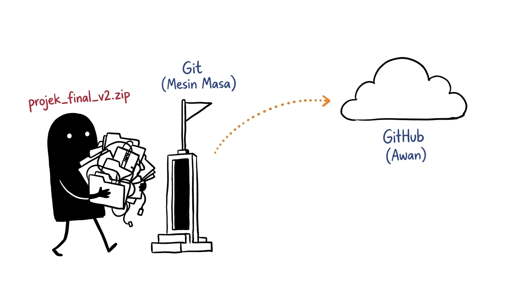
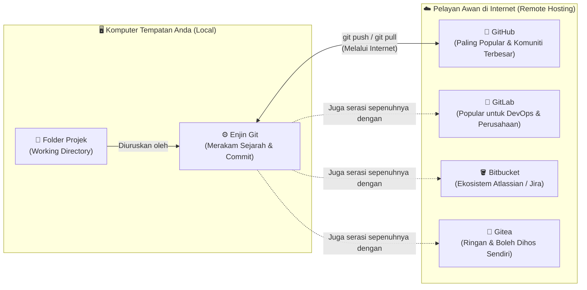

# Bab 1: Pengenalan Git & GitHub — Mesin Masa dan Hab Kod Anda

**Kemajuan Projek Portfolio Anda: [10%]** `██░░░░░░░░░░░░░░░░░░`

### 🎯 Objektif Pembelajaran
Pada akhir bab ini, anda akan dapat:
1. Menerangkan masalah utama pengurusan fail secara manual (`projek_akhir_betul_final.zip`) dan bagaimana sistem Kawalan Versi (*Version Control*) menyelesaikannya.
2. Membezakan peranan **Git** (perisian kawalan versi di dalam komputer anda) dengan **GitHub** (pelayan awan dan rangkaian sosial untuk kod di internet).
3. Mengenal pasti kedudukan alternatif industri lain seperti **GitLab**, **Bitbucket**, dan **Gitea** di dalam ekosistem Git.
4. Menggunakan fungsi utama antaramuka repositori GitHub iaitu **⭐ Star**, **👁️ Watch**, dan **🍴 Fork**.




---

## 1. Mimpi Ngeri `projek_akhir_betul_final.zip`

Pernahkah anda melihat folder tugasan universiti atau projek pengaturcaraan anda kelihatan seperti senarai di bawah?

```text
📁 Tugasan_Laman_Web/
 ├── 📄 index_asal.html
 ├── 📄 index_kemaskini_isnin.html
 ├── 📄 index_selepas_tukar_warna.html
 ├── 📦 projek_akhir.zip
 ├── 📦 projek_akhir_v2_betul.zip
 └── 📦 projek_akhir_v3_betul_betul_final_hantar_ini.zip
```

Situasi ini sangat lazim dalam kalangan pelajar dan pembangun baharu. Apabila anda bekerja secara berseorangan atau berkumpulan menggunakan kaedah salin-dan-namakan-semula (*copy and paste*), tiga masalah besar akan muncul:

1. **Ketakutan Mengubah Kod (*Fear of Breaking Things*):** Apabila kod anda sudah berfungsi pada jam 11:00 malam, anda berasa takut untuk menambah ciri baharu kerana bimbang kod sedia ada akan rosak dan tidak dapat dipulihkan selepas menekan `Ctrl + Z` berkali-kali.
2. **Kekeliruan Kerja Berkumpulan:** Apabila Rakan A menghantar fail `index.html` melalui WhatsApp dan Rakan B pula menghantar versi `index.html` yang berbeza melalui Telegram, anda terpaksa menyemak baris demi baris secara manual untuk menggabungkan kedua-duanya.
3. **Tiada Rekod Siapa Ubah Apa:** Apabila program tiba-tiba gagal berfungsi sehari sebelum tarikh penghantaran, tiada siapa tahu baris kod mana yang telah diubah dan mengapa ia diubah.

Di sinilah **Sistem Kawalan Versi (*Version Control System*)** memainkan peranannya.

---

## 2. Bayangkan Begini... Git Sebagai Butang *Save Checkpoint* Permainan Video

**Bayangkan begini...** Anda sedang bermain permainan video pengembaraan seperti *Elden Ring*, *The Legend of Zelda*, atau *GTA*. Sebelum watak anda memasuki bilik untuk melawan ketua musuh (*Boss Fight*) yang sukar, apakah perkara pertama yang anda lakukan?

Sudah tentu anda akan mencari titik simpanan (**Save Checkpoint**) terlebih dahulu!

Mengapa? Kerana dengan adanya *Save Checkpoint*, anda memperoleh keberanian untuk mencuba pelbagai strategi. Jika watak anda tewas atau tersilap langkah, anda tidak perlu memulakan permainan daripada tahap pertama semula. Anda hanya perlu memuatkan semula (*reload*) titik simpanan terakhir tadi dan teruskan bermain.

**Git berfungsi tepat seperti sistem *Save Checkpoint* dan Mesin Masa untuk kod anda:**

- Setiap kali kod anda mencapai tahap yang stabil (contohnya: *"Bahagian biodata siap"*, *"Borang hubungi berfungsi"*), anda menekan butang simpan di dalam Git yang dipanggil **`commit`**.
- Setiap **`commit`** merakam keadaan tepat kesemua fail di dalam folder projek anda pada saat itu, lengkap dengan tarikh, masa, nama penulis, dan nota ringkas.
- Jika esok anda cuba mengubah kod CSS sehingga keseluruhan susun atur laman web menjadi berterabur, anda tidak perlu panik. Dengan satu arahan Git, anda boleh mengaktifkan **Mesin Masa** untuk kembali tepat ke keadaan `commit` semalam dalam masa sesaat!
- Anda hanya menyimpan **satu folder projek yang bersih** (`portfolio-saya/`). Tiada lagi puluhan fail `.zip` yang mengelirukan.

---

## 3. Git vs. GitHub: Jangan Keliru Antara Kedua-duanya!

Ramai pemula menyangka Git dan GitHub adalah benda yang sama. Sebenarnya, kedua-duanya mempunyai peranan yang berbeza tetapi saling melengkapi:

| Ciri Perbandingan | 🖥️ **Git** (Tempatan / *Local*) | ☁️ **GitHub** (Awan / *Cloud*) |
| :--- | :--- | :--- |
| **Apakah ia?** | Perisian (*software*) baris arahan yang dipasang terus di dalam komputer riba atau PC anda. | Laman web dan perkhidmatan awan (*cloud hosting*) di internet untuk menyimpan folder projek Git anda. |
| **Perlu Internet?** | **Tidak perlu.** Anda boleh membuat `commit` dan melihat sejarah kod walaupun berada di dalam kapal terbang tanpa Wi-Fi. | **Perlu sambungan internet** untuk memuat naik (`push`) atau memuat turun (`pull`/`clone`) kod. |
| **Fungsi Utama** | Merakam sejarah perubahan fail, mencipta *checkpoint* (`commit`), dan menguruskan cabang kod (`branch`). | Menyimpan salinan selamat (*backup*) di awan, membolehkan kolaborasi kumpulan, dan mempamerkan portfolio anda kepada dunia. |
| **Analogi Mudah** | Seperti aplikasi **Kamera & Galeri Foto** di dalam telefon pintar anda (boleh ambil gambar tanpa internet). | Seperti aplikasi **Instagram** atau **Google Photos** tempat anda memuat naik gambar tersebut untuk dikongsi dan disimpan di awan. |

### Peta Visual: Komputer Anda vs. Pelayan Awan

Perhatikan rajah di bawah untuk melihat bagaimana **Git** di dalam komputer anda berhubung dengan **GitHub** (serta alternatif industri lain) di internet:



> **💡 Nota Industri:** Oleh sebab **Git** ialah enjin asas yang universal, kemahiran arahan Git (`commit`, `push`, `pull`, `branch`, `merge`) yang anda pelajari dalam kursus ini boleh digunakan 100% di **GitHub**, **GitLab**, **Bitbucket**, mahupun **Gitea** apabila anda bekerja di syarikat teknologi kelak! Kita akan meneroka perbandingan mendalam antara platform-platform ini dalam **Bab 7**.

---

## 4. Mengenali Antaramuka GitHub: Apa Maksud Star, Watch, dan Fork?

Apabila anda melawat mana-mana halaman projek (dipanggil **`repository`** atau ringkasnya **`repo`**) di GitHub, anda akan melihat tiga butang utama di bahagian penjuru kanan atas halaman. Mari kita fahami fungsi setiap satu:

### ⭐ 1. Star (Simpanan Kegemaran & Tanda Penghargaan)
Butang **⭐ Star** berfungsi gabungan seperti butang **Bookmark (Simpan)** dan butang **Like**.
- **Untuk kegunaan anda sendiri:** Semua repositori yang anda *Star* akan tersimpan di dalam senarai khas **Your Stars** pada profil anda. Ini memudahkan anda mencari semula panduan atau pustaka kod (*library*) penting tanpa perlu menyelongkar sejarah pelayar web (website history).
- **Untuk komuniti:** Jumlah *Star* menunjukkan betapa bermanfaatnya sesuatu projek kepada pembangun lain.

### 👁️ 2. Watch (Langganan Notifikasi)
Butang **👁️ Watch** berfungsi seperti **Loceng Notifikasi (🔔)** di YouTube.
- Apabila anda memilih untuk *Watch* sesebuah repositori (biasanya projek tempat kerja atau projek kumpulan universiti anda), GitHub akan menghantar pemberitahuan setiap kali ada ahli pasukan yang membuka perbincangan baharu (`issue`) atau mencadangkan perubahan kod (`pull request`).

### 🍴 3. Fork (Salin ke Akaun GitHub Anda Sendiri)
Butang **🍴 Fork** bermaksud **menyalin keseluruhan repositori orang lain ke dalam akaun GitHub peribadi anda**.
- Mengapa kita perlukan *Fork*? Kerana anda tidak mempunyai kebenaran untuk mengubah kod di dalam akaun GitHub orang lain secara terus.
- Dengan menekan **🍴 Fork**, anda mendapat satu salinan penuh repositori tersebut di bawah akaun anda sendiri (`github.com/username-anda/nama-repo`). Di situ, anda bebas mengubah suai kod, bereksperimen, dan kemudian menghantar cadangan perubahan kembali kepada pemilik asal melalui proses yang dipanggil **`pull request`** (kita akan melakukannya secara amali pada **Bab 6**!).

---

## 🧪 Latihan Amali Bab 1: Meneroka & Menyimpan Repositori Kursus

Dalam latihan pertama ini, kita belum lagi menaip kod di terminal. Kita akan membiasakan diri dengan antaramuka GitHub dan memastikan anda bersedia untuk membina projek portfolio.

### Langkah 1: Klik Butang ⭐ Star pada Repositori Ini
1. Skrol ke bahagian paling atas halaman repositori kursus ini di pelayar web anda.
2. Cari butang **⭐ Star** di penjuru kanan atas.
3. Klik butang **⭐ Star** sehingga ikon bintangnya bertukar warna (dan bilangannya bertambah satu).

**Jadi kenapa?**
Dengan menekan **⭐ Star**, anda baru sahaja mencipta pautan pantas ke buku teks interaktif ini di dalam akaun GitHub anda. Setiap kali anda ingin menyambung bacaan ke bab seterusnya atau merujuk [`cheatsheet-git-melayu.md`](./cheatsheet-git-melayu.md) semasa minggu peperiksaan/projek, anda hanya perlu membuka menu profil GitHub anda dan klik **Your stars**.

### Langkah 2: Intai Fail Kod Permulaan Portfolio Anda
1. Di halaman utama repositori ini, cari dan klik pada folder bernama **[`template-portfolio/`](./template-portfolio/)**.
2. Klik pada fail **`index.html`** untuk melihat kod HTML yang telah disediakan untuk anda.
3. Perhatikan pada baris ke-23, terdapat penanda komen khas:
   ```html
   <!-- BAB 3: TUKAR NAMA DAN BIODATA ANDA DI BAWAH -->
   <section id="biodata" class="hero-card">
       <p class="greeting">Hai, selamat datang ke laman portfolio saya! 👋</p>
       <h1 class="hero-title">Nama Pelajar Di Sini</h1>
   ```

**Jadi kenapa?**
Anda tidak perlu risau jika anda belum mahir mereka bentuk laman web daripada kosong. Sepanjang kursus ini (bermula di Bab 3 hingga Bab 8), anda akan mengambil kod permulaan di dalam `template-portfolio/` ini, mengubah suainya menjadi maklumat peribadi anda, menguruskannya menggunakan Git, dan akhirnya melancarkannya ke internet sebagai laman web rasmi anda!

---

## ⚠️ Kesilapan Lazim Pemula — Jangan Panik!

> **❌ Salah Faham 1: "Kalau saya tiada internet, saya tak boleh guna Git."**
> **✅ Fakta Sebenar:** Enjin **Git** berjalan sepenuhnya di dalam komputer anda (*local*). Anda boleh mencipta puluhan *Save Checkpoint* (`commit`), mencipta cabang (`branch`), dan menyemak sejarah kod di dalam bilik kuliah atau kafe yang tiada sambungan Wi-Fi. Anda hanya memerlukan internet apabila tiba masa untuk memuat naik (`push`) kod tersebut ke **GitHub**.

> **❌ Salah Faham 2: "Kalau saya tekan butang 🍴 Fork atau ⭐ Star, adakah saya akan merosakkan kod pemilik asal?"**
> **✅ Fakta Sebenar:** Sama sekali tidak! Menekan **⭐ Star** hanyalah menandakan repositori sebagai kegemaran. Menekan **🍴 Fork** pula mencipta salinan berasingan di dalam akaun anda sendiri. Repositori asal kekal selamat dan tidak akan terjejas walau apa pun yang anda lakukan pada salinan *Fork* anda.

> **❌ Salah Faham 3: "GitHub hanya untuk pengaturcara senior yang buat projek besar sahaja."**
> **✅ Fakta Sebenar:** Lebih awal anda menyimpan tugasan kuliah dan projek kecil di GitHub, lebih kukuh profil anda apabila memohon latihan industri (*internship*) nanti. Majikan sangat gemar melihat calon yang sudah biasa menggunakan aliran kerja Git sejak di bangku pengajian.

---

## Cabaran Semakan Kendiri (Bab 1)

Uji kefahaman anda dengan menjawab 3 soalan pantas di bawah sebelum melangkah ke Bab 2:

1. **Situasi A:** Aiman sedang berada di dalam bas ekspres tanpa capaian internet. Bolehkah Aiman menyimpan *checkpoint* (`commit`) bagi perubahan kod yang baru ditulisnya menggunakan Git? Mengapa?
2. **Situasi B:** Apakah perbezaan fungsi antara menekan butang **⭐ Star** dengan menekan butang **🍴 Fork** pada sesebuah repositori GitHub?
3. **Situasi C:** Syarikat tempat anda memohon *internship* menyatakan mereka menggunakan **GitLab** dan bukannya **GitHub**. Adakah ilmu arahan Git yang anda pelajari dalam kursus ini masih boleh digunakan di syarikat tersebut?

<details>
<summary><strong>Klik di sini untuk menyemak jawapan anda</strong></summary>

1. **Ya, boleh!** Kerana **Git** ialah perisian kawalan versi tempatan (*local*) yang beroperasi terus di dalam komputer Aiman tanpa memerlukan sambungan internet.
2. **⭐ Star** berfungsi untuk menyimpan pautan repositori ke dalam senarai kegemaran (*bookmark*) dan memberi tanda penghargaan, manakala **🍴 Fork** menyalin keseluruhan fail dan sejarah repositori tersebut ke dalam akaun GitHub anda sendiri supaya anda boleh mengubah suainya secara bebas.
3. **Ya, 100% boleh digunakan!** GitLab, GitHub, Bitbucket, dan Gitea semuanya menggunakan enjin **Git** yang sama di belakang tabir. Semua arahan seperti `git add`, `git commit`, `git push`, dan `git pull` berfungsi dengan cara yang sama.

</details>

---

## Navigasi Bab

- ⬅️ **Kembali ke Halaman Utama:** [README Kursus Git & GitHub](./README.md)
- ➡️ **Teruskan ke Bab Seterusnya:** [Bab 2: Persediaan, Konfigurasi & Pengesahan Mudah](./bab-02-persediaan-dan-pengesahan.md)
