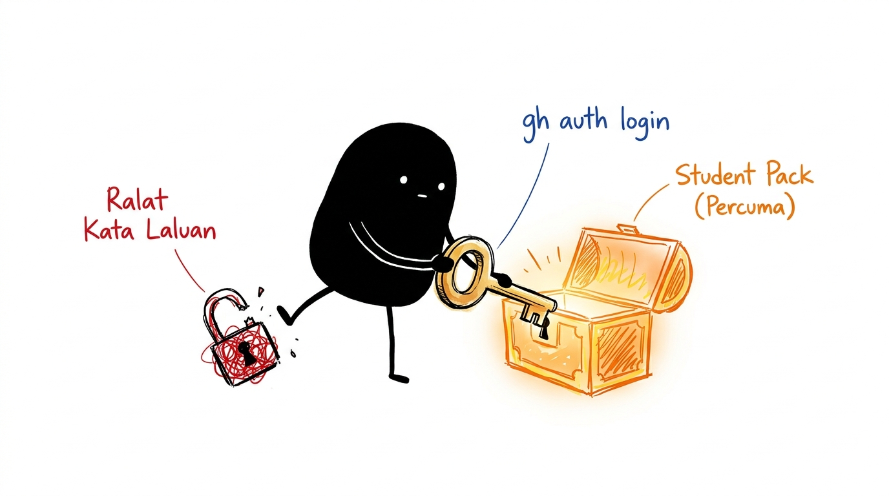
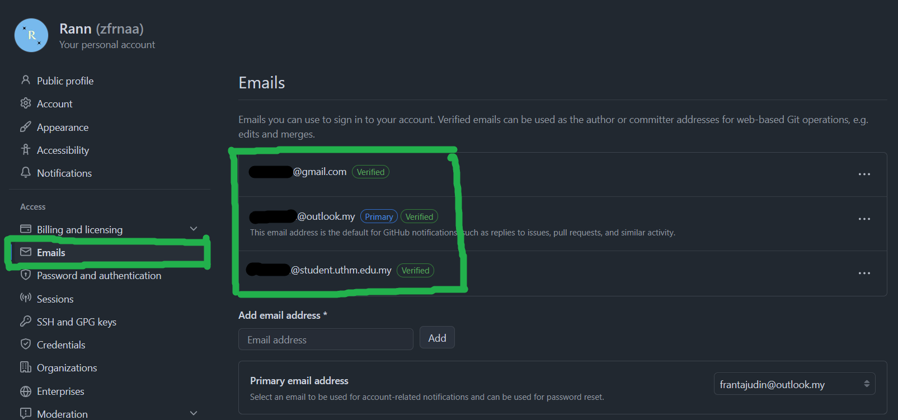
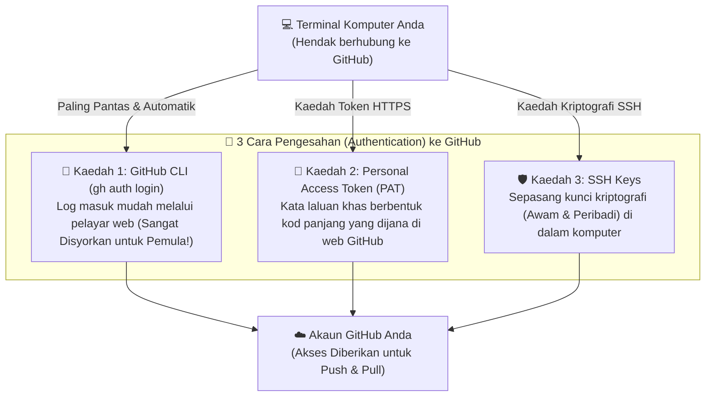

# Bab 2: Persediaan, Konfigurasi & Pengesahan Mudah

**Kemajuan Projek Portfolio Anda: [20%]** `████░░░░░░░░░░░░░░░░`

### 🎯 Objektif Pembelajaran
Pada akhir bab ini, anda akan dapat:
1. Memasang perisian **Git** di dalam komputer anda (Windows, macOS, atau Linux) dan mengesahkan pemasangannya melalui terminal.
2. Menetapkan identiti penulis rasmi anda (`user.name` dan `user.email`) serta nama cabang lalai (`main`) menggunakan arahan `git config`.
3. Mencipta akaun GitHub dan menuntut pakej eksklusif **GitHub Student Developer Pack** menggunakan e-mel institusi (`.edu.my`) atau kad pelajar.
4. Menyambungkan terminal komputer anda dengan akaun GitHub secara lancar menggunakan **GitHub CLI (`gh auth login`)**, serta memahami peranan **Personal Access Token (PAT)** dan **SSH Keys**.




---

## 1. Memasang Git di Komputer Anda

Sebelum kita boleh merakam sebarang *checkpoint* (`commit`), kita perlu memastikan enjin **Git** telah dipasang di dalam komputer anda. Pilih panduan di bawah mengikut sistem operasi yang anda gunakan:

### 🪟 Pengguna Windows (Sangat Disyorkan: Git for Windows)
1. Layari laman rasmi [git-scm.com/download/win](https://git-scm.com/download/win) dan muat turun pemasang **64-bit Git for Windows Setup**.
2. Jalankan fail pemasang (`.exe`) tersebut. Anda boleh menekan **Next** untuk kebanyakan tetapan lalai, tetapi pastikan dua pilihan ini dipilih:
   - Pada skrin *Adjusting the name of the initial branch in new repositories*, pilih **"Override the default branch name for new repositories"** dan pastikan nilainya ialah **`main`**.
   - Pemasangan ini akan turut memasang **Git Bash** — terminal khas yang sangat mesra pengguna untuk menjalankan arahan Git di Windows (anda juga boleh menggunakan **PowerShell** atau **Terminal di dalam VS Code**).

### 🍎 Pengguna macOS
Buka aplikasi **Terminal** (tekan `Cmd + Space` dan taip `Terminal`), kemudian jalankan arahan berikut untuk memasang Git melalui Xcode Command Line Tools atau Homebrew:

```bash
xcode-select --install
```
*(Atau jika anda sudah mempunyai Homebrew, jalankan `brew install git`)*

### 🐧 Pengguna Linux (Ubuntu / Debian / Fedora)
Buka terminal anda dan pasang Git menggunakan pengurus pakej rasmi distro anda:

```bash
# Untuk Ubuntu / Debian / Linux Mint:
sudo apt update && sudo apt install git -y

# Untuk Fedora:
sudo dnf install git -y
```

---

## 2. Bayangkan Begini... Menandatangani Buku Log Makmal

**Bayangkan begini...** Anda bersama tiga orang rakan kumpulan sedang menjalankan uji kaji di dalam makmal sains universiti. Setiap kali seseorang mencatatkan bacaan suhu atau menambah bahan kimia ke dalam buku log makmal, dia **wajib menulis nama dan alamat e-melnya** di sebelah catatan tersebut.

Mengapa peraturan ini sangat penting? Supaya apabila pensyarah atau rakan sepasukan membaca semula buku log itu minggu hadapan, mereka tahu dengan tepat siapa yang membuat perubahan tersebut dan siapa yang perlu dihubungi jika ada soalan!

**Git juga menguatkuasakan peraturan buku log yang sama:**
- Setiap kali anda menyimpan satu **`commit`** (*checkpoint*), Git wajib mengecap nama (`user.name`) dan alamat e-mel (`user.email`) anda pada rekod `commit` tersebut.
- Jika anda belum pernah memberitahu Git siapakah nama dan e-mel anda, Git akan enggan menyimpan `commit` dan memaparkan mesej ralat `Author identity unknown`.
- Berita baiknya: anda hanya perlu menetapkan identiti ini **sekali sahaja** di komputer anda menggunakan bendera `--global`!

---

## 3. Mencipta Akaun GitHub & Menuntut *GitHub Student Developer Pack* 🎒

Jika anda belum mempunyai akaun GitHub, layari [github.com](https://github.com) dan daftar akaun baharu secara percuma.

> **💡 Tip Memilih Nama Pengguna (*Username*) & E-mel:**
> - Pilih *username* yang kemas dan profesional (contohnya `aiman-dev`, `nurulhuda-codes`, atau `faris-rizal`) kerana pautan laman web portfolio anda nanti akan menggunakan nama ini (`username.github.io`) dan bakal diletakkan di dalam resume anda!
> - Di bahagian **Settings > Emails** di akaun GitHub anda, tambahkan kedua-dua **e-mel peribadi** (Gmail/Outlook) dan **e-mel pelajar universiti/kolej** (`.edu.my`) anda. Dengan cara ini, akaun GitHub anda kekal milik anda selama-lamanya walaupun selepas anda tamat pengajian nanti.



### 🎁 Buka Kunci Ganjaran Pelajar: *GitHub Student Developer Pack*
Sebagai pelajar universiti, politeknik, kolej matrikulasi, atau sekolah menengah, anda layak menuntut pakej alatan pembangun bernilai ribuan ringgit secara **100% percuma**!

**Cara Menuntut (Hanya Mengambil Masa 5 Minit):**
1. Pastikan anda telah menambah dan mengesahkan e-mel institusi anda (contoh: `nama@siswa.um.edu.my`, `nama@student.uitm.edu.my`, atau domain kolej anda) di dalam tetapan e-mel GitHub.
2. Layari laman rasmi **[education.github.com/pack](https://education.github.com/pack)** dan klik butang **Sign up for Student Developer Pack**.
3. Pilih status **Student**, pilih e-mel institusi anda, dan muat naik gambar **Kad Matrik / Kad Pelajar** atau surat pengesahan pelajar jika diminta.
4. Setelah diluluskan, anda akan mendapat akses percuma kepada:
   - **GitHub Pro** (repositori peribadi dan ciri lanjutan tanpa had sepanjang pengajian).
   - **GitHub Copilot** (pembantu AI pengaturcaraan pintar terus di dalam editor kod anda).
   - **Domain Percuma** (`.me`, `.tech`, `.live`) daripada Namecheap atau Name.com.
   - **Lesen Penuh JetBrains IDE** (PyCharm Professional, IntelliJ IDEA Ultimate, WebStorm) dan kredit pelayan awan DigitalOcean / Microsoft Azure!

---

## 4. Bagaimana Terminal Anda Log Masuk ke GitHub? (Konsep Pengesahan)

Pada bulan Ogos 2021, GitHub telah **menamatkan penggunaan kata laluan akaun biasa** apabila anda memuat naik kod (`git push`) melalui terminal demi keselamatan. Jadi, bagaimanakah komputer anda membuktikan kepada pelayan GitHub bahawa *"Hei, ini memang akaun saya"*?

Terdapat **tiga kaedah rasmi** untuk mengesahkan identiti terminal anda ke GitHub. Mari kita lihat perbandingannya:



### Memahami Apa Yang Berlaku Di Belakang Tabir:
1. **🌟 GitHub CLI (`gh auth login`) — Pilihan Utama Kita:**
   Alat rasmi ciptaan pasukan GitHub sendiri. Apabila anda menjalankan arahan ini, ia membuka pelayar web anda, meminta anda memasukkan kod 8 aksara, dan secara automatik menguruskan token keselamatan di dalam komputer anda. Tiada lagi masalah tersalah salin token!
2. **🔑 Personal Access Token (PAT):**
   Jika anda menggunakan sambungan HTTPS tanpa GitHub CLI, Git akan meminta kata laluan. Anda tidak boleh menaip kata laluan akaun biasa; sebaliknya anda perlu menjana rentetan kod khas (seperti `ghp_xYz123AbC...`) di halaman *GitHub Settings > Developer settings > Personal access tokens*. Anggaplah PAT seperti **kad akses bilik hotel** yang mempunyai tempoh sah tertentu dan boleh dibatalkan pada bila-bila masa jika hilang.
3. **🛡️ SSH Keys (Kunci SSH):**
   Kaedah kegemaran ramai pembangun berpengalaman. Komputer anda menjana sepasang kunci digital: **Kunci Peribadi (*Private Key*)** yang disimpan rahsia di dalam komputer anda, dan **Kunci Awam (*Public Key*)** yang dimuat naik ke GitHub. Apabila anda membuat `git push`, kedua-dua kunci ini berjabat tangan secara automatik tanpa meminta sebarang kata laluan.

---

## 🧪 Latihan Amali Bab 2: Konfigurasi Git & Log Masuk Tanpa Sakit Kepala

Sekarang, buka aplikasi terminal anda (**Git Bash** atau **PowerShell** di Windows, atau **Terminal** di macOS/Linux) dan ikuti langkah-langkah di bawah bersama-sama.

### Langkah 1: Semak Versi Git Anda
Taipkan arahan berikut dan tekan `Enter`:

```bash
git --version
```

**Jangkaan Output di Terminal:**
```text
git version 2.45.2.windows.1
```
*(Nombor versi mungkin sedikit berbeza mengikut sistem operasi anda. Asalkan ia memaparkan `git version ...`, pemasangan Git anda telah berjaya!)*

**Jadi kenapa?**
Arahan ini mengesahkan bahawa sistem operasi anda mengenali arahan `git` dan bersedia menerima arahan seterusnya.

---

### Langkah 2: Tetapkan Nama, E-mel, dan Cabang Lalai (`main`)
Jalankan ketiga-tiga arahan di bawah satu demi satu. **Pastikan anda menukar nama dan alamat e-mel di dalam tanda petikan `"..."` kepada nama sebenar dan e-mel yang anda gunakan untuk mendaftar akaun GitHub anda:**

```bash
git config --global user.name "Nama Anda"
git config --global user.email "emel-github-anda@contoh.com"


git config --global init.defaultBranch main
```

Untuk menyemak semula bahawa tetapan anda telah disimpan dengan betul, jalankan:

```bash
git config --list
```

**Jangkaan Output di Terminal:**
```text
user.name=Nama Anda
user.email=emel-github-anda@contoh.com
init.defaultbranch=main
```

**Jadi kenapa?**
- `user.name` dan `user.email` memastikan setiap `commit` yang anda buat selepas ini dipautkan terus ke profil GitHub anda (supaya kotak hijau aktiviti pada profil GitHub anda menyala apabila anda memuat naik kod!).
- `init.defaultBranch main` memastikan setiap folder projek baharu yang anda mulakan menggunakan nama cabang utama standard industri moden iaitu **`main`** (menggantikan istilah lama `master` yang masih wujud pada sesetengah repositori terdahulu).

---

### Langkah 3: Pasang & Log Masuk Menggunakan GitHub CLI (`gh auth login`)

Mari kita pasang alat **GitHub CLI (`gh`)** supaya komputer anda boleh log masuk ke GitHub dengan sekali pautan sahaja:

- **Windows (PowerShell / Git Bash):** Muat turun pemasang daripada [cli.github.com](https://cli.github.com/) atau jalankan:
  ```powershell
  winget install --id GitHub.cli
  ```
  *(Nota: Selepas memasang melalui `winget`, tutup dan buka semula tetingkap terminal anda).*
- **macOS (Terminal):**
  ```bash
  brew install gh
  ```
- **Linux (Ubuntu/Debian):**
  ```bash
  sudo apt install gh -y
  ```

Setelah dipasang, jalankan arahan log masuk interaktif ini:

```bash
gh auth login
```

Terminal akan memaparkan beberapa soalan mudah. Gunakan anak panah papan kekunci anda dan tekan `Enter` mengikut pilihan berikut:

```text
? What account do you want to log into?  GitHub.com
? What is your preferred protocol for Git operations on this host?  HTTPS
? Authenticate Git with your GitHub credentials?  Yes
? How would you like to authenticate GitHub CLI?  Login with a web browser

! First copy your one-time code: 1A2B-3C4D
Press Enter to open github.com in your browser...
```

1. Salin kod 8 aksara yang tertera di skrin anda (contoh di atas: `1A2B-3C4D`).
2. Tekan `Enter`. Pelayar web anda akan terbuka secara automatik.
3. Tampalkan kod tersebut di halaman pengesahan GitHub dan klik **Authorize github**.
4. Kembali ke terminal anda, dan anda akan melihat mesej kejayaan:

```text
✓ Authentication complete.
✓ Configured git protocol
✓ Logged in as username-anda
```

**Jadi kenapa?**
Dengan menyelesaikan `gh auth login` sekarang, anda telah menjimatkan berjam-jam masa mencari punca masalah kata laluan! Apabila kita tiba di **Bab 4** nanti untuk memuat naik laman portfolio ke GitHub (`git push`), terminal anda sudah pun mengenali akaun anda secara automatik.

---

## ⚠️ Kesilapan Lazim Pemula — Jangan Panik!

> **Ralat 1: `Author identity unknown — Please tell me who you are`**
> **Mengapa ia berlaku:** Anda cuba membuat `commit` pertama tetapi terlupa menjalankan arahan `git config --global user.name` dan `git config --global user.email`, atau anda tersilap menaip arahan tersebut tanpa tanda petikan `"..."`.
> **Cara selesaikan:** Jalankan semula kedua-dua arahan di **Langkah 2** di atas, kemudian semak dengan `git config --list`.

> **Ralat 2: `remote: Support for password authentication was removed on August 13, 2021.`**
> **Mengapa ia berlaku:** Semasa Git meminta kata laluan di terminal, anda menaip kata laluan log masuk biasa akaun GitHub anda.
> **Cara selesaikan:** Jangan gunakan kata laluan biasa! Jalankan sahaja `gh auth login` (dan pilih `Yes` pada soalan *Authenticate Git with your GitHub credentials?*), atau gunakan **Personal Access Token (PAT)** sebagai kata laluan anda.

> **Ralat 3: `gh: command not found` atau `'gh' is not recognized...` selepas memasang GitHub CLI**
> **Mengapa ia berlaku:** Tetingkap terminal yang sedang terbuka belum memuatkan semula laluan (*PATH*) perisian yang baru dipasang.
> **Cara selesaikan:** Tutup tetingkap Git Bash / PowerShell anda sepenuhnya, kemudian buka semula tetingkap baharu dan cuba taip `gh --version`.

---

## Cabaran Semakan Kendiri (Bab 2)

Pastikan anda boleh menjawab 3 soalan ini sebelum kita mula menulis kod portfolio di Bab 3:

1. Mengapakah alamat e-mel yang anda tetapkan di dalam `git config --global user.email` perlu sama dengan alamat e-mel yang didaftarkan pada akaun GitHub anda?
2. Apakah arahan terminal untuk menyemak senarai penuh konfigurasi Git (`user.name`, `user.email`, `init.defaultBranch`) yang sedang aktif di komputer anda?
3. Jika rakan sekelas anda mengadu dia gagal melakukan `git push` kerana GitHub menolak kata laluan akaunnya, apakah arahan GitHub CLI yang boleh anda cadangkan kepadanya untuk menyelesaikan masalah tersebut dalam masa seminit?

<details>
<summary><strong>Klik di sini untuk menyemak jawapan anda</strong></summary>

1. Kerana GitHub memadankan alamat e-mel yang tertera pada setiap rekod `commit` dengan alamat e-mel akaun GitHub anda. Jika kedua-duanya sepadan, setiap `commit` yang anda muat naik akan diiktiraf sebagai sumbangan rasmi pada profil GitHub anda.
2. Arahan **`git config --list`**.
3. Cadangkan dia memasang GitHub CLI dan menjalankan arahan **`gh auth login`**, kemudian memilih pengesahan melalui pelayar web (*Login with a web browser*).

</details>

---

## Navigasi Bab

- ⬅️ **Kembali ke Bab Sebelumnya:** [Bab 1: Pengenalan Git & GitHub](./bab-01-pengenalan-git-dan-github.md)
- 🏠 **Kembali ke Halaman Utama:** [README Kursus Git & GitHub](./README.md)
- ➡️ **Teruskan ke Bab Seterusnya:** [Bab 3: Asas Git Tempatan (*Local*) — Tapak Portfolio Pertama Anda](./bab-03-asas-git-tempatan.md)
