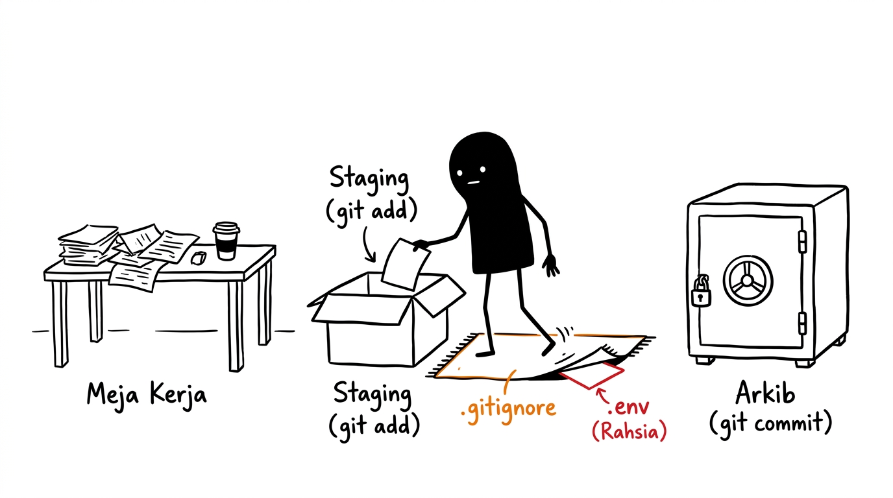
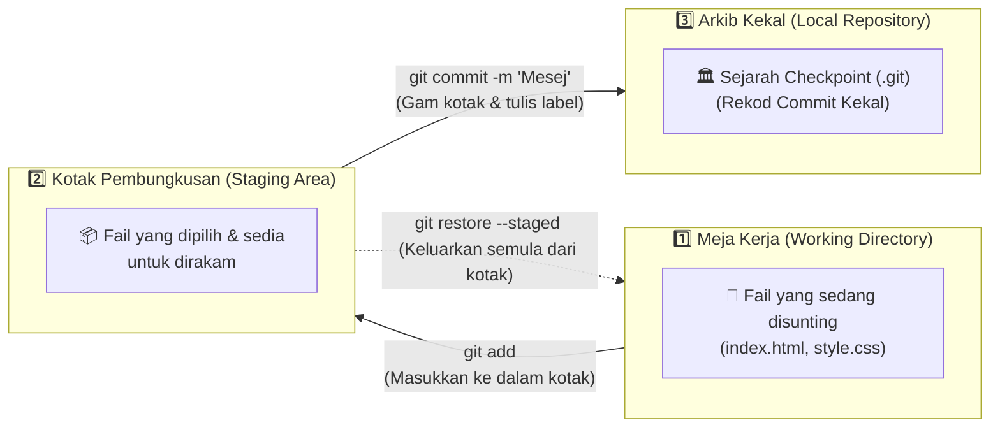

# Bab 3: Asas Git Tempatan (*Local*) — Tapak Portfolio Pertama Anda

**Kemajuan Projek Portfolio Anda: [35%]** `███████░░░░░░░░░░░░░`

### 🎯 Objektif Pembelajaran
Pada akhir bab ini, anda akan dapat:
1. Membezakan tiga peringkat utama di dalam Git: **Meja Kerja (*Working Directory*)**, **Kotak Pembungkusan (*Staging Area*)**, dan **Arkib Kekal (*Local Repository*)**.
2. Memulakan repositori Git tempatan pada projek portfolio anda menggunakan `git init` dan memeriksa keadaan fail menggunakan `git status`.

3. Menyimpan *Save Checkpoint* pertama selepas mengemas kini biodata di dalam `index.html` menggunakan gabungan arahan `git add`, `git commit`, dan menyemak sejarah dengan `git log --oneline`.
4. Melindungi maklumat sulit seperti kata laluan dan kunci rahsia daripada termasuk ke dalam rekod Git dengan mencipta fail **`.gitignore`** sebelum disambungkan ke internet.




---

## 1. Bayangkan Begini... Tiga Peringkat Git Seperti Menghantar Bungkusan Pos

Anda seorang usahawan kraf tangan yang sedang menyiapkan barangan tempahan pelanggan di dalam bilik studio anda. Di dalam studio tersebut, terdapat **tiga ruang berbeza**:

1. **🪑 Meja Kerja (*Working Directory*):**
   Di atas meja ini, terdapat pelbagai barangan yang sedang anda ukir, cat, atau baiki. Ada yang sudah siap dan ada yang masih separuh jalan.
2. **📦 Kotak Pembungkusan (*Staging Area* / *Index*):**
   Apabila ada barangan di atas meja kerja yang sudah benar-benar siap dan kemas, anda memilih barangan tersebut dan memasukkannya ke dalam **kotak kadbod yang masih terbuka**. Selagi kotak ini belum dilekatkan pita pelekat, anda masih boleh menambah barang lain atau mengeluarkan semula barang yang tersilap masuk.
3. **🏛️ Arkib Kekal (*Local Repository* / `.git`):**
   Sebaik sahaja anda berpuas hati dengan isi kotak pembungkusan tadi, anda **melekatkan pita pelekat rapat-rapat, menampal label bertulis tarikh serta kandungan kotak**, dan menyimpannya di dalam rak bilik kebal arkib.

Mengapa Git menggunakan sistem tiga langkah ini dan bukannya terus menyimpan semua fail serentak?
Kerana semasa menulis kod, kadangkala anda menyunting 5 fail berbeza tetapi hanya 2 fail yang sudah betul-betul siap dan berkaitan dengan ciri yang sama (contohnya: mengemas kini biodata). **Kotak Pembungkusan (*Staging Area*)** membolehkan anda memilih fail mana yang patut dimasukkan ke dalam satu *Save Checkpoint* (`commit`) yang teratur!

### Aliran Kerja 3 Kawasan Git Tempatan

Perhatikan bagaimana setiap arahan Git menggerakkan fail anda dari satu kawasan ke kawasan yang lain:



| Arahan Terminal | Peranan dalam Analogi Kita |
| :--- | :--- |
| **`git init`** | Membina bilik arkib `.git` di dalam folder projek anda buat kali pertama. |
| **`git status`** | Lampu pengimbas yang memberitahu anda fail mana berada di atas Meja Kerja (merah) dan fail mana sudah berada di dalam Kotak Pembungkusan (hijau). |
| **`git add <fail>`** | Mengambil fail yang telah siap dari Meja Kerja dan meletakkannya ke dalam Kotak Pembungkusan (*Staging Area*). |
| **`git commit -m "..."`** | Melekatkan pita pelekat pada Kotak Pembungkusan, menulis nota ringkas tentang perubahan tersebut, dan menyimpannya ke dalam Arkib Kekal (*Repository*). |
| **`git log --oneline`** | Membuka buku rekod Arkib Kekal untuk melihat senarai semua *Save Checkpoint* yang pernah anda buat. |

Contoh git status selepas anda menambah fail ke dalam Kotak Pembungkusan:


---

## 2. Mengapa Fail `.gitignore` Sangat Penting Sebelum Anda ke Internet?

Sebelum kita mula menyimpan fail ke dalam Git, ada satu peraturan keselamatan penting yang wajib diketahui oleh setiap pembangun: **Tidak semua fail di dalam folder komputer anda patut disimpan oleh Git atau dimuat naik ke GitHub!**

Antara fail yang **wajib dikecualikan** daripada Git termasuklah:
- 🔐 **Fail Kata Laluan & Kunci API Rahsia** (seperti fail `.env` atau `kata-laluan-rahsia.txt`). Jika anda memuat naik kunci API perkhidmatan awan ke repositori awam di GitHub, bot penggodam boleh menghidunya dalam masa beberapa saat!
- 📦 **Folder Pakej Luaran yang Besar** (seperti `node_modules/` atau `.venv/`). Folder ini boleh mencecah ratusan megabait sedangkan ia boleh dipasang semula pada bila-bila masa.
- 🖥️ **Fail Sampah Sistem Operasi** (seperti `.DS_Store` pada macOS atau `Thumbs.db` pada Windows).

Untuk memberitahu Git supaya menutup mata terhadap fail-fail ini, kita mencipta sebuah fail teks khas bernama **`.gitignore`** (perhatikan tanda titik `.` di hadapan namanya). Sebarang nama fail atau corak folder yang ditulis di dalam `.gitignore` akan diabaikan secara automatik oleh `git status` dan `git add`!

---

## 🧪 Latihan Amali Bab 3: Membina Tapak Portfolio & *Checkpoint* Pertama Anda

Mari kita mulakan projek sebenar anda! Dalam makmal ini, kita akan menyalin templat portfolio kursus, menghidupkan enjin Git, mengemas kini nama serta biodata anda, dan menguji peraturan `.gitignore`.

### Langkah 1: Sediakan Folder Projek `portfolio-saya` dan Hidupkan Git (`git init`)

Buka terminal anda, pastikan anda berada di dalam folder kursus ini, kemudian salin kandungan [`template-portfolio/`](./template-portfolio/) ke dalam folder kerja baharu bernama **`portfolio-saya`** dan masuk ke dalamnya:

```bash
# 1. Salin folder template-portfolio ke folder baharu bernama portfolio-saya
cp -r kursus-git-github/template-portfolio portfolio-saya

# (Jika anda sudah berada di dalam folder kursus-git-github, jalankan: cp -r template-portfolio ../portfolio-saya && cd ../portfolio-saya)

# 2. Masuk ke dalam folder portfolio-saya
cd portfolio-saya

# 3. Hidupkan enjin Git di dalam folder ini!
git init
```

**Jangkaan Output di Terminal:**
```text
Initialized empty Git repository in C:/Users/anda/path/to/portfolio-saya/.git/
```

Sekarang, mari kita periksa keadaan folder kita menggunakan arahan yang paling kerap digunakan oleh semua pengaturcara:

```bash
git status
```

**Jangkaan Output di Terminal:**
```text
On branch main

No commits yet

Untracked files:
  (use "git add <file>..." to include in what will be committed)
        contoh-gitignore.txt
        index.html
        style.css

nothing added to commit but untracked files present (use "git add" to track)
```

**Jadi kenapa?**
- `git init` baru sahaja mencipta folder tersembunyi `.git/` yang bertindak sebagai **Arkib Kekal** anda.
- `git status` melaporkan bahawa kita berada di atas cabang **`main`**, belum mempunyai sebarang `commit`, dan terdapat 3 fail di atas **Meja Kerja (*Working Directory*)** yang berstatus *Untracked* (belum pernah dimasukkan ke dalam kotak pembungkusan).

---

### Langkah 2: Sediakan Perisai `.gitignore` & Uji dengan Fail Rahsia

Sebelum kita merakam `commit` pertama, mari kita tukarkan fail `contoh-gitignore.txt` menjadi fail **`.gitignore`** yang sebenar:

```bash
# Namakan semula (rename) contoh-gitignore.txt kepada .gitignore
mv contoh-gitignore.txt .gitignore
```

Buka fail `.gitignore` tersebut menggunakan editor kod anda (seperti VS Code) dan tambahkan satu baris baharu di bahagian paling bawah untuk mengabaikan fail ujian rahsia kita:

```text
# Tambah baris ini di bahagian bawah fail .gitignore:
kata-laluan-rahsia.txt
```
*(Simpan / Save fail `.gitignore` anda selepas menambah baris di atas).*

Sekarang, mari kita cipta sebuah fail rahsia palsu bernama `kata-laluan-rahsia.txt` di terminal untuk menguji sama ada perisai `.gitignore` kita berfungsi:

```bash
echo "PIN_BANK_SAYA=123456" > kata-laluan-rahsia.txt
git status
```

**Jangkaan Output di Terminal:**
```text
On branch main

No commits yet

Untracked files:
  (use "git add <file>..." to include in what will be committed)
        .gitignore
        index.html
        style.css

nothing added to commit but untracked files present (use "git add" to track)
```

**Jadi kenapa?**
Perhatikan senarai *Untracked files* di atas dengan teliti! Walaupun fail `kata-laluan-rahsia.txt` wujud di dalam folder anda, **Git langsung tidak menyenaraikannya!** Ini membuktikan bahawa `.gitignore` sedang melindungi fail rahsia anda daripada termasuk ke dalam rekod Git secara tidak sengaja.

---

### Langkah 3: Rakam *Checkpoint* Pertama Anda (`git add` & `git commit`)

Mari kita masukkan ketiga-tiga fail asas portfolio kita (`.gitignore`, `index.html`, dan `style.css`) ke dalam **Kotak Pembungkusan (*Staging Area*)**:

```bash
git add .gitignore index.html style.css
git status
```

**Jangkaan Output di Terminal:**
```text
On branch main

No commits yet

Changes to be committed:
  (use "git rm --cached <file>..." to unstage)
        new file:   .gitignore
        new file:   index.html
        new file:   style.css
```

Apabila nama fail telah bertukar kepada warna hijau di bawah *Changes to be committed*, itu tandanya fail-fail tersebut sudah berada di dalam **Kotak Pembungkusan**. Anda juga boleh menggunakan `git add .` untuk menambahkan kesemua fail ke dalam Kotak Pembungkusan jika tiada fail yang anda hendak abaikan.
Sekarang, mari kita lekatkan pita pelekat dan simpan ke dalam **Arkib Kekal** menggunakan `git commit`:

```bash
git commit -m "Mulakan tapak asas portfolio dan tetapan .gitignore"
```

**Jangkaan Output di Terminal:**
```text
[main (root-commit) a1b2c3d] Mulakan tapak asas portfolio dan tetapan .gitignore
 3 files changed, 295 insertions(+)
 create mode 100644 .gitignore
 create mode 100644 index.html
 create mode 100644 style.css
```

**Jadi kenapa?**
Tahniah! 🎉 Anda baru sahaja mencipta ***Save Checkpoint* (`commit`) pertama** anda! Kod `a1b2c3d` (7 aksara rawak pada skrin anda) ialah nombor kad pengenalan unik (*commit hash*) bagi titik simpanan ini.

---

### Langkah 4: Kemas Kini Nama & Biodata Anda di dalam `index.html`

Sekarang, buka fail **`index.html`** di dalam editor kod anda (dan buka juga fail `index.html` menggunakan pelayar web seperti Chrome/Edge untuk melihat rupanya!).

Cari penanda komen Bab 3 pada baris ke-23:

```html
        <!-- BAB 3: TUKAR NAMA DAN BIODATA ANDA DI BAWAH -->
        <section id="biodata" class="hero-card">
            <p class="greeting">Hai, selamat datang ke laman portfolio saya! 👋</p>
            <h1 class="hero-title">Nama Anda Di Sini</h1>
            <p class="hero-subtitle">Pelajar Sains Komputer &amp; Pembangun Perisian Baharu</p>
            <p class="hero-bio">
                Saya sedang mempelajari kawalan versi menggunakan Git dan GitHub untuk membina aplikasi web yang kemas, teratur, dan mudah diselenggara bersama pasukan.
            </p>
```

**Tugasan Anda:**
1. Tukarkan teks `Nama Pelajar Di Sini` di dalam tag `<h1 class="hero-title">` kepada **nama penuh atau nama panggilan profesional anda**.
2. Tukarkan teks di dalam `<p class="hero-subtitle">` dan `<p class="hero-bio">` supaya menggambarkan kursus pengajian, universiti/kolej, atau minat kerjaya teknologi anda.
3. Tekan **Save (`Ctrl + S` / `Cmd + S`)** pada editor kod anda.

Mari kita lihat apa yang dilaporkan oleh Git selepas anda mengubah fail `index.html`:

```bash
git status
```

**Jangkaan Output di Terminal:**
```text
On branch main
Changes not staged for commit:
  (use "git add <file>..." to update what will be committed)
  (use "git restore <file>..." to discard changes in working directory)
        modified:   index.html

no changes added to commit (use "git add" and/or "git commit -a")
```

Disini kita nampak bahawa fail `index.html` telah diubah, tetapi belum dimasukkan ke dalam Kotak Pembungkusan. Sekarang, masukkan `index.html` yang telah dikemas kini itu ke dalam Kotak Pembungkusan dan rakamkan *Checkpoint* kedua anda:

```bash
git add index.html
git commit -m "Kemas kini nama dan biodata peribadi pada halaman utama"
```

**Jangkaan Output di Terminal:**
```text
[main e4f5g6h] Kemas kini nama dan biodata peribadi pada halaman utama
 1 file changed, 3 insertions(+), 3 deletions(-)
```

---

### Langkah 5: Semak Mesin Masa Anda (`git log --oneline`)

Mari kita lihat senarai sejarah *Checkpoint* yang telah tersimpan di dalam **Arkib Kekal** kita setakat ini:

```bash
git log --oneline
```

**Jangkaan Output di Terminal:**
```text
e4f5g6h (HEAD -> main) Kemas kini nama dan biodata peribadi pada halaman utama
a1b2c3d Mulakan tapak asas portfolio dan tetapan .gitignore
```

**Jadi kenapa?**
Dengan arahan `git log --oneline`, anda dapat melihat keseluruhan sejarah perkembangan projek anda secara ringkas dan jelas. Penunjuk `(HEAD -> main)` memberitahu anda bahawa anda sedang berdiri pada *checkpoint* terkini di dalam cabang `main`. 

Arahan lain yang berguna untuk melihat sejarah: 
1. `git log` (lebih terperinci)
2. `git log --graph --oneline --all` (untuk melihat sejarah bercabang)
3. `git log --name-only` (untuk melihat fail apa yang diubah pada setiap *commit*).

---

## ⚠️ Kesilapan Lazim Pemula — Jangan Panik!

> **Situasi 1: Saya jalankan `git commit -m "..."` tetapi keluar mesej `nothing to commit, working tree clean` atau `no changes added to commit`!**
> **Mengapa ia berlaku:** Anda mungkin terlupa menekan **Save (`Ctrl + S`)** di dalam VS Code selepas menyunting fail, ATAU anda sudah menyunting fail di **Meja Kerja** tetapi terlupa memasukkannya ke dalam **Kotak Pembungkusan** menggunakan `git add`.
> **Cara selesaikan:** Pastikan fail telah disimpan di editor kod, jalankan `git status` untuk menyemak, kemudian jalankan `git add <nama-fail>` sebelum menjalankan `git commit -m "..."`.

> **Situasi 2: Alamak! Saya terlupa letak nama fail rahsia di dalam `.gitignore` dan saya sudah tertekan `git add fail-rahsia.txt`!**
> **Mengapa ia berlaku:** Anda telah memasukkan fail rahsia ke dalam Kotak Pembungkusan (*Staging Area*) secara tidak sengaja.
> **Cara selesaikan (Jangan padam fail anda!):** Gunakan arahan **`git rm --cached fail-rahsia.txt`** (atau `git restore --staged fail-rahsia.txt`). Arahan `--cached` mengeluarkan fail tersebut daripada Kotak Pembungkusan Git **tanpa memadamkan fail sebenar di dalam komputer anda**. Selepas itu, tambahkan `fail-rahsia.txt` ke dalam `.gitignore`.

> **Situasi 3: Saya tersilap taip `git commit` sahaja tanpa `-m "Mesej"`, tiba-tiba skrin terminal bertukar menjadi editor pelik (Vim) dan saya tidak boleh keluar!**
> **Mengapa ia berlaku:** Apabila anda tidak menyertakan nota `-m "..."`, Git membuka editor teks terbina dalam (biasanya Vim) untuk meminta anda menulis mesej `commit`.
> **Cara keluar dengan tenang:** Tekan kekunci **`Esc`**, kemudian taip **`:wq`** (titik bertindih, huruf `w`, huruf `q`) dan tekan **`Enter`**. Untuk mengelakkan situasi ini pada masa hadapan, sentiasa sertakan `-m "Mesej ringkas anda"` setiap kali menjalankan `git commit`.
> Jika tidak, anda boleh sahaja menulis mesej commit anda di dalam Vim, dengan tekan i terlebih dahulu, taip mesej commit anda, kemudian tekan **`Esc`**, taip **`:wq`**, dan tekan **`Enter`** untuk menyimpan dan keluar.

---

## Cabaran Semakan Kendiri (Bab 3)

Uji kefahaman anda terhadap aliran kerja Git tempatan dengan 3 soalan ini:

1. Nyatakan tiga kawasan utama Git mengikut urutan daripada tempat anda menyunting fail sehinggalah tempat rekod disimpan secara kekal.
2. Anda telah mengubah fail `style.css` dan `index.html`, tetapi anda hanya mahu merakam perubahan `style.css` sahaja ke dalam `commit` kali ini. Apakah arahan `git add` yang patut anda taip?
3. Apakah fungsi bendera `--cached` di dalam arahan `git rm --cached rahsia.txt`? Adakah fail `rahsia.txt` di atas Meja Kerja komputer anda akan terpadam?

<details>
<summary><strong>Klik di sini untuk menyemak jawapan anda</strong></summary>

1. **Meja Kerja (*Working Directory*)** $\rightarrow$ **Kotak Pembungkusan (*Staging Area*)** $\rightarrow$ **Arkib Kekal (*Local Repository*)**.
2. Taipkan **`git add style.css`** sahaja (jangan gunakan `git add .`), kemudian diikuti dengan `git commit -m "Kemas kini warna di dalam style.css"`.
3. `git rm --cached rahsia.txt` berfungsi untuk mengeluarkan fail `rahsia.txt` daripada penjejakan Git (*Staging Area* / indeks Git) sahaja. **Fail sebenar di dalam komputer anda TIDAK akan terpadam** dan kekal selamat di atas Meja Kerja anda.

</details>

---

## Navigasi Bab

- ⬅️ **Kembali ke Bab Sebelumnya:** [Bab 2: Persediaan, Konfigurasi & Pengesahan Mudah](./bab-02-persediaan-dan-pengesahan.md)
- 🏠 **Kembali ke Halaman Utama:** [README Kursus Git & GitHub](./README.md)
- ➡️ **Teruskan ke Bab Seterusnya:** [Bab 4: Berhubung dengan GitHub (*Remote*) — Menyimpan Kod ke Awan](./bab-04-berhubung-dengan-github.md)
