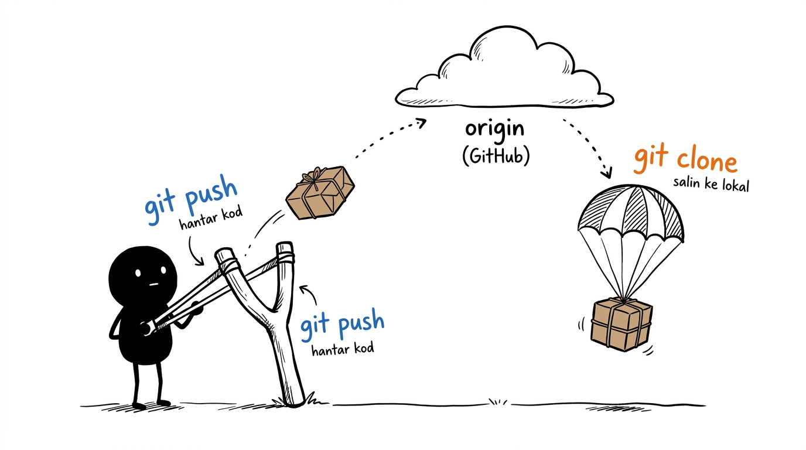
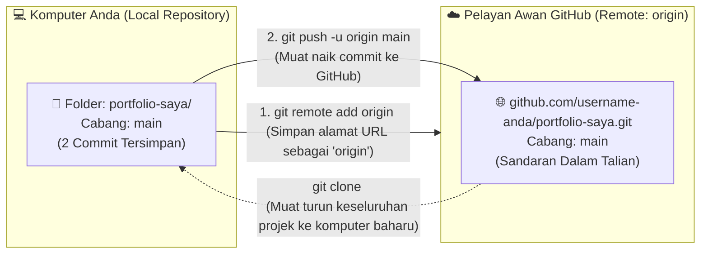
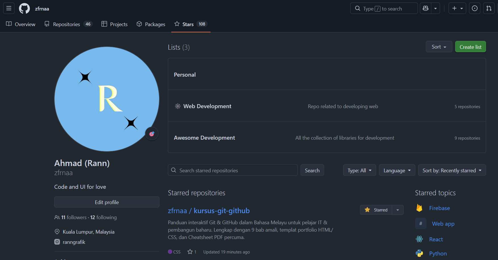

# Bab 4: Berhubung dengan GitHub (*Remote*) — Menyimpan Kod ke Awan

**Kemajuan Projek Portfolio Anda: [50%]** `██████████░░░░░░░░░░`

### 🎯 Objektif Pembelajaran
Pada akhir bab ini, anda akan dapat:
1. Memahami konsep **`remote`** dan mengapa nama panggilan **`origin`** digunakan secara meluas untuk merujuk kepada pelayan GitHub.
2. Membezakan fungsi tiga butang utama pada setiap repositori GitHub: **⭐ Star**, **👁️ Watch**, dan **🍴 Fork**.
3. Mencipta repositori baharu yang kosong di GitHub dan menyambungkannya dengan folder `portfolio-saya` di komputer anda menggunakan `git remote add origin <URL>` dan memuat naik kod menggunakan `git push -u origin main`.
4. Memuat turun mana-mana projek sedia ada dari GitHub ke dalam komputer anda menggunakan arahan `git clone <URL>`.




---

## 1. Bayangkan Begini... `remote` dan `origin` Seperti Nombor Panggilan Pantas (*Speed-Dial*)

**Bayangkan begini...** Setiap kali anda ingin menelefon ibu atau sahabat baik anda, adakah anda menaip kesemua 10 atau 11 digit nombor telefon mereka satu demi satu? Sudah tentu tidak! Anda menyimpan nombor panjang tersebut di dalam buku kenalan telefon pintar anda di bawah nama ringkas seperti **"Ibu"** atau **"Rumah"**. Selepas disimpan, anda hanya perlu menekan nama panggilan tersebut untuk membuat panggilan.

Di dalam dunia Git, perkara yang sama berlaku apabila komputer anda ingin berhubung dengan pelayan GitHub di internet:
- **`remote` (Pelayan Jauh):** Merujuk kepada lokasi repositori anda yang berada di luar komputer anda, iaitu di awan (*cloud*) seperti GitHub.
- **`origin` (Nama Panggilan Lalai):** Daripada memaksa anda menaip alamat URL yang panjang seperti `https://github.com/username-anda/portfolio-saya.git` setiap kali mahu memuat naik kod, Git membenarkan anda menyimpan URL tersebut di bawah satu nama panggilan pendek. Mengikut konvensyen sejagat, nama panggilan lalai bagi repositori utama di awan ialah **`origin`** (yang bermaksud "tempat asal").

### Hubungan Antara Repositori Tempatan (*Local*) dan GitHub (*Remote*)

Perhatikan bagaimana arahan `git remote add`, `git push`, dan `git clone` menghubungkan komputer anda dengan pelayan GitHub:



| Arahan Terminal | Peranan dalam Analogi Kita |
| :--- | :--- |
| **`git remote add origin <URL>`** | Menyimpan nombor telefon (URL GitHub) ke dalam buku kenalan Git dengan nama panggilan **`origin`**. |
| **`git remote -v`** | Membuka buku kenalan Git untuk menyemak sama ada alamat URL bagi `origin` telah ditulis dengan tepat. |
| **`git push -u origin main`** | Menghantar (*upload*) semua *Save Checkpoint* (`commit`) daripada cabang `main` di komputer anda terus ke dalam `origin` (GitHub). |
| **`git clone <URL>`** | Menyalin dan memuat turun keseluruhan folder projek berserta sejarah lengkap `.git` dari GitHub ke dalam komputer anda. |

---

## 2. Mengenali 3 Butang Penting di Halaman GitHub: ⭐ Star, 👁️ Watch, dan 🍴 Fork

Apabila anda melawat mana-mana halaman projek di GitHub (termasuk halaman kursus ini!), anda akan melihat tiga butang utama di penjuru kanan atas. Ramai pemula sering tertukar fungsi ketiga-tiganya:

| Butang GitHub | Fungsi Sebenar | Bila Anda Patut Menggunakannya? |
| :--- | :--- | :--- |
| **⭐ Star** | **Penanda Buku (*Bookmark*) & Tanda Penghargaan.** Menyimpan pautan repositori tersebut ke dalam senarai *Your Stars* di profil anda tanpa menyalin failnya. | Tekan **⭐ Star** pada repositori yang berguna (seperti kursus ini atau pustaka kod yang anda minati) supaya mudah dicari semula pada bila-bila masa. Ini juga cara anda menunjukkan sokongan kepada projek yang anda minati. |
| **👁️ Watch** | **Langganan Notifikasi (*Notification Bell*).** Memberitahu GitHub supaya menghantar e-mel atau pemberitahuan kepada anda setiap kali ada isu (*Issue*), perbincangan, atau kemas kini baharu pada projek tersebut. | Gunakan pada projek kerja berkumpulan anda di universiti atau tempat kerja supaya anda tahu setiap kali rakan sepasukan menghantar kod baharu. |
| **🍴 Fork** | **Salinan Bebas ke Akaun Anda Sendiri.** Mencipta salinan penuh repositori orang lain ke dalam akaun GitHub peribadi anda (`github.com/username-anda/nama-projek`) supaya anda boleh mengubah suai kodnya dengan bebas tanpa menjejaskan projek asal. | Gunakan apabila anda ingin menyumbang kod (*Pull Request*) kepada projek sumber terbuka orang lain (kita akan lakukannya secara amali dalam **Bab 6**!). |



---

## 📄 Mengenal Fail Standard di GitHub (`README.md`, `LICENSE`, `CONTRIBUTING.md`)

Apabila anda melawat mana-mana repositori profesional di GitHub, anda hampir pasti akan terjumpa tiga fail penting ini di muka hadapan:

| Fail Standard | Fungsi & Kegunaannya |
| :--- | :--- |
| **`README.md`** | **"Pintu Hadapan & Manual Projek."** Fail inilah yang dipaparkan secara automatik oleh GitHub di halaman utama repositori. Ia menerangkan apa fungsi projek, cara memasangnya, dan tangkapan skrin aplikasi. |
| **`LICENSE`** | **"Peraturan Undang-Undang."** Menentukan sama ada orang lain boleh menyalin, mengubah suai, atau menjual kod anda (contohnya **MIT License** untuk kod sumber terbuka, atau **CC BY-NC 4.0** untuk bahan percuma bukan komersial). |
| **`CONTRIBUTING.md`** | **"Buku Panduan Penyumbang."** Menyenaraikan syarat dan langkah untuk pembangun luar yang mahu menghantar *Pull Request* (PR) supaya kod mereka menepati piawaian projek. |

### Asas Ringkas Format Markdown (`.md`) untuk `README.md`
Fail `README.md` ditulis menggunakan **Markdown** (format teks ringkas yang bertukar menjadi paparan kemas di GitHub). Anda hanya perlu hafal 4 sintaks asas ini:
- `# Tajuk Besar` atau `## Tajuk Kecil` $\rightarrow$ Mencipta tajuk bahagian.
- `**Teks Tebal**` atau `*Teks Condong*` $\rightarrow$ Menekankan perkataan penting.
- `` `kod arahan` `` $\rightarrow$ Memaparkan nama arahan terminal atau fail.
- `[Teks Pautan](https://pautan.com)` $\rightarrow$ Mencipta pautan boleh klik (dan letak `!` di hadapan `[Teks](gambar.png)` untuk memaparkan gambar).

---

## 🧪 Latihan Amali Bab 4 (Bahagian 1): Memuat Naik `portfolio-saya` ke GitHub (`git push`)

Dalam Bab 3, anda telah mencipta dua `commit` di dalam folder `portfolio-saya` di komputer anda. Sekarang, mari kita muat naik projek tersebut ke akaun GitHub anda supaya ia selamat di awan!

### Langkah 1: Cipta Repositori Baharu yang Kosong di GitHub

1. Buka pelayar web anda dan log masuk ke [https://github.com](https://github.com).
2. Di penjuru kanan atas halaman (sebelah gambar profil anda), klik ikon **`+`** dan pilih **New repository**.
3. Isi maklumat berikut dengan teliti:
   - **Repository name:** Taipkan **`portfolio-saya`**
   - **Description *(Pilihan)*:** `Laman web portfolio peribadi saya yang dibina menggunakan HTML, CSS, dan Git.`
   - **Visibility:** Pilih **Public** (penting supaya anda boleh menerbitkannya secara percuma menggunakan GitHub Pages pada Bab 8 nanti).
4. ⚠️ **AMARAN PENTING (Jangan Tanda Kotak Ini!):**
   Di bawah bahagian **Initialize this repository with:**, pastikan kotak **"Add a README file"**, **"Add .gitignore"**, dan **"Choose a license"** dibiarkan **KOSONG (TIDAK DITANDA)**.
   - *Mengapa?* Kerana folder `portfolio-saya` di dalam komputer anda sudah pun mempunyai sejarah `commit` dan fail `.gitignore` daripada Bab 3. Jika GitHub mencipta fail baharu secara berasingan di awan, sejarah komputer anda dan sejarah GitHub akan bercanggah (conflict)!
5. Klik butang hijau **Create repository**.

---

### Langkah 2: Sambungkan Folder Tempatan dengan GitHub (`git remote add origin`)

Selepas anda menekan *Create repository*, GitHub akan memaparkan halaman persediaan pantas (*Quick setup*). Salin URL HTTPS repositori anda yang kelihatan seperti ini:
`https://github.com/USERNAME-ANDA/portfolio-saya.git` *(Gantikan `USERNAME-ANDA` dengan nama pengguna GitHub sebenar anda)*.

Buka terminal anda, pastikan anda berada di dalam folder `portfolio-saya`, dan jalankan arahan berikut:

```bash
# Pastikan anda berada di dalam folder portfolio-saya
cd portfolio-saya

# 1. Simpan alamat URL GitHub anda dengan nama panggilan 'origin'
# (PENTING: Tukarkan USERNAME-ANDA kepada username GitHub anda sendiri!)
git remote add origin https://github.com/USERNAME-ANDA/portfolio-saya.git

# 2. Semak semula sama ada alamat URL telah tersimpan dengan betul
git remote -v
```

**Jangkaan Output di Terminal:**
```text
origin  https://github.com/USERNAME-ANDA/portfolio-saya.git (fetch)
origin  https://github.com/USERNAME-ANDA/portfolio-saya.git (push)
```

**Jadi kenapa?**
Output di atas mengesahkan bahawa komputer anda kini mengenali `origin` sebagai alamat untuk memuat turun (`fetch`) dan memuat naik (`push`) kod ke repositori `portfolio-saya` di akaun GitHub anda.

---

### Langkah 3: Muat Naik Kod Anda ke Awan (`git push -u origin main`)

Kini tibalah masanya untuk menghantar kedua-dua `commit` yang telah anda buat dalam Bab 3 terus ke pelayan GitHub:

```bash
# Pastikan nama cabang utama tempatan anda ialah 'main'
git branch -M main

# Muat naik (push) cabang 'main' ke 'origin' (GitHub)
git push -u origin main
```

**Jangkaan Output di Terminal:**
```text
Enumerating objects: 8, done.
Counting objects: 100% (8/8), done.
Delta compression using up to 8 threads
Compressing objects: 100% (6/6), done.
Writing objects: 100% (8/8), 3.42 KiB | 3.42 MiB/s, done.
Total 8 (delta 1), reused 0 (delta 0), pack-reused 0
To https://github.com/USERNAME-ANDA/portfolio-saya.git
 * [new branch]      main -> main
branch 'main' set up to track 'origin/main'.
```

**Jadi kenapa?**
- Kerana anda telah log masuk menggunakan `gh auth login` semasa Bab 2, proses muat naik ini berjalan lancar tanpa meminta kata laluan!
- Apakah maksud bendera **`-u`** (singkatan bagi `--set-upstream`)? Ia mengikat cabang `main` di komputer anda dengan cabang `main` di `origin` (`origin/main`). Selepas anda menggunakan `-u` buat kali pertama ini, pada masa hadapan anda hanya perlu menaip **`git push`** atau **`git pull`** sahaja tanpa perlu menaip `origin main` lagi!
- Cuba segar semula (*Refresh* / tekan `F5`) halaman repositori `portfolio-saya` di pelayar web GitHub anda. Anda akan melihat fail `.gitignore`, `index.html`, dan `style.css` sudah terpapar dengan kemas di awan—manakala fail `kata-laluan-rahsia.txt` kekal tersembunyi di dalam komputer anda sahaja!

---

## 🧪 Latihan Amali Bab 4 (Bahagian 2): Memuat Turun Projek Sedia Ada (`git clone`)

Bagaimana pula jika pensyarah atau ketua pasukan anda memberikan pautan GitHub dan meminta anda memuat turun projek tersebut ke dalam komputer anda? Atau bagaimana jika anda membeli komputer riba baharu dan mahu mengambil semula projek anda dari GitHub?

Di sinilah kita menggunakan arahan **`git clone`**.

> **⚠️ Peraturan Penting Sebelum `git clone`:**
> Jangan jalankan `git clone` semasa anda masih berada di dalam folder projek Git yang lain (contohnya di dalam `portfolio-saya`), supaya tidak berlaku masalah "folder Git di dalam folder Git" (*nested repository*). Keluar satu langkah ke folder luar terlebih dahulu menggunakan `cd ..`.

### Langkah 1: Keluar ke Folder Induk dan Jalankan `git clone`

Mari kita berlatih memuat turun sebuah repositori rasmi demonstrasi daripada GitHub (atau anda boleh menggantikan URL di bawah dengan URL repositori kursus ini):

```bash
# 1. Keluar daripada folder portfolio-saya ke folder induk di luar
cd ..

# 2. Muat turun (clone) repositori contoh Octocat Spoon-Knife ke komputer anda
git clone https://github.com/octocat/Spoon-Knife.git

# 3. Masuk ke dalam folder yang baru dimuat turun dan semak sejarahnya
cd Spoon-Knife
git status
git log --oneline
```

**Jangkaan Output di Terminal:**
```text
Cloning into 'Spoon-Knife'...
remote: Enumerating objects: 16, done.
remote: Total 16 (delta 0), reused 0 (delta 0), pack-reused 16
Receiving objects: 100% (16/16), 10.32 KiB | 5.16 MiB/s, done.
---
On branch main
Your branch is up to date with 'origin/main'.

nothing to commit, working tree clean
---
d0dd1f6 (HEAD -> main, origin/main, origin/HEAD) Pointing to the guide for forking
bb4cc8d Updated README.md
a30c19e Create styles.css
```

### Langkah 2: Kembali Semula ke Folder `portfolio-saya`

Apabila anda menggunakan `git clone`, Git secara automatik mencipta folder baharu, menyalin semua fail, menyalin keseluruhan sejarah `commit`, dan mendaftarkan alamat `origin` untuk anda—anda **tidak perlu** lagi menjalankan `git init` atau `git remote add origin` pada projek yang di-*clone*!

Sebelum kita beralih ke bahagian seterusnya, mari kita masuk semula ke dalam folder kerja utama kita iaitu `portfolio-saya`:

```bash
cd ../portfolio-saya
```

---

## ⚠️ Kesilapan Lazim Pemula — Jangan Panik!

> **Situasi 1: Saya jalankan `git remote add origin ...` tetapi keluar ralat `error: remote origin already exists.`!**
> **Mengapa ia berlaku:** Anda pernah menjalankan arahan `git remote add origin` sebelum ini (mungkin anda tersalah taip URL atau tersilap letak `USERNAME-ANDA`). Git tidak membenarkan dua kenalan menggunakan nama `origin` yang sama.
> **Cara selesaikan:** Anda tidak perlu memadam folder projek! Hanya kemas kini alamat URL bagi `origin` menggunakan arahan **`set-url`**:
> ```bash
> git remote set-url origin https://github.com/USERNAME-SEBENAR-ANDA/portfolio-saya.git
> git remote -v
> ```

> **Situasi 2: Semasa saya jalankan `git push -u origin main`, keluar ralat merah `error: failed to push some refs to '...' (Updates were rejected because the remote contains work that you do not have locally)`!**
> **Mengapa ia berlaku:** Semasa mencipta repositori di GitHub tadi, anda mungkin **tertanda kotak "Add a README file"**. Akibatnya, GitHub mempunyai satu `commit` (fail `README.md`) yang belum wujud di dalam komputer anda, lalu GitHub menolak muat naik anda bagi mengelakkan fail `README.md` tersebut terpadam.
> **Cara selesaikan:** Tarik dan gabungkan sejarah daripada GitHub terlebih dahulu menggunakan arahan ini:
> ```bash
> git pull origin main --allow-unrelated-histories
> ```
> *(Jika editor teks terbuka meminta mesej penggabungan, tekan `Esc`, taip `:wq` dan tekan `Enter`)*. Selepas itu, jalankan semula `git push -u origin main`.

> **Situasi 3: Keluar ralat `error: src refspec main does not match any` semasa `git push`!**
> **Mengapa ia berlaku:** Anda cuba memuat naik cabang `main` sedangkan anda **belum pernah membuat sebarang `commit`** di dalam folder tersebut, ATAU cabang tempatan anda masih bernama `master` (tetapan Git lama).
> **Cara selesaikan:** Pastikan anda telah menjalankan `git add` dan `git commit -m "..."` sekurang-kurangnya sekali (seperti dalam Bab 3), kemudian jalankan `git branch -M main` untuk menukar nama cabang kepada `main` sebelum menjalankan `git push -u origin main`.

---

## Cabaran Semakan Kendiri (Bab 4)

Uji kefahaman anda sebelum melangkah ke Bab 5:

1. Apakah perbezaan antara menekan butang **⭐ Star** dan butang **🍴 Fork** pada sesebuah repositori di GitHub?
2. Mengapakah kita menyertakan bendera **`-u`** semasa menjalankan `git push -u origin main` buat kali pertama?
3. Jika anda memuat turun projek daripada GitHub menggunakan `git clone <URL>`, adakah anda masih perlu menaip `git init` di dalam folder tersebut? Mengapa?

<details>
<summary><strong>Klik di sini untuk menyemak jawapan anda</strong></summary>

1. **⭐ Star** berfungsi sebagai penanda buku (*bookmark*) dan tanda penghargaan supaya anda mudah mencari semula repositori tersebut di bawah menu *Your Stars*. **🍴 Fork** pula mencipta satu salinan penuh repositori tersebut ke dalam akaun GitHub anda sendiri supaya anda boleh menyunting kodnya secara bebas.
2. Bendera **`-u`** (`--set-upstream`) menyambungkan cabang `main` di komputer anda dengan cabang `origin/main` di GitHub. Selepas dijalankan sekali, anda hanya perlu menaip `git push` atau `git pull` sahaja pada masa hadapan.
3. **Tidak perlu.** Arahan `git clone` sudah menyalin keseluruhan folder projek berserta folder arkib `.git` dan tetapan `remote origin` secara automatik.

</details>

---

## Navigasi Bab

- ⬅️ **Kembali ke Bab Sebelumnya:** [Bab 3: Asas Git Tempatan (*Local*) — Tapak Portfolio Pertama Anda](./bab-03-asas-git-tempatan.md)
- 🏠 **Kembali ke Halaman Utama:** [README Kursus Git & GitHub](./README.md)
- ➡️ **Teruskan ke Bab Seterusnya:** [Bab 5: Kemas Kini Jarak Jauh — Perbezaan `git fetch` vs `git pull`](./bab-05-kemas-kini-jarak-jauh.md)
