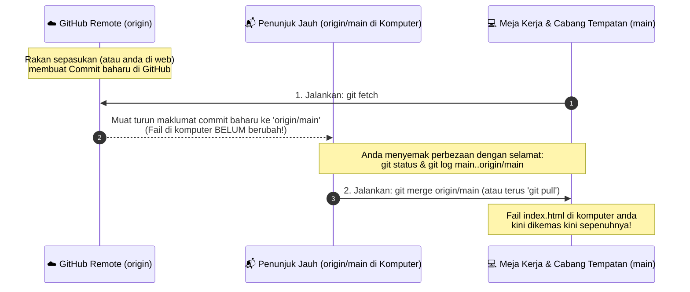

# 📬 Bab 5: Kemas Kini Jarak Jauh — Perbezaan `git fetch` vs `git pull`

**Kemajuan Projek Portfolio Anda: [65%]** `█████████████░░░░░░░`

### 🎯 Objektif Pembelajaran
Pada akhir bab ini, anda akan dapat:
1. Membezakan fungsi **`git fetch`** dan **`git pull`** dengan jelas menggunakan **Analogi Peti Surat (*Mailbox Analogy*)**.
2. Memahami peranan penunjuk **`origin/main`** sebagai cerminan keadaan terkini di GitHub berbanding cabang **`main`** di dalam komputer anda.
3. Mensimulasikan situasi kerja berpasukan secara solo dengan menyunting bahagian kemahiran (`<!-- BAB 5: BAHAGIAN KEMAHIRAN -->`) terus di pelayar web GitHub.
4. Menyemak perubahan baharu dari awan secara selamat menggunakan `git fetch` dan `git log main..origin/main` sebelum menggabungkannya ke komputer menggunakan `git pull`.

---

## 1. Bayangkan Begini... Analogi Peti Surat (*Mailbox Analogy*) untuk `git fetch` vs `git pull`

Apabila anda bekerja di dalam kumpulan (atau apabila anda menyunting kod daripada dua komputer yang berbeza), kerap kali terdapat kemas kini baharu di pelayan GitHub (`origin`) yang belum ada di dalam komputer riba anda.

Untuk mengambil kemas kini tersebut dari GitHub, Git menyediakan dua arahan yang sering mengelirukan pemula: **`git fetch`** dan **`git pull`**.

**Bayangkan begini...** Anda sedang tekun menulis helaian kerja rumah di atas meja tulis di dalam bilik anda, manakala di luar pagar rumah anda terdapat sebuah **Peti Surat**. Posmen (GitHub) baru sahaja memasukkan sepucuk surat kemas kini daripada rakan sepasukan anda ke dalam peti surat tersebut:

1. **🚶‍♂️📬 `git fetch` (Pergi ke Peti Surat & Tengok Sahaja):**
   Apabila anda menjalankan `git fetch`, anda berjalan keluar ke peti surat, mengambil surat yang baru tiba, dan membawanya masuk ke bilik untuk **melihat sampul serta pengirimnya (`origin/main`)**, tetapi anda **belum membukanya atau mencampurkannya ke atas meja kerja anda (`main`)**.
   - **Mengapa ia 100% selamat?** Fail-fail kod yang sedang anda buka di dalam VS Code langsung tidak berubah! Anda boleh menyemak dahulu apa yang rakan anda ubah sebelum membuat keputusan.
2. **⚡📥 `git pull` (Ambil Surat & Terus Campurkan ke Atas Meja Kerja):**
   Apabila anda menjalankan `git pull`, anda pergi ke peti surat, mengambil surat tersebut, dan **serta-merta membuka serta menggabungkan kandungannya terus ke dalam kertas kerja di atas meja anda**.
   - Secara matematik di dalam Git: **`git pull` = `git fetch` + `git merge`**.

### Aliran Urutan `git fetch` berbanding `git pull`

Perhatikan bagaimana kemas kini daripada GitHub mengalir ke dalam penunjuk `origin/main` dahulu sebelum masuk ke dalam `main` tempatan anda:



| Arahan Terminal | Apa Yang Berlaku Pada Fail Anda? | Bila Patut Digunakan? |
| :--- | :--- | :--- |
| **`git fetch`** | **Tiada fail yang berubah.** Ia hanya mengemas kini maklumat di dalam `origin/main` supaya komputer anda tahu ada perubahan baharu di GitHub. | Apabila anda mahu berhati-hati dan menyemak dahulu apa yang rakan sepasukan anda ubah di GitHub sebelum menggabungkannya. |
| **`git log main..origin/main`** | Memaparkan senarai `commit` baharu yang sudah tiba di peti surat (`origin/main`) tetapi belum dimasukkan ke dalam cabang `main` anda. | Selepas menjalankan `git fetch`, untuk membaca mesej `commit` yang baru tiba dari GitHub. |
| **`git pull`** | **Fail di komputer anda terus berubah.** Ia menjalankan `git fetch` dan terus menggabungkan (`merge`) perubahan tersebut ke dalam cabang semasa anda. | Apabila anda pasti mahu terus mengemas kini fail tempatan anda dengan versi paling baharu dari GitHub. |

---

## 🧪 Latihan Amali Bab 5: Simulasi Kerja Berpasukan & Kemas Kini Bahagian Kemahiran

Anda mungkin tertanya-tanya: *"Saya sedang belajar seorang diri di rumah, bagaimana saya hendak mencuba situasi rakan sepasukan memuat naik kod baharu di GitHub?"*

Kita boleh mensimulasikannya dengan mudah! Kita akan menggunakan **Penyunting Web GitHub (*GitHub Web Editor*)** terus di dalam pelayar internet anda untuk menambah kemahiran baharu di dalam `index.html` (seolah-olah rakan kumpulan anda yang melakukannya dari komputer lain), kemudian kita akan menarik perubahan tersebut ke komputer anda menggunakan terminal.

### Langkah 1: Sunting Bahagian Kemahiran Terus di Laman Web GitHub (Simulasi Rakan Sepasukan)

1. Buka pelayar web anda dan pergi ke halaman repositori **`portfolio-saya`** anda di GitHub (`https://github.com/USERNAME-ANDA/portfolio-saya`).
2. Klik pada nama fail **`index.html`** di dalam senarai fail.
3. Di penjuru kanan atas paparan kod fail tersebut, klik **ikon pensel (✏️ *Edit this file*)**.
4. Tatal ke bawah sehingga anda menjumpai penanda komen **`<!-- BAB 5: BAHAGIAN KEMAHIRAN -->`** (sekitar baris ke-37):

```html
        <!-- BAB 5: BAHAGIAN KEMAHIRAN -->
        <section id="kemahiran" class="section-block">
            <div class="section-header">
                <h2>🛠️ Kemahiran Teknikal</h2>
                <p>Teknologi dan alatan yang sedang saya kuasai sepanjang pengajian.</p>
            </div>
            <ul class="skills-grid">
                <li class="skill-item">Git &amp; GitHub (Kawalan Versi)</li>
                <li class="skill-item">HTML5 &amp; CSS3 Responsif</li>
                <li class="skill-item">JavaScript Asas</li>
                <li class="skill-item">Python / Penyelesaian Masalah</li>
            </ul>
        </section>
```

5. **Tugasan Anda di Penyunting Web GitHub:**
   - Ubah suai senarai `<li class="skill-item">` di atas mengikut kemahiran sebenar yang sedang anda pelajari (contohnya: `Java & Pengaturcaraan Berorientasikan Objek`, `Pangkalan Data SQL`, `Reka Bentuk UI/UX Figma`, atau `Pembangunan Web React`).
   - Tambahkan sekurang-kurangnya **dua lagi baris `<li class="skill-item">...</li>`** supaya senarai kemahiran anda mempunyai 6 item kesemuanya!
6. Setelah selesai menyunting di pelayar web:
   - Klik butang hijau **Commit changes...** di penjuru kanan atas.
   - Pada ruangan **Commit message**, taipkan:
     `Kemas kini senarai kemahiran teknikal melalui web GitHub`
   - Pastikan pilihan **Commit directly to the `main` branch** dipilih, kemudian klik **Commit changes**.

---

### Langkah 2: Periksa Keadaan Terminal Sebelum `git fetch`

Sekarang, buka semula terminal dan editor VS Code di dalam komputer anda. Jika anda melihat fail `index.html` di dalam VS Code sekarang, **kemahiran baharu yang anda tambah di web tadi masih belum wujud di komputer anda!**

Mari kita tanya `git status` di dalam terminal komputer anda:

```bash
# Pastikan anda berada di dalam folder portfolio-saya
cd portfolio-saya

git status
```

**Jangkaan Output di Terminal:**
```text
On branch main
Your branch is up to date with 'origin/main'.

nothing to commit, working tree clean
```

**Jadi kenapa?**
Mengapa Git di komputer anda mengatakan *"Your branch is up to date with 'origin/main'"* sedangkan kita baru sahaja mengubah fail di laman web GitHub?
Kerana Git di dalam komputer anda **tidak menghubungi internet secara automatik setiap saat**! Anda belum menyuruh Git berjalan keluar untuk memeriksa **Peti Surat** (`git fetch`).

---

### Langkah 3: Jalankan `git fetch` (Periksa Peti Surat Dengan Selamat)

Mari kita suruh Git memeriksa pelayan GitHub tanpa mengubah fail di atas Meja Kerja kita lagi:

```bash
git fetch
```

**Jangkaan Output di Terminal:**
```text
remote: Enumerating objects: 5, done.
remote: Counting objects: 100% (5/5), done.
remote: Compressing objects: 100% (3/3), done.
remote: Total 3 (delta 2), reused 0 (delta 0), pack-reused 0
Unpacking objects: 100% (3/3), 984 bytes | 492.00 KiB/s, done.
From https://github.com/USERNAME-ANDA/portfolio-saya
   e4f5g6h..7c8d9e0  main       -> origin/main
```

Sekarang, jalankan semula `git status` dan lihat bagaimana laporannya berubah:

```bash
git status
```

**Jangkaan Output di Terminal:**
```text
On branch main
Your branch is behind 'origin/main' by 1 commit, and can be fast-forwarded.
  (use "git pull" to update your local branch)

nothing to commit, working tree clean
```

Dan mari kita intai apakah `commit` baharu yang berada di dalam peti surat (`origin/main`) itu menggunakan `git log`:

```bash
git log main..origin/main --oneline
```

**Jangkaan Output di Terminal:**
```text
7c8d9e0 (origin/main) Kemas kini senarai kemahiran teknikal melalui web GitHub
```

**Jadi kenapa?**
Lihat betapa bergunanya `git fetch`!
- Fail `index.html` di komputer anda masih belum diusik, tetapi `git status` kini memberitahu anda dengan tepat: *"Your branch is behind 'origin/main' by 1 commit"* (Cabang komputer anda ketinggalan 1 commit di belakang GitHub).
- Arahan `git log main..origin/main --oneline` pula memaparkan tajuk `commit` yang baru tiba supaya anda tahu apakah perubahan yang dibuat sebelum anda menggabungkannya.

---

### Langkah 4: Gabungkan Perubahan ke Komputer Anda (`git pull`)

Setelah anda berpuas hati menyemak kandungan peti surat tadi, mari kita bawa masuk dan gabungkan perubahan tersebut ke dalam fail `index.html` di komputer anda menggunakan **`git pull`**:

```bash
git pull
```

**Jangkaan Output di Terminal:**
```text
Updating e4f5g6h..7c8d9e0
Fast-forward
 index.html | 4 +++-
 1 file changed, 3 insertions(+), 1 deletion(-)
```

Sekarang, buka semula fail `index.html` di dalam VS Code dan segar semula (*refresh*) pelayar web tempatan anda! Anda akan melihat senarai kemahiran teknikal yang anda sunting di laman web GitHub tadi kini telah muncul secara automatik di dalam komputer anda.

Mari kita semak sejarah penuh `commit` kita setakat ini:

```bash
git log --oneline
```

**Jangkaan Output di Terminal:**
```text
7c8d9e0 (HEAD -> main, origin/main) Kemas kini senarai kemahiran teknikal melalui web GitHub
e4f5g6h Kemas kini nama dan biodata peribadi pada halaman utama
a1b2c3d Mulakan tapak asas portfolio dan tetapan .gitignore
```

**Jadi kenapa?**
Perhatikan label `(HEAD -> main, origin/main)` pada baris paling atas. Apabila kedua-dua `main` (komputer anda) dan `origin/main` (GitHub) berada pada baris `commit` yang sama (`7c8d9e0`), itu bermakna komputer anda dan awan GitHub kini **100% selari (*synchronized*)**!

---

## 💡 Amalan Terbaik Industri: "Pull Dahulu Sebelum Mula Kerja, Push Selepas Selesai!"

Apabila anda menyertai projek berkumpulan di universiti atau menjalani latihan industri (*internship*), jadikan tabiat harian ini sebagai peraturan wajib anda:
1. **Setiap kali baru membuka komputer riba untuk mula menulis kod:** Jalankan **`git fetch`** dan **`git pull`** terlebih dahulu supaya anda sentiasa bekerja di atas kod yang paling terkini.
2. **Jangan biarkan kerja anda terperap berhari-hari di komputer:** Setiap kali satu bahagian kecil siap, lakukan `git commit` dan `git push` supaya rakan sepasukan anda turut mendapat kemas kini terkini.

---

## ⚠️ Kesilapan Lazim Pemula — Jangan Panik!

> **🚨 Situasi 1: Saya cuba jalankan `git push`, tetapi ditolak dengan ralat `![rejected] main -> main (fetch first)`!**
> **Mengapa ia berlaku:** Ada perubahan baharu di GitHub (mungkin anda pernah menyunting fail melalui pelayar web GitHub atau rakan sepasukan anda baru sahaja membuat `push`) yang belum anda tarik ke dalam komputer anda. Git menghalang anda daripada melakukan `push` secara membuta tuli supaya kerja di GitHub tidak terpadam.
> **Cara selesaikan:** Ikut sahaja nasihat Git! Jalankan **`git pull`** terlebih dahulu untuk mengambil kemas kini dari GitHub ke komputer anda, kemudian barulah jalankan **`git push`** semula.

> **🚨 Situasi 2: Saya jalankan `git pull`, tetapi keluar ralat `error: Your local changes to the following files would be overwritten by merge: index.html. Please commit your changes or stash them before you merge.`!**
> **Mengapa ia berlaku:** Anda sedang menyunting fail `index.html` di komputer anda (belum di-*commit* lagi), dan pada masa yang sama fail `index.html` yang baru tiba dari GitHub juga mempunyai perubahan. Git enggan menimpa kerja anda yang belum disimpan!
> **Cara selesaikan:** Simpan dahulu kerja tempatan anda ke dalam *Save Checkpoint* dengan menjalankan:
> ```bash
> git add index.html
> git commit -m "Simpan perubahan tempatan sebelum pull"
> git pull
> ```

> **🚨 Situasi 3: Selepas jalankan `git pull`, keluar mesej panjang `Need to specify how to reconcile divergent branches`!**
> **Mengapa ia berlaku:** Anda mempunyai `commit` baharu di komputer, dan GitHub juga mempunyai `commit` baharu yang berbeza pada masa yang sama. Git bertanya sama ada anda mahu menggabungkannya secara *merge* biasa.
> **Cara selesaikan:** Jalankan **`git pull --no-rebase`** untuk menggabungkan kedua-dua sejarah tersebut dengan selamat (jika editor teks terbuka, tekan `Esc`, taip `:wq` dan tekan `Enter`).

---

## 🧠 Cabaran Semakan Kendiri (Bab 5)

Uji kefahaman anda terhadap penyegerakan jarak jauh dengan 3 soalan ini:

1. Menggunakan analogi peti surat, terangkan mengapa `git fetch` dianggap 100% selamat untuk dijalankan pada bila-bila masa berbanding `git pull`.
2. Apakah dua arahan Git yang sebenarnya digabungkan secara automatik apabila anda menaip `git pull`?
3. Selepas anda menjalankan `git fetch`, `git status` melaporkan: `Your branch is behind 'origin/main' by 2 commits`. Apakah maksud mesej ini dalam bahasa mudah?

<details>
<summary><strong>Klik di sini untuk menyemak jawapan anda</strong></summary>

1. **`git fetch`** hanya mengambil maklumat perubahan baharu dari GitHub dan menyimpannya di dalam penunjuk `origin/main` (ibarat mengambil surat dari peti surat untuk melihat sampulnya sahaja) **tanpa mengubah sebarang fail kod di atas Meja Kerja (`Working Directory`) anda**. Sebaliknya, `git pull` terus mencampurkan perubahan tersebut ke dalam fail kerja anda.
2. **`git pull` = `git fetch` + `git merge`**.
3. Ia bermaksud terdapat **2 *Save Checkpoint* (`commit`) baharu di pelayan GitHub (`origin/main`)** yang masih belum dimasukkan ke dalam cabang `main` di komputer anda. Anda hanya perlu menjalankan `git pull` untuk mengemas kini komputer anda.

</details>

---

## 🧭 Navigasi Bab

- ⬅️ **Kembali ke Bab Sebelumnya:** [Bab 4: Berhubung dengan GitHub (*Remote*) — Menyimpan Kod ke Awan](./bab-04-berhubung-dengan-github.md)
- 🏠 **Kembali ke Halaman Utama:** [README Kursus Git & GitHub](./README.md)
- ➡️ **Teruskan ke Bab Seterusnya:** [Bab 6: *Branching*, *Merge* dan *Pull Request* — Rahsia Kolaborasi Pasukan](./bab-06-branching-dan-pull-request.md)
