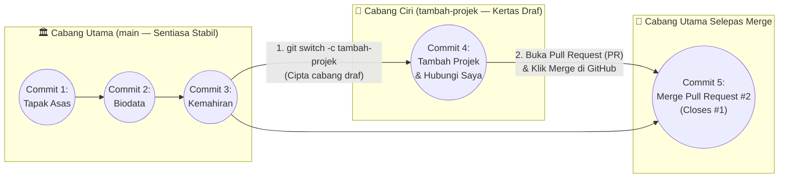
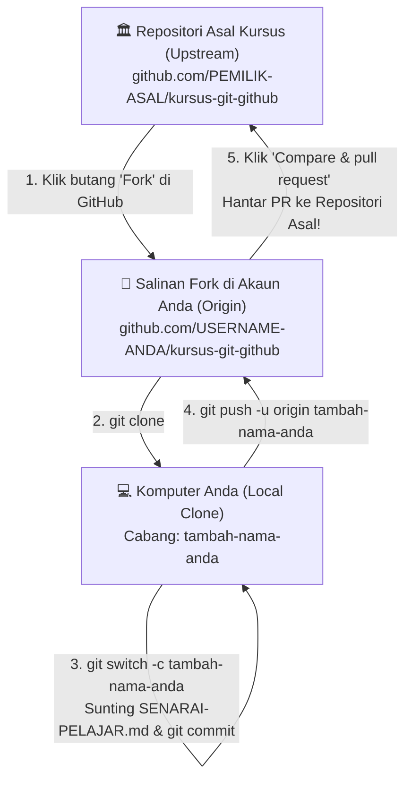

# 🌿 Bab 6: *Branching*, *Merge* dan *Pull Request* — Rahsia Kolaborasi Pasukan

**Kemajuan Projek Portfolio Anda: [80%]** `████████████████░░░░`

### 🎯 Objektif Pembelajaran
Pada akhir bab ini, anda akan dapat:
1. Memahami konsep **Cabang (*Branch*)** menggunakan analogi **Kertas Draf Salinan / Alam Semesta Selari (*Parallel Universe*)** dan merancang tugasan menggunakan **GitHub Issues**.
2. Mencipta cabang baharu dengan `git switch -c`, mengemas kini bahagian projek, dan menghantar **Pull Request (PR)** pertama pada repositori anda sendiri.
3. Menghadapi dan menyelesaikan situasi **Percanggahan Kod (*Merge Conflict*)** (`<<<<<<< HEAD`, `=======`, `>>>>>>>`) dengan tenang tanpa rasa panik.
4. Menyelesaikan **Cabaran Kemuncak Sumber Terbuka**: Melakukan *Fork*, menambah nama anda ke dalam Dinding Kenangan [`SENARAI-PELAJAR.md`](./SENARAI-PELAJAR.md), dan menghantar *Pull Request* sebenar!

---

## 1. Bayangkan Begini... *Branch* Seperti Kertas Draf Salinan

Pernahkah anda berada di dalam projek berkumpulan di mana seorang rakan anda sedang mencuba ciri baharu yang belum siap, lalu dia terus menyimpan kod yang separuh masak itu ke dalam fail utama sehingga keseluruhan projek kumpulan anda gagal dijalankan (*crash*)?

Dalam industri perisian profesional, **tiada siapa yang menyunting kod secara terus di atas cabang utama (`main`)!** Sebaliknya, setiap pembangun menggunakan konsep **Cabang (*Branching*)**.

**Bayangkan begini...** Anda dan kumpulan anda sedang menyiapkan sebuah buku laporan rasmi yang bersih di atas meja utama (**cabang `main`**). Tiba-tiba, anda mendapat idea untuk melukis gambar rajah baharu pada Bab 6, tetapi anda risau lukisan tersebut mungkin comot atau tidak menjadi:
1. **🌿 Mencipta *Branch* (`git switch -c tambah-projek`):**
   Daripada menconteng terus di atas buku laporan rasmi (`main`), anda **membuat satu salinan fotostat (Kertas Draf)**. Di atas kertas draf ini, anda bebas melukis, memadam, atau bereksperimen sesuka hati. Buku laporan rasmi di cabang `main` kekal 100% bersih dan selamat!
2. **🔍 Membuka *Pull Request / PR* (Minta Semakan Kumpulan):**
   Apabila lukisan di atas kertas draf anda sudah siap dan kemas, anda tidak terus menampalnya secara senyap-senyap. Anda mengangkat tangan dan menunjukkan draf tersebut kepada ahli pasukan: *"Kawan-kawan, saya sudah siapkan bahagian projek di cabang `tambah-projek`. Boleh tolong semak sebelum kita masukkan ke dalam `main`?"* Permintaan rasmi ini dipanggil **Pull Request (PR)**.
3. **🤝 Menggabungkan Kod (`Merge`):**
   Selepas disemak dan diluluskan, barulah perubahan daripada kertas draf (`tambah-projek`) digabungkan (**`merge`**) ke dalam buku laporan rasmi (**`main`**)!

### Aliran Kerja *Issue* -> *Branch* -> *Pull Request* -> *Merge*

Perhatikan bagaimana cabang ciri (*feature branch*) berpecah daripada `main` dan kembali semula selepas disiapkan:



| Istilah & Arahan | Peranan dalam Aliran Kerja Pasukan |
| :--- | :--- |
| **GitHub Issue** | Kad tugasan (*To-Do ticket*) di GitHub untuk merekodkan pepijat (*bug*) atau ciri baharu yang perlu dibina sebelum menulis kod. |
| **`git branch`** | Melihat senarai semua cabang yang wujud di komputer anda (tanda `*` menunjukkan cabang semasa anda). |
| **`git switch -c <nama-cabang>`** | Mencipta cabang draf baharu dan terus berpindah ke dalamnya *(Arahan klasik yang setara: `git checkout -b <nama-cabang>`)*. |
| **`git switch main`** | Berpindah semula ke cabang utama `main` *(Arahan klasik yang setara: `git checkout main`)*. |
| **Pull Request (PR)** | Kertas cadangan di GitHub untuk meminta kebenaran menggabungkan kod daripada cabang draf ke dalam cabang `main`. |

---

## 🧪 Latihan Amali Bab 6 (Bahagian 1): Mengurus *Issue*, *Branch*, dan *Pull Request*

Mari kita lengkapkan bahagian terakhir laman web portfolio anda (`Projek Pilihan` & `Hubungi Saya`) menggunakan aliran kerja jurutera perisian sebenar!

### Langkah 1: Buka Satu *GitHub Issue* (Kad Tugasan)

1. Buka repositori **`portfolio-saya`** anda di pelayar web GitHub (`https://github.com/USERNAME-ANDA/portfolio-saya`).
2. Klik tab **Issues** di bahagian atas halaman, kemudian klik butang hijau **New issue**.
3. Isi maklumat berikut:
   - **Title:** `Tambah bahagian projek dan pautan media sosial`
   - **Description:** `Kemas kini senarai projek pilihan dan alamat e-mel/GitHub sebenar di dalam index.html.`
4. Klik **Submit new issue**.
5. Perhatikan nombor di sebelah tajuk Issue anda—ia tertulis **`#1`**. Simpan nombor `#1` ini di dalam ingatan anda kerana kita akan menutupnya secara automatik menggunakan *Pull Request* sebentar lagi!

---

### Langkah 2: Cipta Cabang Baharu (`git switch -c tambah-projek`)

Buka terminal anda di dalam folder `portfolio-saya`. Pastikan anda berada di cabang `main`, kemudian cipta cabang baharu bernama **`tambah-projek`**:

```bash
# 1. Semak cabang semasa anda
git branch

# 2. Cipta cabang baharu 'tambah-projek' dan terus masuk ke dalamnya
git switch -c tambah-projek

# (Nota: Pada versi Git lama, arahan 'git checkout -b tambah-projek' melakukan perkara yang sama)

# 3. Semak semula senarai cabang
git branch
```

**Jangkaan Output di Terminal:**
```text
* main
---
Switched to a new branch 'tambah-projek'
---
  main
* tambah-projek
```

**Jadi kenapa?**
Perhatikan tanda bintang `*` kini berada di sebelah **`tambah-projek`**. Anda kini berada di dalam cabang yang betul! Sebarang perubahan yang anda buat pada fail `index.html` sekarang hanya berlaku di dalam cabang `tambah-projek` tanpa mengusik cabang `main`.

---

### Langkah 3: Sunting Bahagian Projek & Hubungi Saya di dalam `index.html`

Buka fail **`index.html`** di dalam VS Code dan cari penanda komen **`<!-- BAB 6: BAHAGIAN PROJEK & HUBUNGI SAYA -->`** (sekitar baris ke-51):

```html
        <!-- BAB 6: BAHAGIAN PROJEK & HUBUNGI SAYA -->
        <section id="projek" class="section-block">
            <div class="section-header">
                <h2>🚀 Projek Pilihan</h2>
                <p>Hasil kerja amali dan tugasan yang telah saya bangunkan.</p>
            </div>
            <div class="projects-grid">
                <article class="project-card">
                    <span class="project-tag">Projek 01 • Web Statik</span>
                    <h3>Laman Portfolio GitHub Pages</h3>
...
        <section id="hubungi" class="section-block contact-card">
            <h2>📬 Hubungi Saya</h2>
            <p>Berminat untuk bekerjasama dalam projek akademik, hackathon, atau latihan industri (internship)?</p>
            <p class="contact-links">
                <strong>E-mel:</strong> <a href="mailto:pelajar@universiti.edu.my">pelajar@universiti.edu.my</a>
                <span class="divider">•</span>
                <strong>GitHub:</strong> <a href="https://github.com/username-anda" target="_blank" rel="noopener noreferrer">github.com/username-anda</a>
            </p>
        </section>
```

**Tugasan Anda:**
1. Ubah suai tajuk `<h3>` dan penerangan `<p>` di dalam kad-kad projek supaya menceritakan projek kuliah, tugasan pengaturcaraan, atau projek peribadi anda.
2. Di bahagian **Hubungi Saya** (baris 79–81), tukarkan `pelajar@universiti.edu.my` kepada e-mel pilihan anda, dan tukarkan **`username-anda`** kepada *username* GitHub sebenar anda!
3. Tekan **Save (`Ctrl + S`)**.

Sekarang, rakamkan perubahan ini ke dalam cabang `tambah-projek` dan muat naik cabang tersebut ke GitHub:

```bash
git add index.html
git commit -m "Kemas kini senarai projek pilihan dan pautan hubungi saya"
git push -u origin tambah-projek
```

**Jangkaan Output di Terminal:**
```text
[tambah-projek 9a8b7c6] Kemas kini senarai projek pilihan dan pautan hubungi saya
 1 file changed, 6 insertions(+), 6 deletions(-)
...
To https://github.com/USERNAME-ANDA/portfolio-saya.git
 * [new branch]      tambah-projek -> tambah-projek
branch 'tambah-projek' set up to track 'origin/tambah-projek'.
```

---

### Langkah 4: Buka *Pull Request* (PR) & Gabungkan (*Merge*) di GitHub

1. Buka semula halaman repositori `portfolio-saya` di pelayar web GitHub anda.
2. Anda akan melihat sepanduk kuning di bahagian atas berbunyi: **`tambah-projek had recent pushes`** berserta butang hijau **Compare & pull request**. Klik butang hijau tersebut!
3. Pada halaman **Open a pull request**:
   - Pastikan anak panah di bahagian atas menunjukkan: **`base: main` -> `compare: tambah-projek`**.
   - Pada ruangan **Description / Write**, taipkan kata kunci ini:
     ```markdown
     Menambah maklumat projek pilihan dan mengemas kini pautan profil GitHub.

     Closes #1
     ```
     *(💡 **Rahsia Pro:** Apabila anda menulis `Closes #1` di dalam penerangan PR, GitHub akan menutup Issue `#1` yang anda buka pada Langkah 1 secara automatik sebaik sahaja PR ini digabungkan!)*
4. Klik butang hijau **Create pull request**.
5. Pada halaman PR yang baru dibuka, tatal sedikit ke bawah dan klik butang hijau **Merge pull request**, kemudian klik **Confirm merge**.
6. Apabila muncul mesej ungu **Pull request successfully merged and closed**, anda boleh menekan butang **Delete branch** di sebelah kanan untuk mengemas kertas draf di GitHub. (Cuba semak tab **Issues** anda—Issue `#1` kini telah bertukar menjadi *Closed* secara automatik!).

---

### Langkah 5: Kemas Kini Cabang `main` di Komputer Anda

Ingat! Penggabungan (*Merge*) tadi berlaku di pelayan awan GitHub. Komputer anda masih berada di dalam cabang `tambah-projek`. Mari kita kembali ke cabang `main` di komputer dan tarik hasil gabungan terkini menggunakan `git pull`:

```bash
# 1. Pindah semula ke cabang utama 'main'
git switch main

# 2. Tarik perubahan terkini yang telah di-merge di GitHub
git pull

# 3. Padamkan cabang draf tempatan yang sudah selesai digunakan
git branch -d tambah-projek
```

**Jangkaan Output di Terminal:**
```text
Switched to branch 'main'
Your branch is up to date with 'origin/main'.
---
Updating 7c8d9e0..4d5e6f7
Fast-forward
 index.html | 12 ++++++------
 1 file changed, 6 insertions(+), 6 deletions(-)
---
Deleted branch tambah-projek (was 9a8b7c6).
```

---

## 🧪 Latihan Amali Bab 6 (Bahagian 2): Menjinakkan Ketakutan — Simulasi Selamat *Merge Conflict*

Tanyalah mana-mana pelajar sains komputer apakah perkara yang paling menakutkan mereka semasa menggunakan Git—jawapannya pasti **Percanggahan Penggabungan (*Merge Conflict*)**!

Sebenarnya, *Merge Conflict* langsung tidak berbahaya. Ia hanya berlaku apabila **dua pihak mengubah baris yang SAMA di dalam fail yang SAMA pada masa yang serentak**, lalu Git berhenti sejenak dan bertanya secara sopan: *"Eh, ada dua versi ayat yang berbeza pada baris ini. Mana satu yang anda mahu simpan?"*

Mari kita cipta satu *Merge Conflict* secara sengaja supaya anda tidak lagi takut apabila menghadapinya di dunia sebenar!

### Langkah 1: Ubah Baris *Footer* di GitHub Web DAN di Komputer Serentak

1. **Di Pelayar Web GitHub:**
   - Buka fail `index.html` di dalam repositori `portfolio-saya` anda di GitHub dan klik ikon pensel (✏️ **Edit this file**).
   - Tatal ke baris paling bawah (sekitar baris ke-88 di dalam `<footer>`):
     ```html
     <p>Dibina dengan penuh semangat menggunakan <strong>Git &amp; GitHub</strong> • Dihoskan di GitHub Pages</p>
     ```
   - Tukarkan baris tersebut kepada:
     ```html
     <p>Hak Cipta Terpelihara 2026 • Dibina dengan <strong>Git &amp; GitHub</strong> (Versi Web)</p>
     ```
   - Klik **Commit changes...** -> **Commit directly to the `main` branch** -> **Commit changes**.

2. **Di Komputer Anda (Tanpa menjalankan `git pull` dahulu!):**
   - Buka fail `index.html` di dalam VS Code pada komputer anda.
   - Pergi ke baris ke-88 yang sama di dalam `<footer>`, dan tukarkannya kepada ayat yang berbeza:
     ```html
     <p>Portfolio Rasmi Pembangun • Dibina dengan <strong>Git &amp; GitHub</strong> (Versi Komputer)</p>
     ```
   - Simpan fail (`Ctrl + S`), kemudian jalankan `add` dan `commit` di terminal:
     ```bash
     git add index.html
     git commit -m "Kemas kini teks footer daripada komputer"
     ```

---

### Langkah 2: Cetuskan *Merge Conflict* dengan `git pull`

Sekarang, kedua-dua GitHub dan komputer anda telah mengubah baris ke-88 dengan ayat yang berlainan! Mari kita jalankan `git pull` untuk melihat apa yang berlaku:

```bash
git pull --no-rebase
```

**Jangkaan Output di Terminal:**
```text
Auto-merging index.html
CONFLICT (content): Merge conflict in index.html
Automatic merge failed; fix conflicts and then commit the result.
```

Jangan panik! Buka fail `index.html` di dalam VS Code dan lihat baris ke-88. Git telah meletakkan penanda khas untuk menunjukkan kedua-dua versi kepada anda:

```html
<<<<<<< HEAD
            <p>Portfolio Rasmi Pembangun • Dibina dengan <strong>Git &amp; GitHub</strong> (Versi Komputer)</p>
=======
            <p>Hak Cipta Terpelihara 2026 • Dibina dengan <strong>Git &amp; GitHub</strong> (Versi Web)</p>
>>>>>>> 8f9a0b1c2d3e4f5a6b7c8d9e0f1a2b3c4d5e6f7a
```

### Memahami Penanda *Merge Conflict* dalam Bahasa Mudah:
- **`<<<<<<< HEAD`** sehingga **`=======`**: Ini ialah baris kod yang berada di dalam **komputer anda sekarang (`HEAD`)**.
- **`=======`**: Garisan pemisah di antara kedua-dua versi.
- **`=======`** sehingga **`>>>>>>> 8f9a0b1...`**: Ini ialah baris kod yang baru tiba daripada **GitHub**.

---

### Langkah 3: Bersihkan Penanda & Selesaikan *Conflict*

Cara menyelesaikan *Merge Conflict* sangat mudah—anda hanya perlu **memadamkan ketiga-tiga baris penanda (`<<<<<<<`, `=======`, `>>>>>>>`)** dan menyimpan ayat akhir yang anda inginkan!

1. Di dalam VS Code, padamkan penanda tersebut supaya bahagian `<footer>` anda tinggal satu baris yang bersih seperti ini:
   ```html
       <footer class="site-footer">
           <div class="container">
               <p>Hak Cipta Terpelihara 2026 • Portfolio Rasmi Pembangun menggunakan <strong>Git &amp; GitHub</strong></p>
           </div>
       </footer>
   ```
   *(Petua: Di dalam VS Code, anda juga boleh menekan butang kecil **Accept Current Change** atau **Accept Incoming Change** yang muncul di atas garisan `<<<<<<< HEAD`).*
2. Tekan **Save (`Ctrl + S`)** pada fail `index.html`.
3. Beritahu Git bahawa anda sudah selesai memilih jawapan dengan melakukan `git add`, `git commit`, dan `git push`:

```bash
git add index.html
git commit -m "Selesaikan merge conflict pada bahagian footer index.html"
git push
```

**Jangkaan Output di Terminal:**
```text
[main 3c4d5e6] Selesaikan merge conflict pada bahagian footer index.html
---
To https://github.com/USERNAME-ANDA/portfolio-saya.git
   8f9a0b1..3c4d5e6  main -> main
```

**Jadi kenapa?**
Tahniah! 🎉 Anda baru sahaja berhadapan dengan situasi yang paling ditakuti oleh pemula dan menyelesaikannya dalam masa kurang daripada 2 minit. Mulai hari ini, apabila anda melihat perkataan `CONFLICT (content)`, anda tahu bahawa Git hanya meminta anda memilih ayat/code mana yang patut dikekalkan!

---

## 🏆 Cabaran Kemuncak Bab 6: Hantar *Pull Request* Sumber Terbuka Pertama Anda ke `SENARAI-PELAJAR.md`!

Kini tibalah detik paling bersejarah dalam perjalanan pembelajaran anda. Anda telah menguasai cara mengurus repositori anda sendiri—tetapi bagaimana pula cara menyumbang kod kepada projek milik orang lain atau komuniti sumber terbuka (*Open Source*) di mana anda tidak mempunyai akses untuk melakukan `push` secara terus?

Jawapannya ialah aliran kerja **🍴 Fork -> 💻 Clone -> 🌿 Branch -> 📤 Push -> 🎉 Pull Request**!

Dalam cabaran ini, anda akan mengabadikan nama anda di dalam **Balai Kemasyhuran ([`SENARAI-PELAJAR.md`](./SENARAI-PELAJAR.md))** repositori kursus ini.

### Aliran Kerja *Fork* & *Pull Request* Sumber Terbuka



### Langkah Demi Langkah Menghantar PR Anda:

1. **Langkah 1 — Klik ⭐ Star & 🍴 Fork Repositori Kursus Ini:**
   - Buka halaman utama repositori kursus ini di pelayar web GitHub.
   - Pastikan anda telah menekan butang **⭐ Star** (sebagai tanda sokongan dan *bookmark* anda!).
   - Klik butang **🍴 Fork** di penjuru kanan atas, kemudian klik **Create fork**. GitHub kini telah mencipta salinan repositori ini di bawah akaun anda sendiri: `https://github.com/USERNAME-ANDA/kursus-git-github`.

2. **Langkah 2 — *Clone* Salinan *Fork* Anda ke Komputer:**
   - Di terminal anda, keluar dahulu daripada folder `portfolio-saya` (`cd ..`), kemudian muat turun repositori *Fork* anda *(PENTING: Ingat untuk menggantikan **`USERNAME-ANDA`** dengan username GitHub sebenar anda!)*:
   ```bash
   cd ..
   git clone https://github.com/USERNAME-ANDA/kursus-git-github.git
   cd kursus-git-github
   ```

3. **Langkah 3 — Cipta Cabang Khas untuk Nama Anda:**
   - Jangan sunting di atas `main`. Cipta satu cabang baharu menggunakan nama panggilan anda:
   ```bash
   git switch -c tambah-nama-anda
   ```

4. **Langkah 4 — Tambahkan Nama Anda di Bahagian Paling Bawah `SENARAI-PELAJAR.md`:**
   - Buka fail [`SENARAI-PELAJAR.md`](./SENARAI-PELAJAR.md) di dalam editor kod anda.
   - Tatal ke baris paling bawah jadual (di atas baris komen `<!-- TAMBAH BARIS NAMA ANDA DI BAWAH BARIS INI MENGIKUT FORMAT DI ATAS -->`).
   - Tambahkan **satu baris baharu di bahagian paling akhir jadual** mengikut format lajur ini *(jangan ubah baris pelajar lain supaya tidak berlaku Merge Conflict)*:
   ```markdown
   | Bil | Nama / Panggilan | Institusi / Latar Belakang | Pautan GitHub & Portfolio | Tarikh |
   ```
   **Contoh Baris Anda:**
   ```markdown
   | 4 | Aiman Hakim | Universiti Malaya (Sains Komputer) | [GitHub](https://github.com/aimanhakim) • [Portfolio](https://aimanhakim.github.io) | 2026-11-15 |
   ```
   *(Ingat untuk menukar `aimanhakim` / `USERNAME-ANDA` kepada username GitHub sebenar anda!).*

5. **Langkah 5 — *Commit*, *Push*, dan Hantar *Pull Request*!**
   - Simpan fail `SENARAI-PELAJAR.md`, kemudian jalankan:
   ```bash
   git add SENARAI-PELAJAR.md
   git commit -m "Tambah nama [Nama Anda] ke dalam SENARAI-PELAJAR.md"
   git push -u origin tambah-nama-anda
   ```
   - Buka semula halaman repositori *Fork* anda di pelayar web GitHub (`https://github.com/USERNAME-ANDA/kursus-git-github`).
   - Klik butang hijau **Compare & pull request** -> tulis tajuk `Tambah [Nama Anda] ke dalam Senarai Pelajar` -> klik **Create pull request**!

🎉 **Syabas!** Sebaik sahaja anda menekan *Create pull request*, anda secara rasminya telah melakukan sumbangan sumber terbuka (*Open Source Contribution*) pertama anda menggunakan aliran kerja yang sama seperti jurutera perisian di seluruh dunia!

*(Selepas selesai, jangan lupa kembali ke folder projek portfolio anda dengan menaip `cd ../portfolio-saya` di terminal).*

---

## ⚠️ Kesilapan Lazim Pemula — Jangan Panik!

> **Situasi 1: Alamak! Saya sudah mula menyunting fail, baru saya perasan saya terlupa buat cabang baharu dan masih berada di atas `main` (`git status` tulis `On branch main`)!**
> **Mengapa ia berlaku:** Sangat biasa berlaku apabila kita terlalu teruja menulis kod sehingga terlupa menaip `git switch -c`.
> **Cara selesaikan:** Selagi anda **belum** menjalankan `git commit`, anda boleh terus menaip **`git switch -c nama-cabang-baharu`** sekarang! Git secara pintar akan membawa semua perubahan yang sedang anda sunting itu ikut berpindah bersama-sama ke dalam cabang baharu tersebut tanpa hilang sedikit pun.

> **Situasi 2: Semasa saya mahu bertukar cabang (`git switch main`), keluar ralat `error: Your local changes to the following files would be overwritten by checkout`!**
> **Mengapa ia berlaku:** Anda mempunyai perubahan pada fail yang belum disimpan (`commit`) di dalam cabang semasa. Git menghalang anda bertukar cabang supaya kerja separuh jalan anda tidak terpadam.
> **Cara selesaikan:** Lakukan `git add` dan `git commit -m "..."` dahulu pada cabang semasa anda (atau gunakan `git stash` yang akan kita pelajari dalam Bab 9), kemudian barulah jalankan `git switch main`.

> **Situasi 3: Saya cuba memadam cabang dengan `git branch -d nama-cabang`, tetapi keluar ralat `error: The branch '...' is not fully merged`!**
> **Mengapa ia berlaku:** Anda telah menggabungkan (*merge*) cabang tersebut di laman web GitHub melalui Pull Request, tetapi anda belum menjalankan `git pull` di dalam cabang `main` komputer anda—jadi komputer anda menyangka cabang itu belum digabungkan.
> **Cara selesaikan:** Pastikan anda berada di cabang `main` (`git switch main`), jalankan **`git pull`** dahulu, kemudian cuba **`git branch -d nama-cabang`** sekali lagi.

---

## Cabaran Semakan Kendiri (Bab 6)

Uji penguasaan anda terhadap aliran kerja kolaborasi dengan 3 soalan ini:

1. Mengapakah pasukan pembangun perisian mencipta *branch* baharu untuk setiap ciri atau tugasan dan bukannya terus membuat `commit` di atas cabang `main`?
2. Apakah yang berlaku secara automatik di GitHub apabila anda menulis **`Closes #1`** di dalam kotak penerangan (*description*) sebuah *Pull Request*?
3. Apabila berlaku *Merge Conflict*, apakah maksud kod yang berada di antara baris `<<<<<<< HEAD` dan baris `=======`?

<details>
<summary><strong>Klik di sini untuk menyemak jawapan anda</strong></summary>

1. Mencipta *branch* baharu membolehkan setiap ahli pasukan membina dan menguji kod secara terasing (ibarat di atas kertas draf) tanpa merosakkan kod utama yang stabil di dalam cabang `main`, serta membolehkan kod disemak terlebih dahulu melalui *Pull Request* sebelum digabungkan.
2. Sebaik sahaja *Pull Request* tersebut digabungkan (*merged*) ke dalam cabang `main`, GitHub akan **menutup (*close*) Issue `#1` secara automatik** dan mengaitkan rekod PR tersebut terus pada halaman Issue berkenaan.
3. Bahagian di antara `<<<<<<< HEAD` dan `=======` mewakili **perubahan kod yang berada di dalam cabang semasa di komputer anda (`HEAD`)**, manakala bahagian di bawah `=======` sehingga `>>>>>>>` mewakili perubahan yang datang daripada cabang yang cuba digabungkan.

</details>

---

## Navigasi Bab

- ⬅️ **Kembali ke Bab Sebelumnya:** [Bab 5: Kemas Kini Jarak Jauh — Perbezaan `git fetch` vs `git pull`](./bab-05-kemas-kini-jarak-jauh.md)
- 🏠 **Kembali ke Halaman Utama:** [README Kursus Git & GitHub](./README.md)
- ➡️ **Teruskan ke Bab Seterusnya:** [Bab 7: Perisian GUI & Alternatif Industri — VS Code, GitHub Desktop & GitLab](./bab-07-perisian-gui-dan-alternatif.md)
