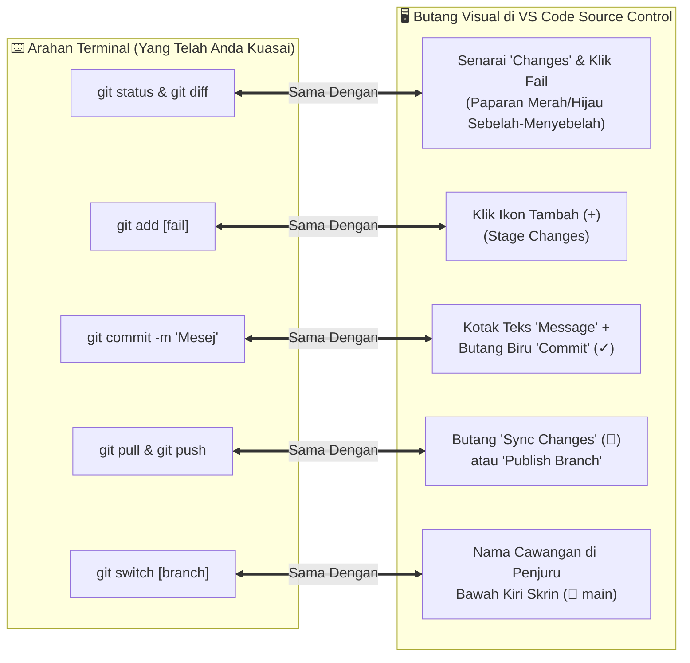
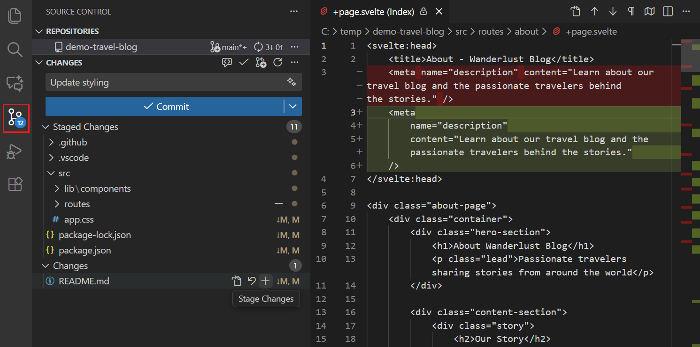
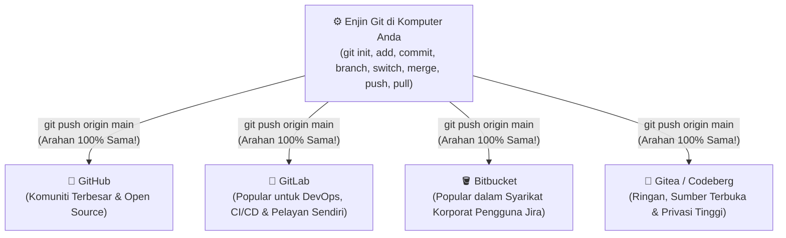

# Bab 7: Perisian GUI & Alternatif Industri — VS Code, GitHub Desktop & GitLab

**Kemajuan Projek Portfolio Anda: [90%]** `██████████████████░░`

### 🎯 Objektif Pembelajaran
Pada akhir bab ini, anda akan dapat:
1. Memahami mengapa jurutera perisian mempelajari **Terminal (CLI)** terlebih dahulu sebelum menggunakan perisian **Antara Muka Grafik (GUI)** untuk mempercepatkan kerja harian.
2. Mengurus perubahan Git secara visual menggunakan **VS Code Source Control Panel** dan memetakan setiap butang grafik kepada arahan terminal yang telah anda kuasai (`git add`, `git commit`, `git push`, `git pull`, `git switch`).
3. Mengenali fungsi utama **GitHub Desktop** untuk melihat graf sejarah cawangan, membandingkan perubahan kod secara sebelah-menyebelah (*side-by-side diff*), dan menyelesaikan percanggahan kod secara visual.
4. Membandingkan ekosistem platform Git di dalam industri (**GitHub vs GitLab vs Bitbucket vs Gitea / Codeberg**) serta menyedari bahawa kesemuanya menggunakan enjin arahan Git yang sama di sebaliknya.

---

## 1. Bayangkan Begini... Belajar Memandu Kereta Manual Sebelum Kereta Automatik

Sepanjang Bab 1 hingga Bab 6, anda telah menaip setiap arahan Git secara manual di dalam skrin hitam terminal. Mungkin terlintas di fikiran anda: *"Adakah jurutera perisian di syarikat teknologi benar-benar menaip semua arahan ini satu demi satu setiap minit, atau adakah wujud butang visual yang lebih pantas?"*

Jawapannya: **Kedua-duanya digunakan serentak!**

**Bayangkan begini...** Mempelajari Git melalui Terminal (**Command Line Interface / CLI**) adalah seperti **belajar memandu menggunakan kereta bertransmisi manual**.
- Semasa belajar kereta manual, anda merasai sendiri bila gear perlu ditukar, bagaimana klac (*clutch*) berfungsi, dan mengapa enjin mati jika anda tersilap langkah.
- Selepas anda faham mekanisme enjin dan gear tersebut, anda boleh memandu **kereta automatik (Perisian GUI seperti VS Code atau GitHub Desktop)** pada bila-bila masa dengan sangat lancar!
- Malah, apabila kereta automatik tersebut menghadapi masalah di tengah jalan (contohnya ralat cawangan atau *Merge Conflict* yang pelik), anda langsung tidak panik kerana anda faham apa yang berlaku di bawah bonet enjin. Sebaliknya, pemula yang terus menghafal butang GUI tanpa memahami konsep `Staging Area`, `Commit`, dan `Remote` sering buntu apabila butang di skrin mereka bertukar kelabu atau memaparkan ralat.

Dalam kerja harian seorang pembangun perisian:
1. **Perisian GUI (VS Code / GitHub Desktop)** digunakan untuk menyemak perbezaan kod baris demi baris (*visual diff*), memilih fail secara pantas dengan satu klik, dan melihat rajah pokok cawangan (*branch graph*).
2. **Terminal (CLI)** pula digunakan apabila bekerja di dalam pelayan awan (*cloud server* melalui SSH yang tidak mempunyai skrin grafik), menjalankan skrip automasi, atau melakukan operasi lanjutan yang tepat.

---

## 2. Menguasai *VS Code Source Control Panel* (Pemetaan Butang ke Arahan CLI)

Berita baik untuk anda: anda tidak perlu memasang sebarang perisian tambahan untuk menggunakan GUI Git kerana **Visual Studio Code (VS Code)** sudah pun mempunyai panel kawalan Git terbina dalam!

Apabila anda menekan ikon **Source Control** di bar sisi kiri VS Code (ikon bercabang tiga seperti nod Git, atau tekan kekunci pintas `Ctrl + Shift + G`), setiap butang yang anda lihat sebenarnya menjalankan arahan terminal yang telah anda pelajari:





### Jadual Pemetaan Lengkap: Terminal vs VS Code GUI

| Apa Yang Anda Mahu Lakukan | Arahan di Terminal (CLI) | Tindakan di VS Code (GUI) |
| :--- | :--- | :--- |
| **Semak fail yang berubah** | `git status` | Buka tab **Source Control (`Ctrl + Shift + G`)** dan lihat senarai di bawah tajuk **Changes**. |
| **Lihat baris mana yang ditambah/dipadam** | `git diff` | Klik pada nama fail di dalam senarai **Changes**. VS Code akan membuka paparan sebelah-menyebelah (Merah = dipadam, Hijau = ditambah). |
| **Masukkan fail ke *Staging Area*** | `git add <nama-fail>` | Halakan tetikus pada nama fail di bawah *Changes*, kemudian klik ikon **`+` (Stage Changes)**. Fail akan berpindah ke bahagian **Staged Changes**. |
| **Keluarkan fail dari *Staging Area*** | `git restore --staged <fail>` | Klik ikon **`-` (Unstage Changes)** pada fail di bawah bahagian *Staged Changes*. |
| **Buang perubahan & patah balik** | `git restore <nama-fail>` | Klik ikon **Anak Panah Melengkung `↩` (Discard Changes)** pada fail di bawah bahagian *Changes*. |
| **Simpan *Checkpoint* (*Commit*)** | `git commit -m "Mesej..."` | Taipkan mesej di dalam kotak teks **Message** di bahagian atas, kemudian klik butang biru **✓ Commit**. |
| **Muat naik & segerakkan ke GitHub** | `git pull` diikuti `git push` | Klik butang biru **🔄 Sync Changes** (atau klik menu tiga titik `...` -> **Push** / **Pull**). |
| **Tukar atau cipta *Branch* baharu** | `git switch` / `git switch -c` | Klik pada nama cawangan semasa (contohnya `main`) di **penjuru paling bawah kiri** tetingkap VS Code, kemudian pilih **+ Create new branch...** di bahagian atas skrin. |

---

## 3. Mengenali *GitHub Desktop* — Papan Pemuka Visual Khas

Selain VS Code, ramai pelajar dan pereka web gemar menggunakan aplikasi rasmi percuma daripada GitHub iaitu **[GitHub Desktop](https://desktop.github.com/)**.

Jika VS Code memfokuskan kepada penulisan kod, **GitHub Desktop** pula berfungsi sebagai papan pemuka khas untuk menguruskan repositori anda secara visual:

1. **📊 Graf Sejarah Visual (*History Tab*):**
   Anda boleh mengklik pada mana-mana `commit` terdahulu di dalam senarai sejarah dan terus melihat semua fail serta baris kod yang berubah pada detik tersebut tanpa perlu menaip ID `commit`.
2. **📥 *Clone* Repositori dengan Satu Klik:**
   Daripada menyalin URL HTTPS, anda hanya perlu memilih nama repositori anda daripada senarai akaun di dalam GitHub Desktop dan klik butang **Clone**.
3. **🔀 Perbandingan Cawangan (*Branch Comparison*):**
   Sebelum menggabungkan kod, anda boleh membandingkan cawangan semasa anda dengan `main` secara visual untuk melihat berapa banyak `commit` yang berada di hadapan (*ahead*) atau di belakang (*behind*).
4. **🤝 Penyelesaian *Merge Conflict* Berpandu:**
   Apabila berlaku percanggahan kod, GitHub Desktop memaparkan kotak amaran yang jelas berserta pautan terus untuk membuka fail yang bercanggah di dalam VS Code, dan mengaktifkan semula butang *Continue Merge* sebaik sahaja semua tanda `<<<<<<<` selesai dibersihkan.

---

## 4. Melangkaui GitHub — Perbandingan Platform Industri (GitLab, Bitbucket & Gitea)

Semasa di universiti, hampir 95% tugasan dan portfolio anda akan dihoskan di **GitHub**. Namun, apabila anda memulakan latihan industri (*internship*) atau bekerja sebagai *Junior Developer* kelak, jangan terkejut jika syarikat tempat anda bekerja berkata: *"Di syarikat ini, kami menyimpan kod di dalam **GitLab** (atau **Bitbucket**)."*

Adakah anda perlu belajar semula daripada kosong? **Langsung tidak!**

Ingat kembali prinsip asas daripada Bab 1: **Git ialah enjin kawalan versi di dalam komputer anda, manakala GitHub hanyalah salah satu laman web pengehosan awan.** Sama ada syarikat anda menggunakan GitHub, GitLab, Bitbucket, atau Gitea, arahan yang anda taip di dalam terminal (`git clone`, `git add`, `git commit`, `git push`, `git pull`, `git switch`, `git merge`) adalah **100% sama tanpa sebarang perubahan!**



### Jadual Perbandingan Jujur: GitHub vs GitLab vs Bitbucket vs Gitea / Codeberg

| Ciri & Kriteria | 🐙 GitHub | 🦊 GitLab | 🪣 Bitbucket | 🍵 Gitea / Codeberg |
| :--- | :--- | :--- | :--- | :--- |
| **Pemilik / Latar Belakang** | Microsoft | GitLab Inc. | Atlassian (Pembuat Jira & Trello) | Komuniti Sumber Terbuka |
| **Siapa Pengguna Utamanya?** | Pelajar, komuniti sumber terbuka (*Open Source*), syarikat pemula (*startups*), dan gergasi teknologi. | Syarikat kejuruteraan, bank, dan agensi yang mahukan sistem automasi (CI/CD) terbina dalam atau mahu menghoskan pelayan sendiri (*self-hosted*). | Syarikat korporat besar yang sudah menggunakan ekosistem Atlassian (**Jira** untuk pengurusan tiket & **Confluence** untuk dokumentasi). | Pembangun bebas, kelab universiti, atau organisasi yang mahukan pelayan Git peribadi yang sangat ringan. |
| **Istilah untuk *Pull Request*** | **Pull Request (PR)** | **Merge Request (MR)** *(Fungsinya 100% sama dengan PR!)* | **Pull Request (PR)** | **Pull Request (PR)** |
| **Kelebihan Utama** | Ekosistem terbesar di dunia, berfungsi sebagai **resume/portfolio rasmi pembangun**, mempunyai GitHub Pages & Student Developer Pack. | Sistem **GitLab CI/CD** yang sangat mantap dan boleh dipasang terus di dalam pelayan dalaman syarikat (*On-Premise*) demi keselamatan data. | Integrasi paling rapat dengan **Jira** (anda boleh melihat status cabang dan kod terus daripada kad tugasan Jira). | Sangat pantas, menggunakan memori (RAM) pelayan yang amat kecil, dan 100% bebas daripada kawalan syarikat gergasi. |

> **💡 Tip Temu Duga Latihan Industri (*Internship*):**
> Jika penemu duga bertanya: *"Kami menggunakan GitLab di sini, tetapi di resume anda tertulis GitHub. Adakah anda tahu menggunakan GitLab?"*
> Jawab dengan yakin: *"Ya! Saya faham bahawa GitLab dan GitHub kedua-duanya menggunakan sistem kawalan versi Git yang sama di sebaliknya. Semua aliran kerja cawangan (`branch`), `commit`, `push`, dan semakan kod melalui Merge Request (MR) di GitLab berfungsi sama seperti Pull Request (PR) yang saya amalkan di GitHub."* Jawapan ini pasti membuatkan penemu duga tersenyum!

---

## 🧪 Latihan Amali Bab 7: Mengemas Kini Portfolio Menggunakan VS Code GUI

Mari kita rasai sendiri kepantasan menguruskan perubahan kod menggunakan panel grafik **VS Code Source Control** untuk menambah sentuhan kemasan terakhir pada fail gaya (`style.css`) portfolio anda sebelum ia dilancarkan ke internet dalam Bab 8!

### Langkah 1: Lakukan Perubahan Kecil pada `style.css` dan Semak *Visual Diff*

1. Buka folder **`portfolio-saya`** anda di dalam **VS Code**.
2. Buka fail **`style.css`**, tatal ke bahagian paling bawah fail tersebut, dan tambahkan kesan animasi lembut apabila tetikus menyentuh kad kemahiran (`.skill-item`):

```css
/* Tambahan Bab 7: Kesan sentuhan (hover) pada lencana kemahiran */
.skill-item {
    transition: transform 0.2s ease, box-shadow 0.2s ease;
}

.skill-item:hover {
    transform: translateY(-2px);
    box-shadow: 0 4px 12px rgba(37, 99, 235, 0.12);
}
```

3. Tekan **Save (`Ctrl + S`)**.
4. Sekarang, lihat ikon **Source Control** di bar sisi kiri VS Code—anda akan melihat lencana nombor **`1`** berwarna biru. Klik ikon tersebut (atau tekan `Ctrl + Shift + G`).
5. Di bawah senarai **Changes**, klik sekali pada nama fail **`style.css`**.

**Apa yang berlaku di skrin anda:**
VS Code membuka tetingkap perbandingan sebelah-menyebelah (**Working Tree**): bahagian kiri ialah kod asal sebelum disunting, manakala bahagian kanan memaparkan kotak berwarna **hijau** pada baris kod baharu yang baru sahaja anda tambahkan!

**Jadi kenapa?**
Anda baru sahaja menjalankan fungsi `git status` dan `git diff` secara visual! Sebelum membuat `commit`, pembangun berpengalaman sentiasa mengklik fail di sini untuk menyemak sama ada terdapat kod ujian (seperti `console.log`) yang terlupa dipadam.

---

### Langkah 2: *Stage*, *Commit*, dan *Sync* Menggunakan Butang Visual

Tanpa membuka terminal, mari kita lengkapkan kitaran `add` -> `commit` -> `push` terus daripada panel kiri VS Code:

1. **Stage (`git add style.css`):**
   - Halakan tetikus pada baris fail `style.css` di bawah tajuk **Changes**, dan klik ikon **`+` (Stage Changes)**.
   - Perhatikan fail `style.css` kini berpindah naik ke bahagian **Staged Changes**.
2. **Commit (`git commit -m "..."`):**
   - Klik di dalam kotak teks **Message** di bahagian atas panel Source Control, dan taipkan:
     ```text
     Tambah kesan animasi hover pada lencana kemahiran di style.css
     ```
   - Klik butang biru **✓ Commit**.
3. **Sync (`git pull` & `git push`):**
   - Selepas menekan *Commit*, butang biru tadi akan bertukar menjadi **🔄 Sync Changes (1 ↑)**. Angka `1 ↑` bermaksud terdapat 1 `commit` di komputer anda yang sedia untuk dimuat naik ke GitHub.
   - Klik butang **🔄 Sync Changes** (jika muncul kotak pengesahan, klik **OK**).

---

### Langkah 3: Sahkan Hasilnya Menggunakan Terminal

Buka terminal terbina dalam VS Code (`` Ctrl + ` ``) dan jalankan arahan semakan sejarah:

```bash
git status
git log --oneline -n 3
```

**Jangkaan Output di Terminal:**
```text
On branch main
Your branch is up to date with 'origin/main'.

nothing to commit, working tree clean
---
a1b2c3d (HEAD -> main, origin/main) Tambah kesan animasi hover pada lencana kemahiran di style.css
3c4d5e6 Selesaikan merge conflict pada bahagian footer index.html
4d5e6f7 Merge pull request #2 from USERNAME-ANDA/tambah-projek
```

**Jadi kenapa?**
Perhatikan bahawa `commit` yang anda lakukan melalui butang visual VS Code tadi direkodkan dengan sempurna di dalam sejarah `git log` dan telah pun disegerakkan ke `origin/main` di GitHub! Ini membuktikan bahawa GUI dan Terminal hanyalah dua cara berbeza untuk mengawal enjin Git yang sama.

---

## ⚠️ Kesilapan Lazim Pemula — Jangan Panik!

> **Situasi 1: Saya terus menekan butang biru *Commit* di VS Code tanpa menekan ikon `+` (*Stage*) dahulu, lalu keluar kotak mesej *"There are no staged changes to commit. Would you like to stage all your changes and commit them directly?"***
> **Mengapa ia berlaku:** Anda cuba melakukan `git commit` sedangkan *Staging Area* anda masih kosong.
> **Cara selesaikan:** Jangan terus menekan *Always*! Sebaiknya klik **Cancel**, semak fail anda satu demi satu di bawah senarai *Changes*, dan klik ikon **`+`** secara manual pada fail yang betul-betul ingin disimpan sahaja. Tabiat memilih fail dengan teliti menghalang anda daripada terbuat `commit` fail sampah secara tidak sengaja.

> **Situasi 2: Saya tertekan ikon anak panah melengkung `↩` (*Discard Changes*) pada fail yang belum pernah di-*commit*, dan semua kod yang baru saya taip hilang!**
> **Mengapa ia berlaku:** Butang *Discard Changes* menjalankan arahan `git restore <fail>`, yang membuang semua suntingan baharu dan mengembalikan fail kepada keadaan `commit` terakhir.
> **Cara selesaikan:** Jika fail tersebut masih terbuka di dalam tab editor VS Code, klik di dalam kod tersebut dengan segera dan tekan **`Ctrl + Z` (Undo)** berkali-kali! Atau gunakan ciri **Timeline** (di bahagian bawah panel Explorer kiri VS Code) yang menyimpan sejarah tempatan (*Local History*) setiap kali anda menekan `Ctrl + S`.

> **Situasi 3: Butang *Sync Changes* di VS Code berpusing tanpa henti atau memaparkan ralat pengesahan!**
> **Mengapa ia berlaku:** Kadangkala GUI tidak memaparkan mesej ralat penuh apabila sambungan internet terputus atau sesi log masuk tamat tempoh.
> **Cara selesaikan:** Inilah kelebihannya kerana anda telah belajar Terminal! Buka terminal (`` Ctrl + ` ``) dan taip **`git push`** atau **`git status`**. Terminal akan terus memaparkan mesej ralat sebenar secara terperinci (dan jika sesi tamat, anda hanya perlu menjalankan `gh auth login`).

---

## Cabaran Semakan Kendiri (Bab 7)

Uji kefahaman anda sebelum kita melancarkan laman portfolio ke internet pada bab seterusnya:

1. Apakah arahan terminal Git yang dijalankan di sebalik tabir apabila anda menekan ikon **`+` (Stage Changes)** pada sesuatu fail di dalam panel VS Code Source Control?
2. Mengapakah butang biru di VS Code dinamakan **Sync Changes** dan bukannya sekadar *Push*? Apakah dua arahan Git yang digabungkan oleh butang tersebut?
3. Jika sebuah syarikat tempat anda memohon latihan industri (*internship*) menggunakan **GitLab** dan meminta anda menghantar **Merge Request (MR)**, apakah istilah yang setara dengannya di dalam **GitHub**?

<details>
<summary><strong>Klik di sini untuk menyemak jawapan anda</strong></summary>

1. Menekan ikon **`+` (Stage Changes)** pada fail adalah sama dengan menjalankan arahan **`git add <nama-fail>`** di terminal untuk memasukkan fail tersebut ke dalam *Staging Area*.
2. Butang **Sync Changes** menyegerakkan kod dua hala: ia menjalankan **`git pull`** terlebih dahulu (untuk menarik sebarang kemas kini daripada GitHub) diikuti dengan **`git push`** (untuk memuat naik `commit` terbaharu anda ke GitHub).
3. Istilah **Merge Request (MR)** di dalam GitLab adalah 100% setara dengan **Pull Request (PR)** di dalam GitHub dan Bitbucket.

</details>

---

## Navigasi Bab

- ⬅️ **Kembali ke Bab Sebelumnya:** [Bab 6: *Branching*, *Merge* dan *Pull Request* — Rahsia Kolaborasi Pasukan](./bab-06-branching-dan-pull-request.md)
- 🏠 **Kembali ke Halaman Utama:** [README Kursus Git & GitHub](./README.md)
- ➡️ **Teruskan ke Bab Seterusnya:** [Bab 8: Projek Akhir — Lancarkan Laman Web Portfolio Anda dengan GitHub Pages!](./bab-08-projek-akhir-github-pages.md)
