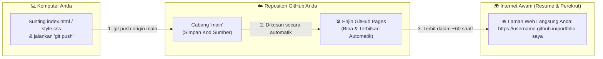
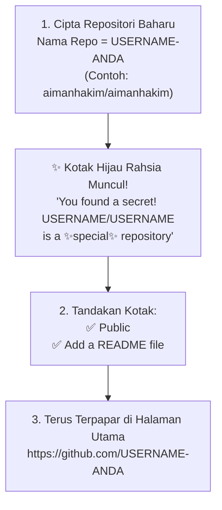

# Bab 8: Projek Akhir — Lancarkan Laman Web Portfolio Anda dengan GitHub Pages!

**Kemajuan Projek Portfolio Anda: [100% — SIAP! 🎉]** `████████████████████`

### 🎯 Objektif Pembelajaran
Pada akhir bab kemuncak ini, anda akan dapat:
1. Memahami konsep pengehosan web statik (**GitHub Pages**) dan menerbitkan repositori `portfolio-saya` anda menjadi laman web langsung di internet secara percuma (`https://username.github.io/portfolio-saya/` atau `https://username.github.io/`).
2. Mengaktifkan **Repositori Istimewa Rahsia (`<username>/<username>`)** untuk mereka bentuk halaman pengenalan peribadi (**GitHub Profile README**) yang memukau perekrut dan penemu duga latihan industri.
3. Mencuba aktiviti kolaborasi rakan sekelas secara langsung dengan menambah ahli pasukan (**Collaborators**) dan menyemak *Pull Request* antara satu sama lain.
4. Mengabadikan pautan portfolio langsung anda di dalam **Dinding Kenangan ([`SENARAI-PELAJAR.md`](./SENARAI-PELAJAR.md))** serta berkongsi pencapaian anda bersama komuniti pembangun!

---

## 1. Bayangkan Begini... Daripada Buku Skrap di Dalam Bilik kepada Galeri Pameran Awam

Sepanjang Bab 3 hingga Bab 7, anda telah membina, mengemas kini, dan menyandarkan fail `index.html` serta `style.css` ke dalam repositori GitHub anda. Namun setakat ini, sesiapa yang melawat repositori anda di GitHub hanya melihat **baris-baris kod mentah HTML dan CSS**—mereka belum dapat melihat rupa sebenar laman web portfolio anda melainkan mereka memuat turun fail tersebut ke komputer mereka.

**Bayangkan begini...**
- Menyimpan fail HTML di dalam repositori biasa adalah seperti **menyimpan pelan seni bina dan resipi masakan di dalam fail plastik**. Hanya rakan pengaturcara yang rajin membuka fail kod tersebut sahaja yang tahu apa yang anda bina.
- Mengaktifkan **GitHub Pages** pula adalah seperti **membuka sebuah galeri pameran awam 24 jam secara percuma di internet**! Setiap kali anda melakukan `git push` pada kod `index.html` atau `style.css`, pelayan GitHub secara automatik membina dan memaparkan laman web sebenar yang lengkap dengan warna, butang, dan tipografi pada satu pautan URL rasmi (`github.io`) yang boleh dibuka melalui telefon pintar atau komputer oleh sesiapa sahaja di seluruh dunia—termasuk bakal majikan dan penemu duga latihan industri (*internship*) anda!

### Aliran Automatik *Git Push* -> *GitHub Pages* -> Laman Web Langsung



---

## 🧪 Latihan Amali Kemuncak 1: Menerbitkan Laman Web Portfolio dengan *GitHub Pages*

Mari kita tukarkan repositori **`portfolio-saya`** anda menjadi laman web langsung di internet sekarang!

### Langkah 1: Pastikan Kod Terkini Sudah Berada di GitHub (`main`)

Sebelum mengaktifkan GitHub Pages, pastikan semua perubahan daripada Bab 3 hingga Bab 7 telah dimuat naik sepenuhnya:

```bash
# Di dalam terminal folder portfolio-saya:
git status
git push
```

Jika terminal memaparkan `Everything up-to-date` dan `working tree clean`, anda sudah bersedia!

---

### Langkah 2: Aktifkan *GitHub Pages* di Tetapan Repositori

1. Buka repositori **`portfolio-saya`** anda di pelayar web GitHub (`https://github.com/USERNAME-ANDA/portfolio-saya`).
2. Pastikan repositori anda berstatus **Public** *(GitHub Pages adalah percuma untuk semua repositori Public, atau repositori Private jika anda telah mengaktifkan GitHub Pro daripada Student Developer Pack di Bab 2)*.
3. Klik tab **⚙️ Settings** di bar menu paling atas halaman repositori anda.
4. Di menu bar sisi sebelah kiri (di bawah bahagian *Code and automation*), klik pada **Pages**.
5. Pada bahagian **Build and deployment**:
   - Di bawah **Source**, pastikan pilihan ditetapkan kepada **Deploy from a branch**.
   - Di bawah **Branch**, klik butang lungsur (*dropdown*) yang tertulis **`None`**, dan tukarkannya kepada **`main`**.
   - Biarkan pilihan folder di sebelahnya kekal sebagai **`/ (root)`**.
   - Klik butang **Save**.

---

### Langkah 3: Tunggu 60 Saat & Lawati Laman Web Rasmi Anda! 🎉

1. Selepas anda menekan **Save**, GitHub akan mula membina laman web anda di belakang tabir.
2. Tunggu kira-kira **1 hingga 2 minit**, kemudian muat semula (*refresh* / tekan `F5`) halaman **Settings -> Pages** tersebut.
3. Anda akan melihat satu kotak pengumuman di bahagian atas berbunyi:
   > 🌐 **Your site is live at `https://USERNAME-ANDA.github.io/portfolio-saya/`**
4. Klik butang **Visit site** (atau klik terus pautan tersebut)!

**Jadi kenapa?**
Lihatlah skrin pelayar web anda sekarang—laman web portfolio peribadi yang anda sunting dari Bab 3 hingga Bab 7 kini **sudah hidup secara rasmi di internet**! Cuba hantar pautan URL tersebut ke telefon pintar anda melalui WhatsApp atau Telegram; anda boleh membukanya di mana-mana sahaja!

---

### 💡 Rahsia Pro: Mahu URL yang Lebih Pendek (`https://username.github.io`) untuk Resume?

Perhatikan bahawa kerana nama repositori kita ialah `portfolio-saya`, URL laman web anda sekarang ialah:
`https://USERNAME-ANDA.github.io/portfolio-saya/`

Tahukah anda bahawa GitHub menyediakan satu keistimewaan khas? Jika anda menamakan repositori anda **tepat-tepat mengikut nama pengguna (*username*) GitHub anda ditambah `.github.io`**, GitHub akan membuang nama folder di belakang dan memberikan anda alamat domain utama yang sangat bersih:
👉 **`https://USERNAME-ANDA.github.io/`**

**Cara menukarnya pada bila-bila masa (Pilihan):**
1. Pergi ke **⚙️ Settings** -> **General** (tab paling atas di sebelah kiri) di dalam repositori `portfolio-saya` anda.
2. Di bawah kotak **Repository name**, tukarkan `portfolio-saya` kepada **`USERNAME-ANDA.github.io`** *(Gantikan `USERNAME-ANDA` dengan username sebenar anda, contohnya `aimanhakim.github.io`)*.
3. Klik **Rename**. Dalam masa seminit, laman web anda akan terus boleh diakses di `https://USERNAME-ANDA.github.io/`!

---

## 🧪 Latihan Amali Kemuncak 2: Membina *GitHub Profile README* (Repositori Rahsia `<username>/<username>`)

Pernahkah anda melawat profil GitHub seorang pembangun senior dan melihat halaman profil mereka memaparkan sepanduk ucapan selamat datang, senarai kemahiran bergambar, pautan portfolio, dan statistik koding—sedangkan profil GitHub biasa hanya memaparkan kotak-kotak kosong?

Ciri ini dipanggil **GitHub Profile README**, dan ia diaktifkan menggunakan satu **"Easter Egg" (Ciri Rahsia)** di GitHub: iaitu dengan mencipta sebuah repositori baharu yang mempunyai **nama yang 100% sama dengan *username* GitHub anda**!



### Langkah Demi Langkah Membina *Profile README* Anda:

1. Di penjuru kanan atas mana-mana halaman GitHub, klik ikon **`+`** dan pilih **New repository**.
2. Pada ruangan **Repository name**, taipkan **username GitHub anda sendiri dengan tepat** (contohnya, jika username anda ialah `farahnabilah`, taipkan `farahnabilah`).
3. Sebaik sahaja anda menaipnya, satu kotak mesej istimewa akan muncul:
   > 🎉 ***username/username* is a ✨special✨ repository that you can use to add a `README.md` to your GitHub profile. Make sure it’s public and initialize it with a README to get started.**
4. Pastikan anda menandakan dua pilihan ini:
   - Pilih **Public**.
   - Tandakan kotak **✅ Add a README file**.
5. Klik butang hijau **Create repository**.
6. Klik ikon pensel (✏️ **Edit README.md**), padamkan teks asal, dan tampalkan (*paste*) templat Markdown profesional di bawah (ubah suai mengikut maklumat anda):

```markdown
# Hai, saya [Nama Penuh Anda]! 👋

🎓 **Pelajar [Nama Kursus, cth: Kejuruteraan Perisian] di [Nama Universiti/Kolej Anda]**
💻 Sedang mendalami pembangunan web, kawalan versi Git, dan kolaborasi sumber terbuka.

---

### 🚀 Laman Web Portfolio Rasmi Saya
👉 **Lawati portfolio langsung saya di sini:** [**https://USERNAME-ANDA.github.io/portfolio-saya/**](https://USERNAME-ANDA.github.io/portfolio-saya/)

---

### 🛠️ Teknologi & Alatan yang Saya Gunakan
- **Bahasa & Web:** HTML5, CSS3, JavaScript, Python
- **Kawalan Versi & Alatan:** Git, GitHub, GitHub Pages, VS Code, Terminal CLI

---

### 🌱 Apa yang Sedang Saya Pelajari Sekarang
- Menguasai aliran kerja `branch`, `merge`, dan *Pull Request* untuk projek berpasukan.
- Membina projek portfolio untuk persediaan latihan industri (*internship*).

---

### 📫 Hubungi Saya
- 💼 **LinkedIn:** [linkedin.com/in/username-anda](https://linkedin.com/)
- 📧 **E-mel:** [emel.anda@universiti.edu.my](mailto:emel.anda@universiti.edu.my)
```

7. Klik butang hijau **Commit changes...** $\rightarrow$ **Commit changes**.
8. Sekarang, klik pada gambar profil anda di penjuru kanan atas dan pilih **Your profile** (`https://github.com/USERNAME-ANDA`).

**Jadi kenapa?**
Halaman profil GitHub anda kini kelihatan seperti profil seorang jurutera perisian profesional—dan yang paling penting, sesiapa sahaja yang melawat profil GitHub anda boleh terus mengklik pautan ke laman web portfolio GitHub Pages anda!

---

## 🤝 Aktiviti Bonus Berpasangan (15 Minit): *Collaborator & Peer Code Review*

Jika anda mengikuti kursus ini bersama rakan sekelas, rakan sebilik, atau di dalam bengkel kelab komputer universiti, luangkan masa 15 minit untuk mencuba simulasi kerja berpasukan tanpa menggunakan *Fork*:

1. **Lantik Rakan Sebagai *Collaborator*:**
   - Buka repositori `portfolio-saya` anda $\rightarrow$ **⚙️ Settings** $\rightarrow$ **Collaborators** (di menu kiri) $\rightarrow$ klik **Add people**.
   - Masukkan *username* GitHub rakan anda dan hantar jemputan.
2. **Rakan Anda Mencipta *Branch* & Menambah Testimoni:**
   - Selepas menerima jemputan, rakan anda boleh melakukan `git clone` repositori anda, mencipta cabang `git switch -c tambah-ucapan-rakan`, menambah satu komen pujian atau ucapan semangat di dalam `index.html`, dan melakukan `git push -u origin tambah-ucapan-rakan`.
3. **Semak & Luluskan *Pull Request* (*Code Review*):**
   - Rakan anda membuka *Pull Request* di repositori anda.
   - Anda membuka tab **Pull requests** $\rightarrow$ klik tab **Files changed** $\rightarrow$ klik butang hijau **Review changes** $\rightarrow$ pilih **Approve** $\rightarrow$ dan klik **Merge pull request**!

---

## 🎉 Tahniah! Anda Telah Menamatkan Projek Portfolio (100% Siap!)

Berhenti sejenak dan berikan tepukan gemuruh kepada diri anda sendiri! 👏🎓

Imbas kembali di mana anda bermula pada Bab 1 dahulu: mungkin anda pernah menyimpan fail dengan nama `tugasan_final_betul_betul_v3.zip`, atau berasa gerun melihat skrin hitam terminal. Hari ini, anda telah:
- ✅ Memasang dan mengkonfigurasi Git serta log masuk menggunakan `gh auth login`.
- ✅ Menguasai kitaran `add`, `commit`, `status`, `log`, dan `.gitignore`.
- ✅ Menyandarkan kod ke awan dengan `push`, `clone`, `fetch`, dan `pull`.
- ✅ Mencipta cawangan (`branch`), menyelesaikan *Merge Conflict* tanpa panik, dan menghantar *Pull Request*.
- ✅ Melancarkan laman web portfolio peribadi anda ke internet menggunakan **GitHub Pages**!

---

## 🌟 3 Langkah Terakhir Anda Sebelum Melangkah ke Bab Bonus

Jangan simpan kejayaan ini seorang diri! Lengkapkan 3 langkah komuniti ini sebagai tanda tamat pengajian anda:

### 1. ⭐ Klik "Star" pada Repositori Kursus Ini (Jika Membantu Anda!)
Adakah panduan Bahasa Melayu yang percuma ini telah membantu anda memahami Git, GitHub, dan menerbitkan laman web portfolio anda?
- Sila tatal ke bahagian paling atas halaman repositori utama kursus ini dan pastikan anda telah menekan butang **⭐ Star** di penjuru kanan atas!
- Setiap ⭐ Star daripada anda adalah tanda penghargaan terbesar buat kami dan membantu algoritma GitHub memaparkan kursus percuma ini kepada ribuan lagi pelajar universiti dan pembangun baharu di seluruh Malaysia.

### 2. 🏆 Kemas Kini Pautan Portfolio Langsung Anda di `SENARAI-PELAJAR.md`
Jika pada Bab 6 tadi anda telah menghantar *Pull Request* ke dalam **[`SENARAI-PELAJAR.md`](./SENARAI-PELAJAR.md)** (atau jika anda belum sempat menghantarnya), kini anda sudah mempunyai pautan laman web sebenar (`https://USERNAME-ANDA.github.io/portfolio-saya/`)!
- Kemas kini baris nama anda di dalam **[`SENARAI-PELAJAR.md`](./SENARAI-PELAJAR.md)** supaya menyertakan pautan `[Portfolio](https://USERNAME-ANDA.github.io/portfolio-saya/)` anda yang sudah aktif, dan kongsikan juga di ruangan **GitHub Discussions (`🚀 Pameran Portfolio`)**!

### 3. 📲 Kongsikan Kejayaan Anda di **Threads**! (Templat Sedia Salin)
Komuniti pembangun teknologi Malaysia di **Threads** sangat aktif dan suka menyokong pelajar yang berkongsi perkembangan pembelajaran (*build in public*). Ambil tangkapan skrin (*screenshot*) laman web portfolio anda yang sudah terbit, dan kongsikan di **Threads** menggunakan templat di bawah:

```text
Alhamdulillah, akhirnya berjaya faham cara guna Git & GitHub tanpa pening kepala! 🎉💻

Daripada takut tengok skrin hitam terminal dan Merge Conflict, hari ini saya dah berjaya:
✅ Urus kod guna Git CLI & VS Code
✅ Hantar Pull Request (PR) pertama
✅ Lancarkan laman web portfolio sendiri guna GitHub Pages secara percuma! 🚀

Cuba tengok hasil laman portfolio saya di sini:
👉 https://USERNAME-ANDA.github.io/portfolio-saya/

Siapa yang nak belajar Git & GitHub dari kosong dalam Bahasa Melayu (siap ada panduan tuntut GitHub Student Pack percuma), boleh rujuk repo percuma ni — jangan lupa bagi ⭐ Star sekali! 🙌
👉 Pautan Panduan Percuma: https://github.com/[USERNAME-PENCIPTA]/kursus-git-github
```

---

## ⚠️ Kesilapan Lazim Pemula — Jangan Panik!

> **Situasi 1: Saya sudah menekan *Save* di GitHub Pages, tetapi apabila saya membuka pautan URL tersebut, keluar ralat `404 There isn't a GitHub Pages site here`!**
> **Mengapa ia berlaku:** Dua punca utama: (1) Pelayan GitHub masih sedang memproses laman anda (ia mengambil masa 1 hingga 2 minit pada kali pertama), atau (2) Fail utama laman web anda tidak dinamakan sebagai `index.html` dengan huruf kecil sepenuhnya (contohnya dinamakan `Index.html` atau berada di dalam subfolder lain).
> **Cara selesaikan:** Pastikan fail `index.html` berada terus di dalam folder utama (*root*) repositori anda, tunggu 2 minit, dan tekan `Ctrl + Shift + R` (*Hard Refresh*) pada pelayar web anda.

> **Situasi 2: Laman web saya sudah keluar di GitHub Pages, tetapi tiada warna atau gaya reka bentuk langsung (hanya teks hitam putih seperti dokumen lama)!**
> **Mengapa ia berlaku:** Pautan ke fail `style.css` di dalam `<head>` fail `index.html` anda mungkin tersilap ejaan atau menggunakan huruf besar/kecil yang berbeza (pelayan Linux di GitHub Pages sangat sensitif huruf besar/kecil: `Style.css` tidak sama dengan `style.css`).
> **Cara selesaikan:** Semak baris `<link rel="stylesheet" href="style.css">` di dalam `index.html` dan pastikan nama fail CSS anda dieja `style.css` dengan huruf kecil sepenuhnya.

> **Situasi 3: Saya sudah mengubah kod `index.html` dan menjalankan `git push`, tetapi laman web `github.io` saya masih memaparkan versi lama!**
> **Mengapa ia berlaku:** Pelayar web (*browser*) anda menyimpan ingatan sementara (*cache*) supaya laman web dibuka dengan pantas, ditambah pula GitHub Pages mengambil masa sekitar 30–60 saat untuk membina semula laman selepas setiap `git push`.
> **Cara selesaikan:** Tunggu 60 saat selepas `git push`, kemudian buka laman web anda dan tekan **`Ctrl + F5`** (atau **`Ctrl + Shift + R`**) untuk memaksa pelayar web memuat turun versi paling baharu.

---

## Cabaran Semakan Kendiri (Bab 8)

Uji kefahaman anda terhadap penerbitan GitHub Pages dan profil profesional:

1. Apakah nama fail HTML utama yang wajib wujud di dalam repositori anda supaya GitHub Pages tahu halaman mana yang perlu dipaparkan secara automatik apabila pelawat membuka URL anda?
2. Apakah nama repositori yang perlu anda cipta jika anda mahu mengaktifkan ciri rahsia **GitHub Profile README** pada halaman utama profil GitHub anda?
3. Selepas laman web portfolio anda sudah hidup di GitHub Pages, apakah yang perlu anda lakukan jika anda mahu mengemas kini teks atau menambah projek baharu pada laman web tersebut?

<details>
<summary><strong>Klik di sini untuk menyemak jawapan anda</strong></summary>

1. Fail tersebut wajib dinamakan **`index.html`** (dengan huruf kecil sepenuhnya).
2. Anda perlu mencipta repositori awam (*Public*) yang dinamakan **sama dengan *username* GitHub anda sendiri** (iaitu `<username>/<username>`), lengkap dengan fail `README.md`.
3. Anda hanya perlu menyunting fail di komputer anda seperti biasa, kemudian jalankan **`git add`**, **`git commit`**, dan **`git push`** ke cabang `main`. GitHub Pages akan mengemas kini laman web langsung anda secara automatik dalam masa sekitar 60 saat!

</details>

---

## Navigasi Bab

- ⬅️ **Kembali ke Bab Sebelumnya:** [Bab 7: Perisian GUI & Alternatif Industri — VS Code, GitHub Desktop & GitLab](./bab-07-perisian-gui-dan-alternatif.md)
- 🏠 **Kembali ke Halaman Utama:** [README Kursus Git & GitHub](./README.md)
- 🏆 **Abadikan Nama & Portfolio Anda:** [Dinding Kenangan (`SENARAI-PELAJAR.md`)](./SENARAI-PELAJAR.md)
- ➡️ **Teruskan ke Bab Bonus:** [Bab 9: Langkah Seterusnya ke Tahap *Junior Dev* — `stash`, `rebase`, & GitHub Actions](./bab-09-langkah-seterusnya-junior-dev.md)
