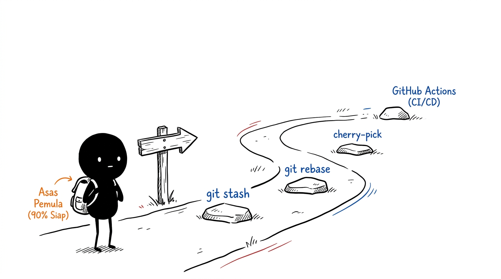
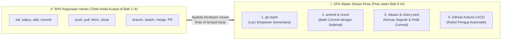

# Bab 9: Langkah Seterusnya ke Tahap *Junior Dev* — `stash`, `rebase`, & GitHub Actions

**Tahap Seterusnya: Melangkaui Sempadan Pemula (*Junior Dev Roadmap*)** `🌟 [BAB BONUS KERJAYA]`

### 🎯 Objektif Pembelajaran
Pada akhir bab bonus ini, anda akan dapat:
1. Mengetahui sempadan yang jelas antara kemahiran Git harian (yang telah anda kuasai 100%) dengan alatan Git tahap pertengahan yang digunakan oleh pasukan kejuruteraan perisian sepenuh masa.
2. Menyimpan kerja separuh jalan di dalam laci sementara menggunakan **`git stash`** dan **`git stash pop`** apabila perlu menukar cawangan secara mengejut.
3. Membezakan cara membaiki kesilapan pada *commit* terakhir menggunakan **`git commit --amend`**, **`git revert`**, dan **`git reset`** secara selamat tanpa memadamkan kerja rakan sepasukan.
4. Memahami konsep di sebalik **`git rebase`** (merapikan sejarah cawangan), **`git cherry-pick`** (memetik satu *commit* spesifik), dan **GitHub Actions (CI/CD)** (robot penguji kod automatik).




---

## 1. Tarik Nafas Lega: Garisan Sempadan Pemula vs *Junior Developer*

Sebelum anda membaca bab terakhir ini, kami mahu memberikan satu jaminan yang jujur dan menenangkan kepada anda:

> 🛡️ **Setakat Bab 8, anda sudah menguasai 90% arahan Git yang digunakan setiap hari dalam tugasan universiti dan latihan industri (*internship*). Bab ini adalah peta jalan apabila anda bersedia melangkah ke tahap *Junior Developer* sepenuh masa.**

Anda **tidak perlu** menghafal kesemua arahan di dalam Bab 9 ini sekarang! Tujuan bab ini ditulis adalah supaya apabila anda masuk ke bilik mesyuarat syarikat teknologi kelak dan terdengar jurutera senior menyebut istilah seperti *"Tolong stash dulu kerja awak"*, *"Kita cherry-pick commit itu"*, atau *"Pipeline GitHub Actions gagal"*, anda sudah faham maksud konsep tersebut dan tahu di mana mahu merujuknya semula.

### Peta Jalan Kemahiran Git Anda: Daripada Pelajar ke Industri



---

## 2. Lima Alatan Situasi Khas untuk *Junior Developer*

Mari kita kenali lima situasi dunia sebenar di tempat kerja dan alatan Git yang direka khas untuk menyelesaikannya.

---

### Alatan 1: `git stash` — Laci Simpanan Sementara Semasa Kecemasan

**Bayangkan begini...** Anda sedang kusyuk memasang *puzzle* yang rumit di atas meja belajar (sedang menyunting kod di cawangan `ciri-pembayaran`, tetapi kod tersebut masih separuh jalan dan belum boleh dijalankan). Tiba-tiba, ketua pasukan anda datang dengan cemas: *"Ada ralat kecemasan pada halaman log masuk di cawangan `main`! Tolong tukar ke `main` dan baiki sekarang juga!"*

Masalahnya:
- Anda **tidak mahu** melakukan `git commit` kerana kod di `ciri-pembayaran` masih belum siap dan bersepah.
- Tetapi Git **tidak membenarkan** anda menjalankan `git switch main` selagi ada fail yang sedang disunting belum disimpan!

Penyelesaiannya ialah **`git stash`**. Arahan ini ibarat **menolak masuk semua kepingan *puzzle* yang belum siap tadi ke dalam sebuah laci meja sementara**, supaya meja anda (`Working Directory`) kembali bersih serta-merta!

```bash
# 1. Simpan kerja separuh jalan ke dalam laci sementara (stash)
git stash

# 2. Meja kini bersih! Anda bebas bertukar ke cawangan 'main' untuk baiki isu kecemasan
git switch main
# ... (baiki isu kecemasan, commit, dan push) ...

# 3. Kembali semula ke cawangan asal anda
git switch ciri-pembayaran

# 4. Keluarkan semula kerja separuh jalan tadi dari laci ke atas meja!
git stash pop
```

**Jadi kenapa?**
Dengan `git stash` dan `git stash pop`, anda tidak perlu membuat `commit` separuh masak semata-mata untuk berpindah ke cawangan lain!

---

### Alatan 2: `git commit --amend` & `git revert` vs `git reset` — Membaiki Kesilapan *Commit*

Pernahkah anda baru sahaja menekan `Enter` pada arahan `git commit -m "Kemaskini fail"`, dan sesaat kemudian anda tersedar: *"Alamak! Saya tersalah eja mesej commit, dan saya terlupa masukkan fail `style.css` sekali!"*?

Berikut adalah 3 cara membaiki `commit` mengikut situasinya:

| Arahan | Bila Perlu Digunakan? | Analogi & Tahap Keselamatan |
| :--- | :--- | :--- |
| **`git commit --amend -m "Mesej baharu"`** | Apabila anda baru sahaja membuat `commit` di komputer (**belum `push`**) dan mahu membetulkan ejaan mesej `commit` terakhir atau menyelitkan fail yang tertinggal. | **Menukar Pelekat Label:** Menggantikan kotak `commit` paling akhir dengan kotak baharu yang telah diperbetulkan. *(Selamat selagi belum di-push).* |
| **`git revert <ID-commit>`** | Apabila anda mahu membatalkan perubahan sesuatu `commit` yang **sudah pun di-`push` ke GitHub** dan dikongsi bersama rakan sepasukan. | **Resit Pembatalan (*Refund*):** Ia tidak memadam sejarah lama; sebaliknya ia mencipta satu `commit` baharu yang membalikkan perubahan salah tadi. *(100% Paling Selamat untuk kerja berkumpulan!).* |
| **`git reset --soft HEAD~1`** | Apabila anda mahu membuka semula bungkusan `commit` terakhir di komputer (**belum `push`**) dan mengembalikan fail tersebut ke *Staging Area*. | **Membuka Semula Kotak:** Sejarah `commit` terakhir dipadamkan daripada log, tetapi kod yang anda taip kekal selamat di dalam editor. *(⚠️ Jangan guna pada commit yang sudah di-push ke cabang kumpulan!).* |

---

### Alatan 3: `git rebase` — Merapikan Sejarah Cawangan Supaya Lurus dan Bersih

Dalam Bab 6, kita menggunakan `git merge` untuk menggabungkan cawangan. Apabila pasukan yang besar melakukan puluhan `git merge` setiap hari, graf sejarah Git boleh kelihatan berselirat seperti mi segera kerana penuh dengan simpang *Merge commit*.

Sesetengah syarikat teknologi mengamalkan **`git rebase`** sebagai alternatif untuk mencantikkan sejarah:

**Bayangkan begini...** Anda sedang menulis Bab 2 sebuah novel di atas kertas draf sejak hari Isnin. Sementara itu, rakan anda telah menambah Bab 1 yang baharu ke dalam buku utama (`main`) pada hari Rabu.
- Apabila anda menjalankan **`git rebase main`** di dalam cawangan anda, Git akan **mengangkat cawangan kerja anda dan menanamnya semula di paling hadapan `main` yang terkini**—seolah-olah anda baru sahaja memulakan kerja anda selepas kerja rakan anda siap!
- Hasilnya: Sejarah projek (`git log`) kelihatan seperti **satu garisan lurus yang sangat kemas** tanpa simpang-siur.

> **⚠️ Peraturan Penting `git rebase`:** Hanya lakukan `rebase` pada cawangan peribadi anda sendiri sebelum digabungkan. Jangan sesekali melakukan `rebase` ke atas cawangan awam seperti `main` yang sedang digunakan oleh orang lain!

---

### Alatan 4: `git cherry-pick` — Memetik Satu *Commit* Spesifik Seperti Memetik Buah Ceri

**Bayangkan begini...** Rakan sepasukan anda sedang membina cawangan besar bernama `reka-bentuk-besar` yang mengandungi 20 `commit` (dan cawangan itu belum sedia untuk digabungkan ke `main`). Namun, salah satu daripada 20 `commit` tersebut (contohnya `commit` bernombor `7f8e9a0` yang membaiki ralat butang telefon pintar) sangat diperlukan di dalam cawangan `main` hari ini juga!

Daripada menggabungkan kesemua 20 `commit` yang belum siap itu, anda boleh menggunakan **`git cherry-pick`**:

```bash
# Pastikan anda berada di cawangan yang mahu menerima commit tersebut (cth: main)
git switch main

# Petik SATU commit spesifik sahaja menggunakan ID-nya
git cherry-pick 7f8e9a0
```

**Jadi kenapa?**
`git cherry-pick` menyalin perubahan daripada satu `commit` pilihan anda sahaja dan menampalnya terus ke dalam cawangan semasa anda tanpa membawa masuk 19 `commit` lain yang belum siap!

---

### Alatan 5: *GitHub Actions (CI/CD)* — Robot Penguji Kod Automatik 24 Jam

Apabila anda melawat repositori projek sumber terbuka yang besar di GitHub, pernahkah anda melihat tanda **✅ semak hijau (*green checkmark*)** atau **❌ pangkah merah** di sebelah setiap `commit` dan *Pull Request*?

Tanda tersebut dijana oleh **GitHub Actions**—iaitu sistem **CI/CD (*Continuous Integration / Continuous Deployment*)** terbina dalam GitHub!

**Bayangkan begini...** GitHub Actions adalah seperti **seorang pembantu makmal robotik yang bekerja 24 jam sehari di dalam repositori anda**:
1. **Continuous Integration (CI — Pengujian Automatik):**
   Setiap kali seorang ahli kumpulan membuka *Pull Request*, bot GitHub Actions akan hidup secara automatik, memuat turun kod tersebut ke dalam komputer maya di awan, dan menjalankan ujian kod (*unit tests* & semakan ralat sintaks). Jika kod rakan anda mempunyai pepijat, bot tersebut akan meletakkan tanda **❌ Merah** dan menghalang butang *Merge* daripada ditekan sehingga ralat itu dibaiki oleh anda/orang lain!
2. **Continuous Deployment (CD — Penerbitan Automatik):**
   Sebenarnya, anda **sudah pun menggunakan GitHub Actions CD dalam Bab 8 tadi**! Semasa anda mengaktifkan **GitHub Pages**, robot GitHub Actions-lah yang bekerja di belakang tabir membina dan menerbitkan laman web portfolio anda ke internet setiap kali anda menjalankan `git push` ke cawangan `main`!

---

## 🧪 Latihan Amali Ringkas Bab 9: Mencuba Kuasa `git stash` dan `git commit --amend`

Mari kita cuba dua alatan paling berguna daripada senarai di atas terus di dalam folder `portfolio-saya` anda supaya anda merasai sendiri cara ia berfungsi!

### Latihan A: Menyimpan dan Mengeluarkan Kerja dengan `git stash`

1. Buka fail `index.html` di dalam folder `portfolio-saya`, dan tambahkan satu baris komen ujian di bahagian paling atas fail:
   ```html
   <!-- Ujian kerja separuh jalan untuk git stash -->
   ```
   Tekan **Save (`Ctrl + S`)**.
2. Buka terminal dan semak status semasa:
   ```bash
   git status
   ```
   *(Terminal akan memaparkan `modified: index.html`).*
3. Sekarang, bayangkan anda perlu membersihkan meja kerja anda secara mengejut. Jalankan arahan `git stash`:
   ```bash
   git stash
   git status
   ```

**Jangkaan Output di Terminal:**
```text
Saved working directory and index state WIP on main: a1b2c3d Tambah kesan animasi hover...
---
On branch main
nothing to commit, working tree clean
```
Lihat semula fail `index.html` di dalam VS Code—baris komen ujian tadi telah hilang daripada fail dan disimpan dengan selamat di dalam laci `stash`!

### Contoh B: Merapikan Sejarah dengan `git rebase`
Bayangkan anda sedang membina ciri baharu di dalam cawangan `ciri-profil`, tetapi rakan sepasukan anda baru sahaja menggabungkan kod penting ke dalam `main`. Untuk menyusun semula kerja anda supaya terletak kemas di atas versi `main` yang paling baharu:
```bash
# 1. Pastikan anda berada di dalam cawangan ciri anda
git switch ciri-profil

# 2. Susun semula commit anda di atas main yang terkini
git rebase main
```
**Jangkaan Output di Terminal:**
```text
Successfully rebased and updated refs/heads/ciri-profil.
```

### Contoh C: Memetik Satu Commit Spesifik dengan `git cherry-pick`
Bayangkan di dalam cawangan `eksperimen`, anda hanya mahu mengambil **satu** `commit` pembaikan pepijat (contohnya ID `9f8e7d6` daripada `git log --oneline`) ke dalam `main` tanpa menggabungkan keseluruhan cawangan `eksperimen`:
```bash
# 1. Pindah ke cawangan sasaran (main)
git switch main

# 2. Petik hanya commit pembaikan pepijat tersebut
git cherry-pick 9f8e7d6
```
**Jangkaan Output di Terminal:**
```text
[main 4c5d6e7] Baiki ralat paparan butang pada telefon
 Date: ...
 1 file changed, 3 insertions(+), 1 deletion(-)
```

4. Sekarang, keluarkan semula kerja tersebut daripada laci kembali ke fail anda:
   ```bash
   git stash pop
   ```

**Jangkaan Output di Terminal:**
```text
On branch main
Changes not staged for commit:
        modified:   index.html

Dropped refs/stash@{0} (5f6a7b8c9d0e1f2a3b4c5d6e7f8a9b0c1d2e3f4a)
```
Baris komen ujian anda kini muncul semula di dalam `index.html`! *(Anda boleh memadamkan baris komen ujian tersebut atau menjalankan `git restore index.html` untuk membersihkan semula fail anda).*

---

### Latihan B: Membetulkan Mesej *Commit* Terakhir dengan `git commit --amend`

Sekiranya pada masa hadapan anda tersalah taip mesej `commit` (sebelum melakukan `git push`), anda hanya perlu menjalankan satu arahan ini:

```bash
# Menyemak mesej commit paling akhir sekarang
git log --oneline -n 1

# Mengubah mesej commit paling akhir tanpa mencipta commit baharu
git commit --amend -m "Tambah kesan animasi hover pada lencana kemahiran ( dikemas kini )"

# Semak semula log
git log --oneline -n 1
```

**Jadi kenapa?**
Daripada mencipta banyak `commit` tambahan semata-mata kerana tersalah ejaan mesej, `git commit --amend` memastikan sejarah kerja anda kekal bersih dan profesional sebelum dihantar ke GitHub.

---

## ⚠️ Kesilapan Lazim Pemula — Jangan Panik!

> **Situasi 1: Saya sudah menyimpan kod di dalam `git stash` semalam, dan hari ini saya terlupa sama ada masih ada barang di dalam laci `stash` saya atau tidak!**
> **Mengapa ia berlaku:** Kerana perubahan di dalam `stash` disembunyikan daripada `git status`, mudah untuk kita terlupa tentangnya.
> **Cara selesaikan:** Jalankan arahan **`git stash list`**. Ia akan memaparkan senarai semua simpanan sementara yang ada di dalam laci anda (contohnya `stash@{0}: WIP on main...`). Jika senarai itu kosong, bermakna laci anda sudah bersih!

> **Situasi 2: Saya menjalankan `git commit --amend` pada `commit` yang SUDAH pun saya `git push` ke GitHub sebelum ini, dan sekarang `git push` saya ditolak (`rejected`)!**
> **Mengapa ia berlaku:** `git commit --amend` menukar ID `commit` yang lama kepada ID yang baharu, menyebabkan sejarah di komputer anda berbeza dengan sejarah yang sudah berada di GitHub.
> **Cara selesaikan:** Sebagai peraturan am, **elakkan menggunakan `--amend` selepas anda sudah melakukan `git push`**. Jika ia berlaku pada cawangan peribadi anda sendiri (bukan cawangan `main` kumpulan), anda boleh menggunakan `git push --force-with-lease` untuk mengemas kini cawangan peribadi tersebut dengan selamat.

> **Situasi 3: Saya terdengar rakan menyebut `git reset --hard`, patutkah saya menggunakannya?**
> **Mengapa ia berlaku:** Ramai pemula menyalin arahan `git reset --hard` daripada forum internet tanpa mengetahui bahawa perkataan `--hard` akan **memadamkan semua kerja yang belum disimpan secara kekal tanpa boleh dikembalikan (`Ctrl + Z` juga tidak berfungsi)**!
> **Cara selesaikan:** Elakkan sama sekali menggunakan `--hard` melainkan anda 100% pasti mahu membuang semua perubahan. Gunakan **`git stash`** (yang menyimpan perubahan di dalam laci) atau **`git revert`** (yang mencipta rekod pembatalan dengan selamat).

---

## Cabaran Semakan Kendiri (Bab 9)

Uji pengetahuan peta jalan *Junior Developer* anda dengan 3 soalan terakhir ini:

1. Anda sedang menyunting fail di dalam cawangan `ciri-profil`, tetapi kod anda baru siap separuh jalan. Tiba-tiba anda perlu berpindah ke cawangan `main` selama 5 minit untuk menyemak kod rakan anda. Apakah arahan Git yang membolehkan anda menyimpan kerja separuh jalan itu buat sementara waktu tanpa perlu membuat `commit`?
2. Mengapakah arahan **`git revert`** jauh lebih selamat digunakan berbanding **`git reset`** apabila anda ingin membatalkan perubahan kod yang **sudah pun dimuat naik (`push`)** ke cawangan utama pasukan di GitHub?
3. Apakah peranan utama **GitHub Actions (CI/CD)** apabila seorang pembangun menghantar *Pull Request* ke dalam repositori pasukan?

<details>
<summary><strong>Klik di sini untuk menyemak jawapan anda</strong></summary>

1. Anda boleh menjalankan **`git stash`** untuk menyimpan perubahan separuh jalan ke dalam laci sementara, bertukar ke `main`, dan kemudian menjalankan **`git stash pop`** apabila kembali ke cawangan `ciri-profil`.
2. **`git revert`** mencipta satu `commit` baharu yang membalikkan perubahan salah tersebut tanpa memadamkan rekod sejarah sedia ada, jadi ia tidak akan merosakkan sejarah repositori rakan sepasukan lain. Sebaliknya, `git reset` mengubah dan memadam sejarah `commit` yang boleh menyebabkan konflik teruk kepada ahli pasukan lain.
3. **GitHub Actions (CI/CD)** bertindak sebagai robot automatik yang menjalankan ujian kod (*automated tests*), menyemak ralat sintaks, dan membina/menerbitkan aplikasi secara automatik bagi memastikan kod di dalam *Pull Request* tersebut selamat sebelum digabungkan ke dalam `main`.

</details>

---

## Penutup: Selamat Maju Jaya, Pembangun Baharu!

Anda kini telah menamatkan kesemua **9 Bab Kursus Interaktif Git & GitHub dalam Bahasa Melayu**! 🎉

---

## Mahu Lebih Lagi? (Topik Lanjutan)

Selain alatan *Junior Dev* di atas, dunia kejuruteraan perisian sebenar masih mempunyai beberapa teknik Git yang lebih mendalam apabila anda menguruskan projek berskala besar:

- **`git reflog`** — *"Kotak hitam"* yang merekodkan hampir semua pergerakan anda supaya anda boleh menyelamatkan `commit` yang disangka sudah hilang.
- **`git bisect`** — Carian binari automatik untuk mencari `commit` mana yang mula-mula menyebabkan pepijat (*bug*) muncul.
- **`git worktree`** — Membuka beberapa `branch` berbeza dalam folder berasingan secara serentak tanpa perlu `git stash`.
- **`git tag` & *Semantic Versioning* (`v1.0.0`)** — Menanda versi rasmi pelepasan (*release*) perisian.
- ***Conventional Commits* & `git submodules`** — Piawaian mesej `commit` berstruktur dan pengurusan repositori di dalam repositori.

**Berminat untuk saya hasilkan Panduan Lanjutan (Bahagian 2)?**  
Anda boleh mengundi atau mencadangkan topik pilihan anda melalui ruang **GitHub Discussions** di repositori ini, atau tinggalkan komen pada hantaran **Threads** saya (**`@zfrnaa`**)!

---

Simpan tiga pautan penting ini sebagai teman setia sepanjang pengajian universiti, latihan industri (*internship*), dan kerjaya anda sebagai pembangun perisian:

- ⚡ **[Helaian Rujukan Pantas PDF (`cheatsheet-git-melayu.pdf`)](./cheatsheet-git-melayu.pdf) & [Versi Web (`cheatsheet-git-melayu.md`)](./cheatsheet-git-melayu.md):** Muat turun fail PDF ini ke telefon pintar anda atau buka versi web pada bila-bila masa anda memerlukan rujukan pantas arahan terminal semasa membuat tugasan atau projek tahun akhir (FYP).
- 🏆 **[Balai Kemashyuran (`SENARAI-PELAJAR.md`)](./SENARAI-PELAJAR.md):** Semak nama dan pautan portfolio anda bersama rakan-rakan graduan kursus ini di seluruh Malaysia.
- ⭐ **Jangan Lupa Klik "Star":** Pastikan anda telah menekan butang **⭐ Star** pada repositori utama kursus ini supaya ia kekal tersimpan di dalam akaun GitHub anda untuk rujukan masa hadapan!

---

## Navigasi Bab

- ⬅️ **Kembali ke Bab Sebelumnya:** [Bab 8: Projek Akhir — Lancarkan Laman Web Portfolio Anda dengan GitHub Pages!](./bab-08-projek-akhir-github-pages.md)
- ⚡ **Rujukan Harian Anda:** [Helaian Rujukan Pantas Git (`cheatsheet-git-melayu.md`)](./cheatsheet-git-melayu.md)
- 🏠 **Kembali ke Halaman Utama:** [README Kursus Git & GitHub](./README.md)
