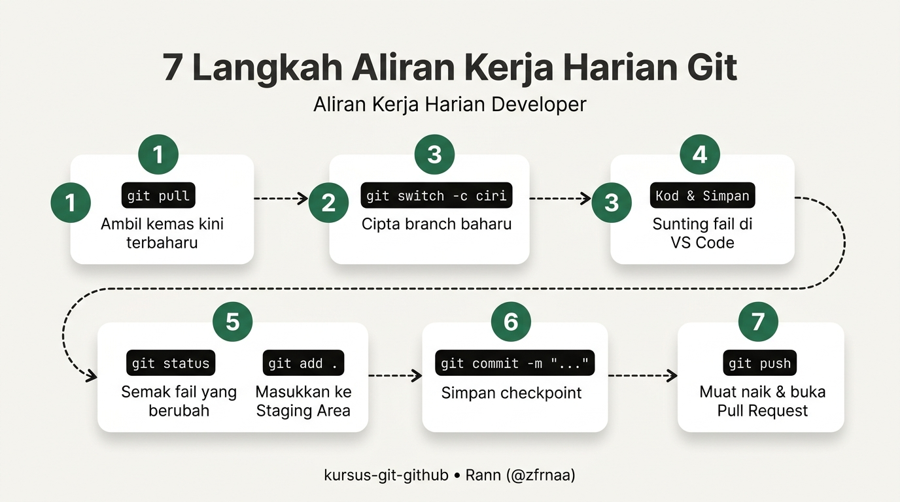

# Helaian Rujukan Pantas Git (*Git Cheatsheet*)

> **Muat Turun Versi PDF untuk Telefon Pintar:** Mahu simpan rujukan ini di dalam telefon supaya mudah dibuka pada bila-bila masa tanpa internet? **[Klik di sini untuk memuat turun `Cheatsheet-Git`](./cheatsheet-git-melayu.pdf)**!

Simpan halaman ini (atau klik **⭐ Star** pada repositori utama) supaya anda boleh merujuknya dengan pantas semasa kuliah, amali, atau ketika menyiapkan projek tahun akhir (FYP).

Setiap arahan di bawah dilengkapi dengan jawapan kepada soalan **"Jadi kenapa?"** supaya anda tahu bila dan mengapa anda perlu menaip arahan tersebut.

---

## 1. Persediaan Awal (*Setup & Authentication*)
Digunakan sekali sahaja apabila anda mula-mula memasang Git pada komputer baharu.

| Arahan Terminal | Apa Fungsinya & Jadi Kenapa? |
| :--- | :--- |
| `git --version` | Menyemak versi Git yang terpasang di dalam komputer anda supaya anda pasti perisian Git sudah sedia digunakan. |
| `git config --global user.name "Nama Anda"` | Menetapkan nama rasmi anda pada setiap rekod `commit` supaya ahli kumpulan tahu siapa yang menulis kod tersebut. |
| `git config --global user.email "emel@anda.com"` | Menghubungkan setiap `commit` dengan alamat e-mel akaun GitHub anda supaya aktiviti koding anda direkodkan pada graf hijau profil GitHub. |
| `git config --global init.defaultBranch main` | Menamakan cawangan utama lalai sebagai `main` supaya selaras dengan piawaian moden GitHub. |
| `git config --list` | Memaparkan semula semua tetapan nama dan e-mel anda supaya anda boleh mengesahkan tiada kesilapan ejaan sebelum memulakan projek. |
| `gh auth login` | Log masuk ke akaun GitHub anda melalui pelayar web dengan satu klik supaya anda boleh memuat naik kod (`push`) tanpa ralat kata laluan terminal. |

---

## 2. Asas Git Tempatan (*Local Repository*)
Digunakan setiap hari semasa anda menulis dan menyimpan perubahan kod di dalam komputer sendiri.

| Arahan Terminal | Apa Fungsinya & Jadi Kenapa? |
| :--- | :--- |
| `git init` | Mengaktifkan sistem penjejakan Git di dalam folder projek anda supaya setiap perubahan kod selepas ini boleh disimpan dan dipulihkan semula dan juga membuat repository. |
| `git status` | Menyemak fail mana yang telah diubah atau belum disimpan supaya tiada kod penting tertinggal sebelum anda menutup komputer atau menghantar tugasan. |
| `git add <nama-fail>` | Memasukkan satu fail spesifik ke dalam *Staging Area* supaya anda boleh memilih perubahan yang betul-betul sudah siap sahaja untuk direkodkan. |
| `git add .` | Memasukkan kesemua fail yang telah diubah di dalam folder semasa ke dalam *Staging Area* sekaligus supaya anda menjimatkan masa apabila banyak fail dikemas kini. |
| `git commit -m "Mesej jelas"` | Mencipta satu titik simpanan kekal (*save checkpoint*) berserta nota ringkas supaya anda boleh berpatah balik ke keadaan kod ini pada bila-bila masa jika berlaku kesilapan. |

---

## 3. Cawangan & Gabungan (*Branching & Merging*)
Digunakan apabila anda mahu mencuba ciri baharu atau bekerja di dalam kumpulan tanpa merosakkan kod utama (`main`) yang sedang stabil.

| Arahan Terminal | Apa Fungsinya & Jadi Kenapa? |
| :--- | :--- |
| `git branch` | Menyenaraikan semua `branch` di dalam komputer anda dan menandakan `branch` semasa dengan simbol `*` supaya anda tidak tersilap menyunting kod di tempat yang salah. |
| `git switch -c <nama-branch>` | Mencipta satu `branch` baharu dan terus berpindah ke dalamnya supaya anda boleh membina ciri baharu di ruang yang selamat tanpa mengganggu kod utama. *(Alternatif lama: `git checkout -b <nama-branch>`)* |
| `git switch <nama-branch>` | Berpindah dari satu `branch` ke `branch` yang lain (contohnya kembali ke `main`) supaya anda boleh menyemak atau menyambung kerja pada bahagian berbeza. |
| `git merge <nama-branch>` | Menggabungkan kod yang telah siap daripada `<nama-branch>` ke dalam `branch` semasa anda supaya ciri baharu tersebut disatukan secara rasmi ke dalam projek utama. |
| `git branch -d <nama-branch>` | Memadamkan `branch` yang telah selesai digabungkan supaya senarai cawangan projek anda kekal kemas dan tidak mengelirukan. |

---

## 4. Berhubung dengan GitHub (*Remote Repository*)
Digunakan untuk menyandarkan kod ke awan (GitHub) dan bekerjasama dengan rakan sepasukan.

| Arahan Terminal | Apa Fungsinya & Jadi Kenapa? |
| :--- | :--- |
| `git clone <url-repo>` | Memuat turun keseluruhan projek daripada GitHub ke dalam komputer anda lengkap dengan sejarah `commit` supaya anda boleh terus menyambung kerja atau mengkaji kod tersebut. |
| `git remote add origin <url-repo>` | Menyambungkan folder Git tempatan di komputer anda dengan repositori di GitHub supaya komputer anda tahu ke alamat mana kod perlu dimuat naik. |
| `git remote -v` | Memaparkan alamat URL GitHub (`origin`) yang sedang tersambung supaya anda pasti kod anda tidak dihantar ke repositori yang salah. |
| `git push -u origin main` | Memuat naik kod daripada cawangan `main` di komputer ke GitHub buat kali pertama dan mengikat kedua-duanya supaya untuk kali seterusnya anda hanya perlu menaip `git push`. |
| `git push` | Menghantar semua `commit` terbaharu dari komputer anda ke GitHub supaya kod anda selamat disimpan di awan dan boleh dilihat oleh ahli kumpulan. |
| `git fetch` | Memeriksa dan memuat turun maklumat perubahan terbaharu dari GitHub tanpa mengubah fail kerja anda di komputer supaya anda boleh menyemak apa yang rakan anda ubah sebelum menggabungkannya. |
| `git pull` | Mengambil perubahan terbaharu dari GitHub dan terus menggabungkannya ke dalam fail kerja anda supaya kod di komputer anda sentiasa selari dengan versi terkini kumpulan. |

---

## 5. Semakan Sejarah & Patah Balik (*Inspect & Undo*)
Digunakan apabila anda mahu melihat rekod kerja terdahulu atau membetulkan kesilapan tanpa panik.

| Arahan Terminal | Apa Fungsinya & Jadi Kenapa? |
| :--- | :--- |
| `git log --oneline` | Memaparkan sejarah semua `commit` secara ringkas (satu baris setiap rekod) supaya anda mudah mencari ID `commit` tertentu apabila mahu menyemak sejarah projek. |
| `git diff` | Menunjukkan perbezaan baris demi baris antara kod yang baru anda taip dengan kod terakhir yang disimpan supaya anda dapat mengesan kesilapan sebelum membuat `commit`. |
| `git restore <nama-fail>` | Membuang perubahan yang belum di-*stage* pada fail tersebut dan mengembalikannya kepada keadaan `commit` terakhir supaya anda dapat memulihkan kod yang tersilap dipadam dengan segera. |
| `git restore --staged <nama-fail>` | Mengeluarkan semula fail daripada *Staging Area* tanpa memadamkan kod yang telah anda taip supaya fail yang belum sedia tidak terbuat `commit` secara tidak sengaja. |
| `git rm --cached <nama-fail>` | Membuang fail daripada penjejakan Git (walaupun sudah di-`commit` secara tempatan) tanpa memadamkan fail sebenar di komputer. Jalankan `git commit --amend --no-edit` selepas itu supaya fail tersebut tidak ikut ter-`push` ke GitHub. |
| `git commit --amend -m "Mesej baharu"` | Membetulkan ejaan mesej `commit` yang paling akhir (atau menambah fail yang tertinggal) supaya sejarah kerja anda kelihatan kemas sebelum dimuat naik ke GitHub. |
| `git stash` | Menyimpan sementara perubahan kod yang belum siap ke dalam ruang simpanan tersembunyi supaya anda boleh berpindah `branch` dengan segera apabila perlu membaiki isu kecemasan lain. |
| `git stash pop` | Mengeluarkan semula kod yang disimpan di dalam `stash` tadi kembali ke ruang kerja anda supaya anda boleh menyambung semula tugasan yang tertangguh. |

---

## 🔄 Ringkasan Aliran Kerja Harian Anda (*Daily Workflow*)



Setiap kali anda duduk di hadapan komputer untuk menyambung tugasan koding, amalkan 5 langkah mudah ini mengikut turutan:

```text
1. git pull                      --> Ambil kemas kini terbaharu dari GitHub (elak bercanggah dengan kod rakan).
2. git switch -c ciri-baharu     --> Cipta branch khas untuk tugasan hari ini (jangan kacau kod main).
3. [Tulis kod & simpan fail]     --> Lakukan kerja pengaturcaraan anda seperti biasa di dalam VS Code/Code Editor anda yang lain.
4. git status                    --> Semak fail mana yang telah berubah.
5. git add .                     --> Masukkan perubahan ke dalam Staging Area.
6. git commit -m "Mesej jelas"   --> Simpan checkpoint di dalam komputer.
7. git push -u origin ciri-baharu--> Muat naik ke GitHub & buka Pull Request (PR)!
```

---

> **💡 Tip Pantas:** Terlupa cara guna sesuatu arahan? Kembali ke **[Jadual Kandungan Utama (`README.md`)](./README.md)** untuk membaca penjelasan penuh berserta contoh amali.
